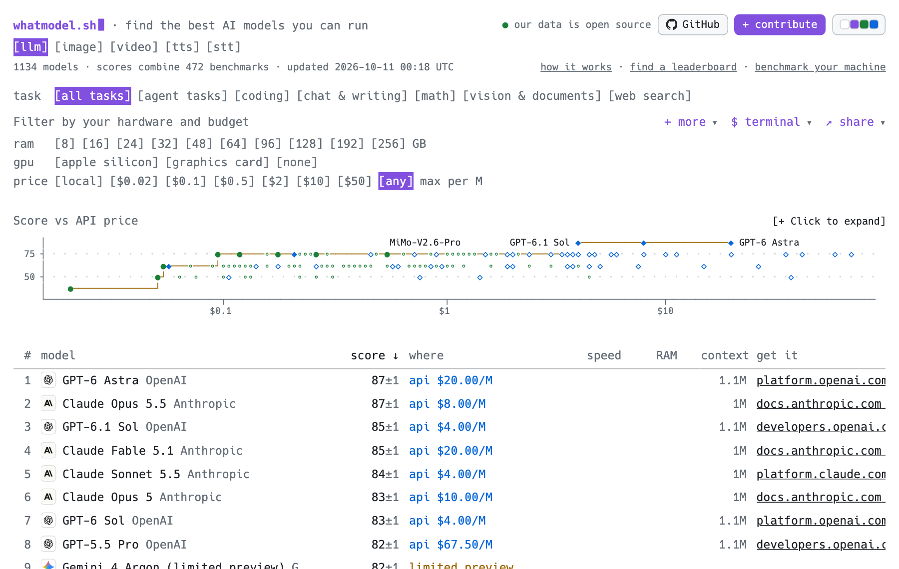
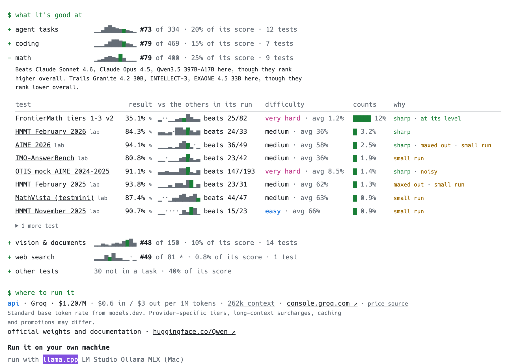

<!-- Generated by `npm run pages` from data/ and lib/. Edit scripts/pages.ts or lib/markdown.ts, not this file. -->

# whatmodel.sh · find the best AI models you can run

<a href="https://whatmodel.sh"><picture><source media="(prefers-color-scheme: dark)" srcset="docs/images/board-dark.png"></picture></a>

**The open AI model leaderboard.** Every model is ranked by one score built from 19,731 published benchmark results, with its price, the memory it needs and the command to run it. Filter by your computer or budget at [whatmodel.sh](https://whatmodel.sh), or read the same leaderboard below. [About this repo](#about-this-repo)

**llm** · [image](pages/image.md) · [video](pages/video.md) · [tts](pages/tts.md) · [stt](pages/stt.md)

updated 2026-10-11 02:20 UTC · 1134 models · scores combine 472 benchmarks · [how it works](pages/method.md) · [benchmark your machine](https://whatmodel.sh/bench) · [interactive version](https://whatmodel.sh/)

Run `curl "whatmodel.sh/?mac=$(sysctl -n hw.memsize)"` to see what your Mac can run, or `curl whatmodel.sh` for this list in your terminal.

<details><summary>Linux, Windows and common machines</summary>

```sh
curl "whatmodel.sh/?ram=$(awk '/MemT/{print $2}' /proc/meminfo)&vram=$(nvidia-smi -i 0 --query-gpu=memory.total --format=csv,noheader,nounits 2>/dev/null || cat /sys/class/drm/card*/device/mem_info_vram_total 2>/dev/null | sort -n | tail -1)"   # Linux
curl.exe "whatmodel.sh/?ram=$((gcim Win32_ComputerSystem).TotalPhysicalMemory)&vram=$(nvidia-smi -i 0 --query-gpu=memory.total --format=csv,noheader,nounits 2>$null)"   # Windows
```

[16GB Mac](https://whatmodel.sh/?ram=16&gpu=apple) · [32GB Mac](https://whatmodel.sh/?ram=32&gpu=apple) · [64GB Mac](https://whatmodel.sh/?ram=64&gpu=apple) · [128GB Mac](https://whatmodel.sh/?ram=128&gpu=apple) · [12GB graphics card](https://whatmodel.sh/?ram=32&gpu=card&vram=12) · [24GB graphics card](https://whatmodel.sh/?ram=64&gpu=card&vram=24) · [16GB, no graphics card](https://whatmodel.sh/?ram=16&gpu=none)

</details>

```text
  score vs API price
       │                      MiMo-V2.6-Pro        GPT-6.1 Sol ◆──────◆────────◆ GPT-6 Astra
    75 ┤ · · · · · · · · ●─●──∘─●◆∘∘●∘───◇∘●─∘─∘◇∘∘∘∘∘∘◇◇∘◇─◇◇◇◇◇◇◇◇ ·◇·◇◇ · · ◇ · ·◇·◇· ◇ ◇ ·
       │            ◆─∘──∘∘∘∘∘∘ ◇∘∘ ◇∘∘∘∘∘ ∘◇∘∘∘◇∘∘∘  ∘◇◇ ∘ ∘◇◇∘◇◇   ◇      ◇    ◇
    50 ┤ · · · · · ●┘◇∘∘ ·∘◇∘∘ · ·∘·∘∘ · · · ·◇· · ·◇· · · · · ·∘· · · ··· · · · · · ◇ · · · ·
       │  ●────────┘
       └──────────────────┬──────────────────────┬──────────────────────┬─────────────────────
                        $0.1                    $1                     $10
```

<details><summary>Full charts: score vs price and memory</summary>

```text
  score vs API price (USD per 1M tokens, 3 input : 1 output, log)
  ● open weights  ◆ API only  ─┘ best for the price
       │                                                               Claude Opus 5.5
       │                  ·                      ·                    ◆────────◆ GPT-6 Astra
       │                                           GPT-6.1 Sol ◆──────┘ ◇      ◇
    80 ┤ · · · · · · · · ··· MiMo-V2.6-Pro ●───────∘───────────┘ · · ·◇··◇ · · ◇ · · · · · ◇ ·
       │                        ●◆─◇●────◇─┘         ◇∘ ◇∘  ◇   ◇ ◇∘    ◇                ◇
       │                 ●─●────┘  ∘         ◇   ·◇ ∘◇◇  ∘  ◇◇◇◇ ◇ ◇    ◇             ◇
       │                 │    ∘   ∘  ∘∘  ◇∘∘ ◇ ∘◇∘∘∘∘∘∘◇◇∘◇  ◇     ◇                ◇
       │            ◆────┘·  ∘  ◇∘  ∘  ∘ ∘ ∘∘∘  ∘∘∘    ◇◇ ◇ ∘◇          ·        ◇
    60 ┤ · · · · · ·│· · ∘ ∘ ◇∘· · ·∘∘∘·∘∘ · ◇∘◇∘∘ ∘ · · · · ◇◇∘ · · · · · · · · · · · · · · ·
       │            ● ∘  ∘·∘∘∘  ◇ ∘ ∘  ∘ ∘  ◇∘∘∘◇·              ◇    ◇  ·
       │            │    ∘∘∘  ∘ ◇∘  ◇∘ ∘      ∘       ∘   ∘     ◇◇          ◇
       │            │  ∘  ·◇         ∘        ∘  ·  ◇                   ·            ◇
       │           ●┘◇    ∘  ∘    ∘ ∘         ◇                 ∘
       │           │  ∘   ·  ∘                   ·                      ·
    40 ┤ · · · · · │ · · · ·∘· · · · · · · · · · · · · · · · · · · · · · · · · · · · · · · · ·
       │           │      ·                      ·                      ·
       │  ●─Llama 3.2 1B Instruct
       │                  ·                      ·                      ·
       └──────────────────┬──────────────────────┬──────────────────────┬─────────────────────
                        $0.1                    $1                     $10
```

```text
  score vs memory to run it (GB, log)
  ─┘ best for the memory
       │                                                           Hy4 preview (770B-A49B)
       │                     ·   MiMo-V2.6-Flash (309B-A15…       ●────∘● MiMo-V2.6-Pro
    75 ┤ · · · · · · · ·Qwen3.8 27B·●─∘──────────●─∘──∘∘●─∘●─────∘┘· ∘∘· · ∘∘· ·∘·∘· · · · ∘ ·
       │           Spark-X2.5 4B    ∘∘∘ ∘∘       ∘∘ ∘ ∘∘∘∘ ∘∘∘   ∘       ∘∘ ∘ ∘∘  ·   ∘
       │       ●──●────∘─∘∘─∘∘─────∘∘∘∘∘∘  ∘ ∘∘∘∘∘ ∘∘∘  ∘∘ ∘∘       ∘∘           ∘ ∘
       │       ∘  ∘    ∘ ∘∘ ∘∘   ∘∘∘∘∘∘∘∘∘∘∘∘∘∘ ∘ ∘ ∘∘ ∘    ∘∘       ∘∘  ∘      ∘ ·
    50 ┤ ·●────∘ ·∘· ∘ ∘ ∘∘·∘∘ ·∘∘∘∘∘∘∘∘∘∘∘∘ ·∘· ∘ ∘ ·∘·∘∘ ·∘· · ∘ ·∘· · · · · ·∘· · · · · · ·
       │  ∘    ∘  ∘  ∘ ∘ ∘∘ ∘∘∘∘ ∘∘∘∘∘∘ ∘∘∘∘ ∘∘∘∘∘∘ ∘∘ ·  ∘ ∘       ∘             ·
       │  ∘    ∘  ∘  ∘ ∘ ∘∘ ∘∘∘∘ ∘∘∘∘ ∘∘ ∘∘∘  ∘    ∘   ∘ ∘                        ∘
       │  ∘    ∘  ∘  ∘ ∘ ∘  ∘∘∘∘∘  ∘∘   ∘∘∘   ∘∘   ∘   ·                          ·
    25 ┤ ·∘· · ∘ ·∘· ∘ ∘ · ·∘· · ∘∘∘ · ·∘∘∘· · · ∘∘· · · · ∘ · · · · ·∘· · · · · · · · · · · ·
       │  ∘    ∘  ∘    ∘ ∘  ∘·  ∘∘∘      ∘             ·                          ·
       │  ∘    ∘  ∘  ∘   ∘  ∘   ∘
       │  ∘    ∘             ·             ∘           ·                          ·
       │  ∘                        ∘
     0 ┤ ·∘· · · · · · · · · · · · · · · · · · · · · · · · · · · · · · · · · · · ··· · · · · ·
       │  ∘
       │                     ·                         ·                          ·
       └─────────────────────┬─────────────────────────┬──────────────────────────┬───────────
                           10GB                      100GB                       1TB
```

</details>

<pre>
   #  model                                     score  where                   RAM  context  get it
   1  <a href="pages/model/gpt-6-astra.md">GPT-6 Astra</a>                               87±1   api $20.00/M                    1.1M  <a href="https://platform.openai.com/docs/models">openai.com ↗</a>
   2  <a href="pages/model/claude-opus-5-5.md">Claude Opus 5.5</a>                           87±1   api $8.00/M                       1M  <a href="https://docs.anthropic.com/en/docs/about-claude/models">anthropic.com ↗</a>
   3  <a href="pages/model/gpt-6-1-sol.md">GPT-6.1 Sol</a>                               85±1   api $4.00/M                     1.1M  <a href="https://developers.openai.com/api/docs/models/gpt-6.1-sol">openai.com ↗</a>
   4  <a href="pages/model/claude-fable-5-1.md">Claude Fable 5.1</a>                          85±1   api $20.00/M                      1M  <a href="https://docs.anthropic.com/en/docs/about-claude/models">anthropic.com ↗</a>
   5  <a href="pages/model/claude-sonnet-5-5.md">Claude Sonnet 5.5</a>                         84±1   api $4.00/M                       1M  <a href="https://platform.claude.com/docs/en/models/sonnet-5-5/overview">claude.com ↗</a>
   6  <a href="pages/model/claude-opus-5.md">Claude Opus 5</a>                             83±1   api $10.00/M                      1M  <a href="https://docs.anthropic.com/en/docs/about-claude/models">anthropic.com ↗</a>
   7  <a href="pages/model/gpt-6-sol.md">GPT-6 Sol</a>                                 83±1   api $4.00/M                     1.1M  <a href="https://platform.openai.com/docs/models">openai.com ↗</a>
   8  <a href="pages/model/gpt-5-5-pro.md">GPT-5.5 Pro</a>                               82±1   api $67.50/M                    1.1M  <a href="https://developers.openai.com/api/docs/models/gpt-5.5-pro">openai.com ↗</a>
   9  <a href="pages/model/gemini-4-argon.md">Gemini 4 Argon (limited p…</a>                82±1   limited preview
  10  <a href="pages/model/gpt-5-6-sol.md">GPT-5.6 Sol</a>                               82±1   api $8.00/M                     1.1M  <a href="https://platform.openai.com/docs/models">openai.com ↗</a>
  11  <a href="pages/model/claude-fable-5.md">Claude Fable 5</a>                            81±1   api $20.00/M                      1M  <a href="https://docs.anthropic.com/en/docs/about-claude/models">anthropic.com ↗</a>
  12  <a href="pages/model/claude-mythos-preview.md">Claude Mythos Preview (li…</a>                81±1†  limited preview                   1M
  13  <a href="pages/model/gpt-5-4-pro.md">GPT-5.4 Pro</a>                               81±1   api $67.50/M                    1.1M  <a href="https://developers.openai.com/api/docs/models/gpt-5.4-pro">openai.com ↗</a>
  14  <a href="pages/model/gpt-5-5.md">GPT-5.5</a>                                   80±1   api $11.25/M                    1.1M  <a href="https://platform.openai.com/docs/models">openai.com ↗</a>
  15  <a href="pages/model/mimo-v2-6-pro.md">MiMo-V2.6-Pro</a>                             79±1   api $0.54/M +local   ~443GB       1M  <a href="https://mimo.mi.com/docs/en-US/quick-start/summary/model">mimo.mi.com ↗</a>
  16  <a href="pages/model/hy4-preview.md">Hy4 preview (770B-A49B)</a>                   79±1   api $1.25/M +local   ~248GB       1M  <a href="https://cloud.tencent.com/document/product/1823/130051">tencent.com ↗</a>
  17  <a href="pages/model/gpt-5-6-terra.md">GPT-5.6 Terra</a>                             79±1   api $4.50/M                     1.1M  <a href="https://platform.openai.com/docs/models">openai.com ↗</a>
  18  <a href="pages/model/qwen3-8-2-4t-a95b.md">Qwen3.8 Max (2.4T-A95B)</a>                   78±1   api $3.00/M +local   ~380GB     262k  <a href="https://deepinfra.com/models">deepinfra.com ↗</a>
  19  <a href="pages/model/claude-opus-4-8.md">Claude Opus 4.8</a>                           78±0   api $10.00/M                      1M  <a href="https://docs.anthropic.com/en/docs/about-claude/models">anthropic.com ↗</a>
  20  <a href="pages/model/gpt-5-4.md">GPT-5.4</a>                                   78±1   api $5.63/M                     1.1M  <a href="https://platform.openai.com/docs/models">openai.com ↗</a>
  21  <a href="pages/model/deepseek-v4-1-flash.md">DeepSeek V4.1 Flash</a>                       78±1   api $0.26/M +local   ~537GB       1M  <a href="https://api-docs.deepseek.com/quick_start/pricing">deepseek.com ↗</a>
  22  <a href="pages/model/claude-haiku-5-5.md">Claude Haiku 5.5</a>                          77±1   api $0.20/M                       1M  <a href="https://platform.claude.com/docs/en/models/haiku-5-5/overview">claude.com ↗</a>
  23  <a href="pages/model/gemini-3-8-flash.md">Gemini 3.8 Flash</a>                          77±1   api $1.50/M                       1M  <a href="https://ai.google.dev/gemini-api/docs/models">google.dev ↗</a>
  24  <a href="pages/model/muse-spark-1-3.md">Muse Spark 1.3</a>                            77±1   api $2.00/M                       1M  <a href="https://dev.meta.ai/docs/pricing-rate-limits">dev.meta.ai ↗</a>
  25  <a href="pages/model/kimi-k3.md">Kimi K3</a>                                   77±1   api $6.00/M +local   ~884GB       1M  <a href="https://platform.moonshot.ai/docs/api/chat">moonshot.ai ↗</a>
  26  <a href="pages/model/gpt-5-2-pro.md">GPT-5.2 Pro</a>                               77±1   api $57.75/M                    400k  <a href="https://developers.openai.com/api/docs/models/gpt-5.2-pro">openai.com ↗</a>
  27  <a href="pages/model/mimo-v2-6-flash.md">MiMo-V2.6-Flash (309B-A15…</a>                77±1   api $0.17/M +local   ~136GB       1M  <a href="https://mimo.mi.com/docs/en-US/quick-start/summary/model">mimo.mi.com ↗</a>
  28  <a href="pages/model/gpt-6-luna.md">GPT-6 Luna</a>                                77±1   api $0.20/M                     1.1M  <a href="https://platform.openai.com/docs/models">openai.com ↗</a>
  29  <a href="pages/model/gpt-5-6-luna.md">GPT-5.6 Luna</a>                              77±1   api $0.45/M                     1.1M  <a href="https://platform.openai.com/docs/models">openai.com ↗</a>
  30  <a href="pages/model/grok-4-6.md">Grok 4.6</a>                                  77±1   api $3.00/M                     500k  <a href="https://docs.x.ai/docs/models">x.ai ↗</a>
  31  <a href="pages/model/deepseek-v4-pro.md">DeepSeek V4 Pro (0813)</a>                    76±1   api $1.63/M +local  ~1010GB       1M  <a href="https://deepinfra.com/models">deepinfra.com ↗</a>
  32  <a href="pages/model/gemini-3-7-flash.md">Gemini 3.7 Flash</a>                          76±1   api $1.50/M                       1M  <a href="https://ai.google.dev/gemini-api/docs/models">google.dev ↗</a>
  33  <a href="pages/model/glm-5-3.md">GLM-5.3</a>                                   76±1   api $2.15/M +local   ~239GB       1M  <a href="https://docs.z.ai/guides/overview/pricing">z.ai ↗</a>
  34  <a href="pages/model/qwen3-8-max-0902.md">Qwen3.8 Max (0902)</a>                        76±1   api $3.00/M                       1M  <a href="https://www.alibabacloud.com/help/en/model-studio/text-generation-model">alibabacloud.co…</a>
  35  <a href="pages/model/deepseek-v3-2-speciale.md">DeepSeek V3.2 Speciale</a>                    76±3†  comparison only
  36  <a href="pages/model/deepseek-v4-flash-vision-exp.md">DeepSeek V4 Flash Vision …</a>                76±2   local                ~104GB       1M  <a href="pages/model/deepseek-v4-flash-vision-exp.md#run-it-on-your-own-machine">llama.cpp ›</a>
  37  <a href="pages/model/qwen3-8-flash-next.md">Qwen3.8-Flash-Next</a>                        75±1   local                 ~59GB     262k  <a href="pages/model/qwen3-8-flash-next.md#run-it-on-your-own-machine">llama.cpp ›</a>
  38  <a href="pages/model/qwen3-8-omni-flash.md">Qwen3.8-Omni-Flash</a>                        75±2†  api $0.23/M                       1M  <a href="https://www.alibabacloud.com/help/en/model-studio/qwen-omni">alibabacloud.co…</a>
  39  <a href="pages/model/gemini-3-1-pro.md">Gemini 3.1 Pro (Preview)</a>                  75±1   api $4.50/M                       1M  <a href="https://ai.google.dev/gemini-api/docs/models">google.dev ↗</a>
  40  <a href="pages/model/muse-spark-1-2.md">Muse Spark 1.2</a>                            75±1   api $2.00/M                       1M  <a href="https://dev.meta.ai/docs">dev.meta.ai ↗</a>
  41  <a href="pages/model/claude-opus-4-7.md">Claude Opus 4.7</a>                           75±1   api $10.00/M                      1M  <a href="https://docs.anthropic.com/en/docs/about-claude/models">anthropic.com ↗</a>
  42  <a href="pages/model/grok-4-5.md">Grok 4.5</a>                                  75±1   api $3.00/M                     500k  <a href="https://docs.x.ai/docs/models">x.ai ↗</a>
  43  <a href="pages/model/muse-spark-1-1.md">Muse Spark 1.1</a>                            75±1   api $2.00/M                       1M  <a href="https://dev.meta.ai/docs">dev.meta.ai ↗</a>
  44  <a href="pages/model/muse-spark.md">Muse Spark</a>                                75±2   comparison only
  45  <a href="pages/model/step-5-preview.md">Step 5 Preview</a>                            75±1   comparison only
  46  <a href="pages/model/claude-sonnet-5.md">Claude Sonnet 5</a>                           75±1   api $4.00/M                       1M  <a href="https://docs.anthropic.com/en/docs/about-claude/models">anthropic.com ↗</a>
  47  <a href="pages/model/grok-4-7.md">Grok 4.7</a>                                  75±1   api $3.00/M                     500k  <a href="https://docs.x.ai/docs/models">x.ai ↗</a>
  48  <a href="pages/model/claude-opus-4-6.md">Claude Opus 4.6</a>                           75±1   api $10.00/M                      1M  <a href="https://docs.anthropic.com/en/docs/about-claude/models">anthropic.com ↗</a>
  49  <a href="pages/model/gpt-5-2-chat-latest-20260210.md">GPT-5.2 Chat (2026-02-10)</a>                 74±3*  comparison only
  50  <a href="pages/model/gpt-5-3-codex.md">GPT-5.3-Codex</a>                             74±1   api $4.81/M                     400k  <a href="https://platform.openai.com/docs/models">openai.com ↗</a>
  51  <a href="pages/model/deepseek-v4-flash.md">DeepSeek V4 Flash (0731)</a>                  74±1   api $0.11/M +local    ~92GB       1M  <a href="https://deepinfra.com/models">deepinfra.com ↗</a>
  52  <a href="pages/model/qwen3-7-max.md">Qwen3.7 Max</a>                               74±1   api $3.75/M                       1M  <a href="https://deepinfra.com/models">deepinfra.com ↗</a>
  53  <a href="pages/model/glm-5-3-flash.md">GLM-5.3-Flash</a>                             74±1   api $0.24/M +local   ~103GB       1M  <a href="https://docs.z.ai/guides/overview/pricing">z.ai ↗</a>
  54  <a href="pages/model/gemini-3-5-flash.md">Gemini 3.5 Flash</a>                          74±1   api $3.38/M                       1M  <a href="https://ai.google.dev/gemini-api/docs/models">google.dev ↗</a>
  55  <a href="pages/model/hivemind-32b-preview.md">Hivemind 32B Preview</a>                      74±4*  local                 ~70GB           <a href="pages/model/hivemind-32b-preview.md#run-it-on-your-own-machine">how to run ›</a>
  56  <a href="pages/model/gpt-5-2.md">GPT-5.2</a>                                   74±1   api $4.81/M                     400k  <a href="https://platform.openai.com/docs/models">openai.com ↗</a>
  57  <a href="pages/model/hy3.md">Hunyuan Hy3 (295B-A21B)</a>                   74±1   api $0.23/M +local    ~96GB     256k  <a href="https://deepinfra.com/models">deepinfra.com ↗</a>
  58  <a href="pages/model/gemini-3-6-flash.md">Gemini 3.6 Flash</a>                          74±1   api $1.50/M                       1M  <a href="https://ai.google.dev/gemini-api/docs/models">google.dev ↗</a>
  59  <a href="pages/model/glm-5-2.md">GLM-5.2</a>                                   74±1   api $2.15/M +local   ~121GB       1M  <a href="https://docs.z.ai/guides/overview/pricing">z.ai ↗</a>
  60  <a href="pages/model/seed-2-1-pro-preview.md">Seed 2.1 Pro (Preview)</a>                    74±3*  comparison only
  61  <a href="pages/model/dola-seed-2-0-pro.md">Dola Seed 2.0 Pro</a>                         74±2   comparison only
  62  <a href="pages/model/qwen3-7-max-preview.md">Qwen3.7 Max Preview</a>                       74±3*  comparison only
  63  <a href="pages/model/qwen3-8-27b.md">Qwen3.8 27B</a>                               73±1   api $1.60/M +local    ~18GB     262k  <a href="https://console.groq.com/docs/models">groq.com ↗</a>
  64  <a href="pages/model/laguna-s-2-1.md">Laguna S 2.1 (118B-A8B)</a>                  73±4*†  local                 ~71GB       1M  <a href="pages/model/laguna-s-2-1.md#run-it-on-your-own-machine">LM Studio ›</a>
  65  <a href="pages/model/grok-4-20-multi-agent-0309.md">Grok 4.20 Multi-Agent (03…</a>                73±2   api $1.56/M                       1M  <a href="https://docs.x.ai/developers/models/grok-4.20-multi-agent-0309.md">x.ai ↗</a>
  66  <a href="pages/model/seed-2-0-lite.md">Seed2.0 Lite</a>                             73±4*†  comparison only
  67  <a href="pages/model/kimi-k2-6.md">Kimi K2.6</a>                                 73±1   api $1.71/M +local   ~317GB     262k  <a href="https://platform.moonshot.ai/docs/api/chat">moonshot.ai ↗</a>
  68  <a href="pages/model/ernie-5-1.md">ERNIE 5.1</a>                                 73±3*  comparison only
  69  <a href="pages/model/gpt-5-pro.md">GPT-5 Pro</a>                                 73±1   api $41.25/M                    400k  <a href="https://developers.openai.com/api/docs/models/gpt-5-pro">openai.com ↗</a>
  70  <a href="pages/model/longcat-2-0.md">LongCat 2.0 (1.6T-A48B)</a>                   73±2   api $1.30/M +local  ~2155GB       1M  <a href="https://longcat.chat/platform/docs/pricing/longcat-2.0">longcat.chat ↗</a>
  71  <a href="pages/model/gemini-3-pro-preview.md">Gemini 3 Pro (Preview)</a>                    73±1   comparison only                   1M
  72  <a href="pages/model/qwen-agentworld-35b-a3b.md">Qwen-AgentWorld 35B-A3B</a>                  73±4*†  local                 ~22GB     262k  <a href="pages/model/qwen-agentworld-35b-a3b.md#run-it-on-your-own-machine">LM Studio ›</a>
  73  <a href="pages/model/gpt-5.md">GPT-5</a>                                     72±1   api $3.44/M                     400k  <a href="https://platform.openai.com/docs/models">openai.com ↗</a>
  74  <a href="pages/model/qwen3-6-max-preview.md">Qwen3.6 Max Preview</a>                       72±1   api $2.92/M                     256k  <a href="https://www.alibabacloud.com/help/en/model-studio/text-generation-model">alibabacloud.co…</a>
  75  <a href="pages/model/qwen3-5-max-preview.md">Qwen3.5-Max-Preview</a>                       72±3*  comparison only
  76  <a href="pages/model/claude-sonnet-4-6.md">Claude Sonnet 4.6</a>                         72±1   api $6.00/M                       1M  <a href="https://docs.anthropic.com/en/docs/about-claude/models">anthropic.com ↗</a>
  77  <a href="pages/model/gemini-3-flash-preview.md">Gemini 3 Flash (Preview)</a>                  72±1   api $1.13/M                       1M  <a href="https://ai.google.dev/gemini-api/docs/models/gemini-3-flash-preview">google.dev ↗</a>
  78  <a href="pages/model/deepseek-v4-pro-preview.md">DeepSeek V4 Pro (Preview,…</a>                72±1   local                ~604GB           <a href="pages/model/deepseek-v4-pro-preview.md#run-it-on-your-own-machine">llama.cpp ›</a>
  79  <a href="pages/model/claude-opus-4-5.md">Claude Opus 4.5</a>                           72±1   api $10.00/M                    200k  <a href="https://docs.anthropic.com/en/docs/about-claude/models">anthropic.com ↗</a>
  80  <a href="pages/model/qwen3-7-plus.md">Qwen3.7 Plus</a>                              72±1   api $0.70/M                       1M  <a href="https://www.alibabacloud.com/help/en/model-studio/models">alibabacloud.co…</a>
  81  <a href="pages/model/kimi-k2-7-code.md">Kimi K2.7 Code</a>                            72±1   api $1.71/M +local   ~359GB     262k  <a href="https://platform.kimi.ai/docs/guide/kimi-k2-7-code-quickstart">kimi.ai ↗</a>
  82  <a href="pages/model/deepseek-v4-flash-preview.md">DeepSeek V4 Flash (Previe…</a>                72±1   local                ~103GB           <a href="pages/model/deepseek-v4-flash-preview.md#run-it-on-your-own-machine">llama.cpp ›</a>
  83  <a href="pages/model/grok-4-20.md">Grok 4.20 (0309 reasoning)</a>                72±1   api $1.56/M                       1M  <a href="https://docs.x.ai/docs/models">x.ai ↗</a>
  84  <a href="pages/model/solar-open-2.md">Solar Open 2 (250B-A15B)</a>                  72±1†  local                ~527GB       1M  <a href="pages/model/solar-open-2.md#run-it-on-your-own-machine">how to run ›</a>
  85  <a href="pages/model/north-small-translate-1-0.md">North Small Translate 1.0</a>                 71±6†  api price unknown                16k  <a href="https://docs.cohere.com/docs/models">cohere.com ↗</a>
  86  <a href="pages/model/gpt-5-4-mini.md">GPT-5.4 mini</a>                              71±1   api $1.69/M                     400k  <a href="https://platform.openai.com/docs/models">openai.com ↗</a>
  87  <a href="pages/model/ling-3-0-flash.md">Ling 3.0 Flash (124B-A5B)</a>                 71±2†  api $0.090/M +loc…    ~75GB     131k  <a href="https://deepinfra.com/inclusionAI/Ling-3.0-flash">deepinfra.com ↗</a>
  88  <a href="pages/model/mistral-large-4.md">Mistral Large 4 (public p…</a>                71±2   api $2.06/M                       1M  <a href="https://docs.mistral.ai/models/mistral-large-4">mistral.ai ↗</a>
  89  <a href="pages/model/gpt-5-1.md">GPT-5.1</a>                                   71±1   api $3.44/M                     400k  <a href="https://platform.openai.com/docs/models">openai.com ↗</a>
  90  <a href="pages/model/glm-5-1.md">GLM-5.1</a>                                   71±1   api $2.15/M +local   ~119GB     200k  <a href="https://docs.z.ai/guides/overview/pricing">z.ai ↗</a>
  91  <a href="pages/model/gpt-5-3-chat-latest-20261002.md">GPT-5.3 Chat (Arena 2026-…</a>                71±3*  comparison only
  92  <a href="pages/model/qwen3-5-397b-a17b.md">Qwen3.5 397B-A17B</a>                         71±0   api $1.09/M +local    ~65GB     262k  <a href="https://deepinfra.com/models">deepinfra.com ↗</a>
  93  <a href="pages/model/ernie-5-0-preview-1203.md">ERNIE 5.0 Preview (1203)</a>                  71±3*  comparison only
  94  <a href="pages/model/ornith-1-5-35b-a3b.md">Ornith 1.5 35B-A3B</a>                        71±2†  local                 ~22GB     262k  <a href="pages/model/ornith-1-5-35b-a3b.md#run-it-on-your-own-machine">LM Studio ›</a>
  95  <a href="pages/model/minimax-m3.md">MiniMax-M3</a>                                70±1   api $0.48/M +local   ~137GB       1M  <a href="https://deepinfra.com/models">deepinfra.com ↗</a>
  96  <a href="pages/model/grok-4-3.md">Grok 4.3</a>                                  70±1   api $1.56/M                       1M  <a href="https://docs.x.ai/docs/models">x.ai ↗</a>
  97  <a href="pages/model/gemini-2-5-pro-preview-06-05.md">Gemini 2.5 Pro Preview (0…</a>                70±2   comparison only
  98  <a href="pages/model/o3-pro.md">o3-pro</a>                                    70±2   api $35.00/M                    200k  <a href="https://developers.openai.com/api/docs/models/o3-pro">openai.com ↗</a>
  99  <a href="pages/model/kat-coder-v2-5-dev.md">KAT-Coder-V2.5-Dev (35B-A…</a>                70±2†  local                 ~22GB     262k  <a href="pages/model/kat-coder-v2-5-dev.md#run-it-on-your-own-machine">LM Studio ›</a>
 100  <a href="pages/model/qwen3-6-plus.md">Qwen3.6 Plus</a>                              70±1   api $1.13/M                       1M  <a href="https://docs.together.ai/docs/serverless-models">together.ai ↗</a>
 101  <a href="pages/model/inkling-small.md">Inkling Small (266B-A12B)</a>                 70±1   api $0.64/M +local    ~86GB       1M  <a href="https://deepinfra.com/models">deepinfra.com ↗</a>
 102  <a href="pages/model/mimo-v2-pro.md">MiMo-V2-Pro</a>                               70±1   comparison only
 103  <a href="pages/model/kimi-k2-5.md">Kimi K2.5</a>                                 70±1   api $1.20/M +local   ~160GB     262k  <a href="https://docs.aws.amazon.com/bedrock/latest/userguide/models-supported.html">aws.amazon.com ↗</a>
 104  <a href="pages/model/glm-5.md">GLM-5</a>                                     70±1   api $1.55/M +local   ~119GB     205k  <a href="https://docs.z.ai/guides/overview/pricing">z.ai ↗</a>
 105  <a href="pages/model/qwen3-max-2026-01-23.md">Qwen3-Max (2026-01-23)</a>                    70±1†  comparison only
 106  <a href="pages/model/mimo-v2-5-pro.md">MiMo-V2.5-Pro (1T-A42B)</a>                   70±1   api $0.65/M +local   ~163GB       1M  <a href="https://novita.ai/models/llm/xiaomimimo-mimo-v2.5-pro">novita.ai ↗</a>
 107  <a href="pages/model/inkling.md">Inkling (975B-A41B)</a>                       70±1   api $1.73/M +local   ~156GB       1M  <a href="https://deepinfra.com/models">deepinfra.com ↗</a>
 108  <a href="pages/model/muse-glimmer-30b.md">Muse Glimmer 30B</a>                          70±1   api $0.64/M +local    ~19GB     131k  <a href="https://fireworks.ai/docs/">fireworks.ai ↗</a>
 109  <a href="pages/model/nemotron-3-ultra-550b-a55b.md">Nemotron 3 Ultra 550B-A55B</a>                69±1   api $1.35/M +local    ~89GB       1M  <a href="https://docs.together.ai/docs/serverless-models">together.ai ↗</a>
 110  <a href="pages/model/qwen3-6-27b.md">Qwen3.6 27B</a>                               69±1   api $1.20/M +local    ~18GB     262k  <a href="https://console.groq.com/docs/models">groq.com ↗</a>
 111  <a href="pages/model/ring-2-6-1t.md">Ring-2.6-1T</a>                               69±2†  comparison only
 112  <a href="pages/model/ax-k2.md">A.X K2 (688B-A33B)</a>                        69±1†  local               ~1454GB     262k  <a href="pages/model/ax-k2.md#run-it-on-your-own-machine">how to run ›</a>
 113  <a href="pages/model/longcat-flash-chat-2602-exp.md">LongCat-Flash-Chat-2602-E…</a>                69±3*  comparison only
 114  <a href="pages/model/o3.md">o3</a>                                        69±1   api $3.50/M                     200k  <a href="https://platform.openai.com/docs/models">openai.com ↗</a>
 115  <a href="pages/model/mimo-v2-5.md">MiMo-V2.5 (310B-A15B)</a>                     69±1   api $0.21/M +local   ~100GB       1M  <a href="https://novita.ai/models/llm/xiaomimimo-mimo-v2.5">novita.ai ↗</a>
 116  <a href="pages/model/qwen3-5-plus.md">Qwen3.5 Plus</a>                              69±2   api $0.90/M                       1M  <a href="https://www.alibabacloud.com/help/en/model-studio/text-generation-model">alibabacloud.co…</a>
 117  <a href="pages/model/qwen3-5-122b-a10b.md">Qwen3.5 122B-A10B</a>                         69±1   api $1.10/M +local    ~75GB     262k  <a href="https://www.alibabacloud.com/help/en/model-studio/models">alibabacloud.co…</a>
 118  <a href="pages/model/gemini-3-5-flash-lite.md">Gemini 3.5 Flash-Lite</a>                     69±1   api $0.85/M                       1M  <a href="https://ai.google.dev/gemini-api/docs/models">google.dev ↗</a>
 119  <a href="pages/model/glm-4-7.md">GLM-4.7</a>                                   69±1   api $1.00/M +local    ~58GB     205k  <a href="https://docs.z.ai/guides/overview/pricing">z.ai ↗</a>
 120  <a href="pages/model/gpt-5-5-instant.md">GPT-5.5 Instant</a>                           69±1   comparison only
 121  <a href="pages/model/qwen3-max-preview.md">Qwen3-Max-Preview</a>                         69±3*  api $2.40/M                     262k  <a href="https://www.alibabacloud.com/help/en/model-studio/text-generation-model">alibabacloud.co…</a>
 122  <a href="pages/model/gpt-5-4-nano.md">GPT-5.4 nano</a>                              69±1   api $0.46/M                     400k  <a href="https://platform.openai.com/docs/models">openai.com ↗</a>
 123  <a href="pages/model/claude-sonnet-4-5.md">Claude Sonnet 4.5</a>                         69±1   api $6.00/M                     200k  <a href="https://docs.anthropic.com/en/docs/about-claude/models">anthropic.com ↗</a>
 124  <a href="pages/model/qwen3-5-27b.md">Qwen3.5 27B</a>                               69±0   api $0.84/M +local    ~18GB     262k  <a href="https://deepinfra.com/models">deepinfra.com ↗</a>
 125  <a href="pages/model/glm-5v-turbo.md">GLM-5V-Turbo</a>                              69±2   api $1.90/M                     200k  <a href="https://www.siliconflow.com/models/glm-5v-turbo">siliconflow.com…</a>
 126  <a href="pages/model/gpt-5-2-codex.md">GPT-5.2-Codex</a>                             69±2   comparison only
 127  <a href="pages/model/gpt-5-chat-20261002.md">GPT-5 Chat (Arena 2026-10…</a>                69±3*  comparison only
 128  <a href="pages/model/longcat-flash-thinking.md">LongCat-Flash-Thinking (5…</a>                69±1†  comparison only                 128k
 129  <a href="pages/model/ernie-5-0-0110.md">ERNIE 5.0 (0110)</a>                          68±3*  comparison only
 130  <a href="pages/model/step-3-5-flash.md">Step 3.5 Flash (196B-A11B)</a>                68±1   api $0.15/M +local   ~118GB     256k  <a href="https://platform.stepfun.ai/docs/en/guides/models/step-3.5-flash.md">stepfun.ai ↗</a>
 131  <a href="pages/model/deepseek-v3-2.md">DeepSeek V3.2</a>                             68±1   api $0.29/M +local   ~110GB     128k  <a href="https://deepinfra.com/models">deepinfra.com ↗</a>
 132  <a href="pages/model/mimo-v2-omni.md">MiMo-V2-Omni</a>                              68±2   comparison only                 262k
 133  <a href="pages/model/gemini-2-5-pro-exp-03-25.md">Gemini 2.5 Pro Experiment…</a>                68±3   comparison only
 134  <a href="pages/model/amazon-nova-experimental-chat-26-02-10.md">Amazon Nova Experimental …</a>                68±3*  comparison only
 135  <a href="pages/model/grok-4-0709.md">Grok 4 (0709)</a>                             68±1   comparison only
 136  <a href="pages/model/minimax-m2-7.md">MiniMax-M2.7</a>                              68±1   api $0.53/M +local    ~75GB     205k  <a href="https://platform.minimax.io/docs/guides/text-generation">minimax.io ↗</a>
 137  <a href="pages/model/qwen3-6-35b-a3b.md">Qwen3.6 35B-A3B</a>                           68±1   api $0.31/M +local    ~23GB     262k  <a href="https://deepinfra.com/models">deepinfra.com ↗</a>
 138  <a href="pages/model/ornith-1-0-35b.md">Ornith 1.0 35B (35B-A3B)</a>                  68±1   local                 ~23GB     262k  <a href="pages/model/ornith-1-0-35b.md#run-it-on-your-own-machine">LM Studio ›</a>
 139  <a href="pages/model/hy3-preview.md">Hy3 preview (295B-A21B)</a>                   68±1   local                ~629GB           <a href="pages/model/hy3-preview.md#run-it-on-your-own-machine">how to run ›</a>
 140  <a href="pages/model/gpt-5-codex.md">GPT-5-Codex</a>                               68±5*  comparison only
 141  <a href="pages/model/gpt-5-mini.md">GPT-5 mini</a>                                67±1   api $0.69/M                     400k  <a href="https://platform.openai.com/docs/models">openai.com ↗</a>
 142  <a href="pages/model/gemini-2-5-pro.md">Gemini 2.5 Pro</a>                            67±1   api $3.44/M                       1M  <a href="https://ai.google.dev/gemini-api/docs/models">google.dev ↗</a>
 143  <a href="pages/model/claude-opus-4-20250514.md">Claude Opus 4</a>                             67±1   comparison only
 144  <a href="pages/model/ernie-5-0-preview-1022.md">ERNIE 5.0 Preview (1022)</a>                  67±3*  comparison only
 145  <a href="pages/model/ernie-5-0-preview-1220.md">ERNIE 5.0 Preview (1220)</a>                  67±4*  comparison only
 146  <a href="pages/model/k-exaone-2-0.md">K-EXAONE 2.0 (750B-A37B)</a>                  67±1†  local                ~791GB     262k  <a href="pages/model/k-exaone-2-0.md#run-it-on-your-own-machine">how to run ›</a>
 147  <a href="pages/model/claude-opus-4-1-20250805.md">Claude Opus 4.1</a>                           67±1   comparison only
 148  <a href="pages/model/kimi-k2-thinking.md">Kimi K2 Thinking</a>                          67±1   api $1.07/M +local   ~160GB     262k  <a href="https://docs.aws.amazon.com/bedrock/latest/userguide/models-supported.html">aws.amazon.com ↗</a>
 149  <a href="pages/model/laguna-m-1.md">Laguna M.1</a>                                67±2   api price unknown…   ~135GB     262k  <a href="https://huggingface.co/poolside/Laguna-M.1/blob/2bf8a4ab6d2e8e1e0d92a41318532a0fee1640d6/README.md#pool">huggingface.co ↗</a>
 150  <a href="pages/model/qwen3-7-flash.md">Qwen3.7 Flash</a>                             67±1   api $0.055/M                      1M  <a href="https://www.alibabacloud.com/help/en/model-studio/text-generation-model">alibabacloud.co…</a>
 151  <a href="pages/model/step-3-7-flash.md">Step 3.7 Flash (198B-A11B)</a>                67±1   api $0.44/M +local   ~104GB     256k  <a href="https://platform.stepfun.ai/docs/en/guides/models/step-3.7-flash.md">stepfun.ai ↗</a>
 152  <a href="pages/model/gemma-4-31b.md">Gemma 4 31B</a>                               67±1   api $0.19/M +local    ~21GB     262k  <a href="https://deepinfra.com/google/gemma-4-31B-it">deepinfra.com ↗</a>
 153  <a href="pages/model/gemini-3-1-flash-lite.md">Gemini 3.1 Flash-Lite</a>                     67±1   api $0.56/M                       1M  <a href="https://ai.google.dev/gemini-api/docs/models">google.dev ↗</a>
 154  <a href="pages/model/qwen3-coder-next.md">Qwen3-Coder-Next (80B-A3B)</a>                67±2   api $0.60/M +local    ~27GB     262k  <a href="https://www.alibabacloud.com/help/en/model-studio/model-pricing">alibabacloud.co…</a>
 155  <a href="pages/model/gemini-2-5-pro-preview-03-25.md">Gemini 2.5 Pro Preview (0…</a>                67±2   comparison only
 156  <a href="pages/model/gemini-2-5-pro-preview-05-06.md">Gemini 2.5 Pro Preview (0…</a>                67±1   comparison only
 157  <a href="pages/model/watt-tool-70b.md">watt-tool-70B</a>                             67±7*  local                 ~22GB           <a href="pages/model/watt-tool-70b.md#run-it-on-your-own-machine">llama.cpp ›</a>
 158  <a href="pages/model/gigachat-3-5-ultra-reasoning.md">GigaChat 3.5 Ultra Reason…</a>                67±1†  local                ~461GB     262k  <a href="pages/model/gigachat-3-5-ultra-reasoning.md#run-it-on-your-own-machine">how to run ›</a>
 159  <a href="pages/model/qwen3-5-35b-a3b.md">Qwen3.5 35B-A3B</a>                           67±0   api $0.35/M +local    ~23GB     262k  <a href="https://deepinfra.com/models">deepinfra.com ↗</a>
 160  <a href="pages/model/deepseek-v3-1-terminus.md">DeepSeek V3.1 Terminus</a>                    67±1   local                ~230GB     164k  <a href="pages/model/deepseek-v3-1-terminus.md#run-it-on-your-own-machine">llama.cpp ›</a>
 161  <a href="pages/model/deepseek-v3-2-exp.md">DeepSeek V3.2 Exp</a>                         67±1   local                ~726GB           <a href="pages/model/deepseek-v3-2-exp.md#run-it-on-your-own-machine">how to run ›</a>
 162  <a href="pages/model/amazon-nova-experimental-chat-26-01-10.md">Amazon Nova Experimental …</a>                67±3*  comparison only
 163  <a href="pages/model/qwen3-235b-a22b-thinking-2507.md">Qwen3 235B-A22B Thinking …</a>                66±1   api $0.97/M +local    ~76GB     131k  <a href="https://novita.ai/models">novita.ai ↗</a>
 164  <a href="pages/model/grok-4-1-fast-reasoning.md">Grok 4.1 Fast (Reasoning)</a>                 66±1   api $0.28/M                     128k  <a href="https://azure.microsoft.com/en-us/pricing/details/ai-foundry-models/grok">azure.microsoft…</a>
 165  <a href="pages/model/xlam-2-32b-fc-r.md">xLAM-2-32b-fc-r</a>                           66±4*  local                 ~21GB           <a href="pages/model/xlam-2-32b-fc-r.md#run-it-on-your-own-machine">LM Studio ›</a>
 166  <a href="pages/model/o4-mini.md">o4-mini</a>                                   66±1   api $1.93/M                     200k  <a href="https://platform.openai.com/docs/models">openai.com ↗</a>
 167  <a href="pages/model/nova-2-omni.md">Nova 2 Omni (Preview)</a>                    66±7*†  api $0.93/M                       1M  <a href="https://aws.amazon.com/nova/pricing/">aws.amazon.com ↗</a>
 168  <a href="pages/model/gpt-5-1-codex.md">GPT-5.1-Codex</a>                             66±2*  comparison only
 169  <a href="pages/model/grok-3-preview-02-24.md">Grok 3 Preview (02-24)</a>                    66±3*  comparison only
 170  <a href="pages/model/llama-xlam-2-70b-fc-r.md">Llama-xLAM-2-70b-fc-r</a>                     66±4*  local                 ~29GB           <a href="pages/model/llama-xlam-2-70b-fc-r.md#run-it-on-your-own-machine">llama.cpp ›</a>
 171  <a href="pages/model/qwen3-6-flash.md">Qwen3.6 Flash</a>                             66±1   api $0.56/M                       1M  <a href="https://www.alibabacloud.com/help/en/model-studio/text-generation-model">alibabacloud.co…</a>
 172  <a href="pages/model/mimo-v2-flash.md">MiMo-V2-Flash (309B-A15B)</a>                 66±1   local                ~108GB           <a href="pages/model/mimo-v2-flash.md#run-it-on-your-own-machine">llama.cpp ›</a>
 173  <a href="pages/model/glm-4-6.md">GLM-4.6</a>                                   66±1   api $1.00/M +local    ~58GB     205k  <a href="https://docs.z.ai/guides/overview/pricing">z.ai ↗</a>
 174  <a href="pages/model/kimi-k2.md">Kimi K2 Instruct (0711)</a>                   66±1   api $1.00/M +local   ~160GB     131k  <a href="https://novita.ai/models">novita.ai ↗</a>
 175  <a href="pages/model/o1-2024-12-17.md">o1 (2024-12-17)</a>                           66±1   api $26.25/M                    200k  <a href="https://developers.openai.com/api/docs/models/o1">openai.com ↗</a>
 176  <a href="pages/model/minimax-m2-5.md">MiniMax-M2.5</a>                              66±1   api $0.53/M +local    ~75GB     205k  <a href="https://platform.minimax.io/docs/guides/text-generation">minimax.io ↗</a>
 177  <a href="pages/model/qwen3-max-2025-09-23.md">Qwen3-Max (2025-09-23)</a>                    66±1   api $2.40/M                     262k  <a href="https://www.alibabacloud.com/help/en/model-studio/text-generation-model">alibabacloud.co…</a>
 178  <a href="pages/model/deepseek-v3-1.md">DeepSeek V3.1</a>                             66±1   api $0.42/M +local   ~110GB     131k  <a href="https://deepinfra.com/models">deepinfra.com ↗</a>
 179  <a href="pages/model/spark-x2-5-4b.md">Spark-X2.5 4B</a>                             66±1†  local                ~3.9GB       1M  <a href="pages/model/spark-x2-5-4b.md#run-it-on-your-own-machine">LM Studio ›</a>
 180  <a href="pages/model/minimax-m2-1.md">MiniMax-M2.1</a>                              66±1   local                 ~79GB           <a href="pages/model/minimax-m2-1.md#run-it-on-your-own-machine">llama.cpp ›</a>
 181  <a href="pages/model/grok-4-1-fast-non-reasoning.md">Grok 4.1 Fast (Non-Reason…</a>                66±5*  api $0.28/M                     128k  <a href="https://learn.microsoft.com/en-us/azure/foundry/foundry-models/concepts/models-sold-directly-by-azure">learn.microsoft…</a>
 182  <a href="pages/model/nemotron-cascade-2-30b-a3b.md">Nemotron Cascade 2 30B-A3B</a>                66±1   local                 ~20GB     256k  <a href="pages/model/nemotron-cascade-2-30b-a3b.md#run-it-on-your-own-machine">LM Studio ›</a>
 183  <a href="pages/model/laguna-xs-2-1.md">Laguna XS 2.1 (33B-A3B)</a>                   66±2†  local                 ~21GB     262k  <a href="pages/model/laguna-xs-2-1.md#run-it-on-your-own-machine">LM Studio ›</a>
 184  <a href="pages/model/longcat-flash-chat.md">LongCat-Flash-Chat (560B-…</a>                66±1   local                ~333GB     128k  <a href="pages/model/longcat-flash-chat.md#run-it-on-your-own-machine">LM Studio ›</a>
 185  <a href="pages/model/o3-mini.md">o3-mini</a>                                   65±1   api $1.93/M                     200k  <a href="https://developers.openai.com/api/docs/models/o3-mini">openai.com ↗</a>
 186  <a href="pages/model/translategemma-27b.md">TranslateGemma 27B</a>                      65±10*†  local                 ~18GB           <a href="pages/model/translategemma-27b.md#run-it-on-your-own-machine">LM Studio ›</a>
 187  <a href="pages/model/claude-3-7-sonnet-20250219.md">Claude 3.7 Sonnet</a>                         65±1   comparison only
 188  <a href="pages/model/claude-sonnet-4-20250514.md">Claude Sonnet 4</a>                           65±1   comparison only
 189  <a href="pages/model/mimo-v2-6-distill-qwen-9b.md">MiMo-V2.6-Distill-Qwen-9B</a>                 65±2†  local                ~7.8GB           <a href="pages/model/mimo-v2-6-distill-qwen-9b.md#run-it-on-your-own-machine">LM Studio ›</a>
 190  <a href="pages/model/k-exaone-236b-a23b.md">K-EXAONE (236B-A23B)</a>                      65±1   local                ~152GB     262k  <a href="pages/model/k-exaone-236b-a23b.md#run-it-on-your-own-machine">llama.cpp ›</a>
 191  <a href="pages/model/deepseek-r1-0528.md">DeepSeek R1 0528</a>                          65±1   api $0.91/M +local   ~110GB     164k  <a href="https://deepinfra.com/models">deepinfra.com ↗</a>
 192  <a href="pages/model/exaone-4-5-33b.md">EXAONE 4.5 33B</a>                            65±2†  local                 ~24GB     262k  <a href="pages/model/exaone-4-5-33b.md#run-it-on-your-own-machine">llama.cpp ›</a>
 193  <a href="pages/model/gemma-2-9b-it-wpo-hb.md">gemma-2-9b-it-WPO-HB</a>                      65±2*  local                ~7.6GB           <a href="pages/model/gemma-2-9b-it-wpo-hb.md#run-it-on-your-own-machine">llama.cpp ›</a>
 194  <a href="pages/model/grok-4-1.md">Grok 4.1</a>                                  65±2*  comparison only
 195  <a href="pages/model/qwen3-5-flash.md">Qwen3.5 Flash</a>                             65±1   api $0.17/M                       1M  <a href="https://www.alibabacloud.com/help/en/model-studio/text-generation-model">alibabacloud.co…</a>
 196  <a href="pages/model/chatgpt-4o-latest-20250326.md">ChatGPT-4o (2025-03-26)</a>                   65±2   comparison only
 197  <a href="pages/model/intellect-3.md">INTELLECT-3</a>                               65±1   local                 ~48GB           <a href="pages/model/intellect-3.md#run-it-on-your-own-machine">llama.cpp ›</a>
 198  <a href="pages/model/nemotron-3-super-120b-a12b.md">Nemotron 3 Super 120B-A12B</a>                65±1   api $0.28/M +local    ~73GB     262k  <a href="https://docs.aws.amazon.com/bedrock/latest/userguide/models-supported.html">aws.amazon.com ↗</a>
 199  <a href="pages/model/glm-4-5.md">GLM-4.5</a>                                   65±1   api $1.00/M +local    ~58GB     131k  <a href="https://docs.z.ai/guides/overview/pricing">z.ai ↗</a>
 200  <a href="pages/model/solar-pro-4.md">Solar Pro 4</a>                               65±2   api $0.53/M                     524k  <a href="https://developers.upstage.ai/docs/apis/chat">upstage.ai ↗</a>
 201  <a href="pages/model/minimax-m2.md">MiniMax-M2</a>                                65±1   api $0.53/M +local    ~75GB     205k  <a href="https://docs.aws.amazon.com/bedrock/latest/userguide/models-supported.html">aws.amazon.com ↗</a>
 202  <a href="pages/model/laguna-xs-2.md">Laguna XS.2</a>                               65±2   local                 ~21GB     262k  <a href="pages/model/laguna-xs-2.md#run-it-on-your-own-machine">LM Studio ›</a>
 203  <a href="pages/model/qwen3-235b-a22b-instruct-2507.md">Qwen3 235B-A22B Instruct …</a>                65±1   api $0.20/M +local    ~76GB     262k  <a href="https://deepinfra.com/models">deepinfra.com ↗</a>
 204  <a href="pages/model/mistral-medium-3-5.md">Mistral Medium 3.5 (128B)</a>                 65±1   api $3.00/M +local    ~42GB     262k  <a href="https://docs.mistral.ai/models/model-cards/mistral-medium-3-5-26-04">mistral.ai ↗</a>
 205  <a href="pages/model/command-a-plus.md">Command A+ (05-2026)</a>                      64±1   api price unknown…    ~71GB     128k  <a href="https://docs.cohere.com/docs/command-a-plus">cohere.com ↗</a>
 206  <a href="pages/model/amazon-nova-experimental-chat-12-10.md">Amazon Nova Experimental …</a>                64±3*  comparison only
 207  <a href="pages/model/claude-haiku-4-5.md">Claude Haiku 4.5</a>                          64±1   api $2.00/M                     200k  <a href="https://docs.anthropic.com/en/docs/about-claude/models">anthropic.com ↗</a>
 208  <a href="pages/model/nemotron-labs-3-puzzle-75b-a9b.md">Nemotron-Labs-3 Puzzle 75…</a>                64±1†  local                 ~35GB           <a href="pages/model/nemotron-labs-3-puzzle-75b-a9b.md#run-it-on-your-own-machine">llama.cpp ›</a>
 209  <a href="pages/model/qwen3-vl-235b-a22b-thinking.md">Qwen3-VL 235B-A22B Thinki…</a>                64±1   local                ~111GB     256k  <a href="pages/model/qwen3-vl-235b-a22b-thinking.md#run-it-on-your-own-machine">LM Studio ›</a>
 210  <a href="pages/model/translategemma-12b.md">TranslateGemma 12B</a>                      64±10*†  local                ~8.4GB           <a href="pages/model/translategemma-12b.md#run-it-on-your-own-machine">LM Studio ›</a>
 211  <a href="pages/model/qwen3-coder-480b-a35b.md">Qwen3-Coder 480B-A35B Ins…</a>                64±1   api $0.67/M +local    ~78GB     262k  <a href="https://novita.ai/models">novita.ai ↗</a>
 212  <a href="pages/model/mistral-medium-3-1.md">Mistral Medium 3.1 (2508)</a>                 64±2   comparison only
 213  <a href="pages/model/gemma-4-26b-a4b.md">Gemma 4 26B-A4B</a>                           64±1   api $0.14/M +local    ~18GB     262k  <a href="https://deepinfra.com/google/gemma-4-26B-A4B-it">deepinfra.com ↗</a>
 214  <a href="pages/model/kimi-k2-0905.md">Kimi K2 Instruct (0905)</a>                   64±2   local                ~298GB           <a href="pages/model/kimi-k2-0905.md#run-it-on-your-own-machine">llama.cpp ›</a>
 215  <a href="pages/model/qwen3-vl-235b-a22b-instruct.md">Qwen3-VL 235B-A22B Instru…</a>                64±1   local                ~134GB     256k  <a href="pages/model/qwen3-vl-235b-a22b-instruct.md#run-it-on-your-own-machine">LM Studio ›</a>
 216  <a href="pages/model/hunyuan-t1-20250711.md">Hunyuan-T1 (20250711)</a>                     64±3*  comparison only
 217  <a href="pages/model/nova-2-pro.md">Nova 2 Pro (Preview)</a>                      64±2   api $3.78/M                       1M  <a href="https://aws.amazon.com/nova/pricing/">aws.amazon.com ↗</a>
 218  <a href="pages/model/grok-3-mini-beta.md">Grok 3 Mini Beta</a>                          64±1   comparison only
 219  <a href="pages/model/minicpm5-2b.md">MiniCPM5 2B</a>                               64±1†  local                  ~3GB     131k  <a href="pages/model/minicpm5-2b.md#run-it-on-your-own-machine">LM Studio ›</a>
 220  <a href="pages/model/grok-3-beta.md">Grok 3 Beta</a>                               63±1   comparison only
 221  <a href="pages/model/qwen-vl-max-2025-08-13.md">Qwen-VL-Max (2025-08-13)</a>                  63±4*  comparison only
 222  <a href="pages/model/qwen3-next-80b-a3b-thinking.md">Qwen3-Next 80B-A3B Thinki…</a>                63±1   api $0.41/M +local    ~27GB     131k  <a href="https://www.alibabacloud.com/help/en/model-studio/models">alibabacloud.co…</a>
 223  <a href="pages/model/deepseek-r1.md">DeepSeek R1 (Jan '25)</a>                     63±1   api $4.00/M +local   ~110GB     128k  <a href="https://docs.together.ai/docs/serverless-models">together.ai ↗</a>
 224  <a href="pages/model/gemini-2-5-flash-preview-09-2025.md">Gemini 2.5 Flash Preview …</a>                63±1   comparison only
 225  <a href="pages/model/qwen3-next-80b-a3b-instruct.md">Qwen3-Next 80B-A3B Instru…</a>                63±1   api $0.34/M +local    ~27GB     131k  <a href="https://deepinfra.com/models">deepinfra.com ↗</a>
 226  <a href="pages/model/hunyuan-turbos-20250416.md">Hunyuan-TurboS (20250416)</a>                 63±3*  comparison only
 227  <a href="pages/model/granite-4-2-30b.md">Granite 4.2 30B</a>                           63±1   api $0.28/M +local    ~19GB     131k  <a href="https://deepinfra.com/ibm-granite/granite-4.2-30b">deepinfra.com ↗</a>
 228  <a href="pages/model/hunyuan-vision-1-5-thinking.md">Hunyuan-Vision-1.5-Thinki…</a>                63±3*  api price unknown                40k  <a href="https://cloud.tencent.com/document/product/1823/130051">tencent.com ↗</a>
 229  <a href="pages/model/sonar-pro.md">Sonar Pro</a>                                 63±5*  comparison only
 230  <a href="pages/model/o1-preview.md">o1-preview</a>                                63±1   comparison only
 231  <a href="pages/model/gemini-2-5-flash-preview-04-17.md">Gemini 2.5 Flash Preview …</a>                63±1   comparison only
 232  <a href="pages/model/gemini-2-5-flash-lite-preview-09-2025.md">Gemini 2.5 Flash-Lite Pre…</a>                63±3*  comparison only
 233  <a href="pages/model/glm-4-5-air.md">GLM-4.5-Air</a>                               63±1   api $0.42/M +local    ~35GB     131k  <a href="https://docs.z.ai/guides/overview/pricing">z.ai ↗</a>
 234  <a href="pages/model/qwen3-5-9b.md">Qwen3.5 9B</a>                                63±1   api $0.11/M +local   ~7.4GB     262k  <a href="https://deepinfra.com/models">deepinfra.com ↗</a>
 235  <a href="pages/model/seed-oss-36b.md">Seed-OSS 36B Instruct</a>                     63±1   local                 ~23GB     524k  <a href="pages/model/seed-oss-36b.md#run-it-on-your-own-machine">LM Studio ›</a>
 236  <a href="pages/model/gpt-4-5-preview-2025-02-27.md">GPT-4.5 Preview</a>                           63±1   comparison only
 237  <a href="pages/model/trinity-large-thinking.md">Trinity-Large-Thinking</a>                    63±2   api $0.39/M +local   ~141GB     512k  <a href="https://docs.arcee.ai/arcee-language-models/trinity-large-thinking.md">arcee.ai ↗</a>
 238  <a href="pages/model/magistral-medium-2509.md">Magistral Medium 1.2 (250…</a>                63±2†  comparison only                 128k
 239  <a href="pages/model/minimax-m1.md">MiniMax-M1 (80k)</a>                          62±1   api $0.96/M +local   ~959GB       1M  <a href="https://novita.ai/models">novita.ai ↗</a>
 240  <a href="pages/model/gemma-4-12b.md">Gemma 4 12B</a>                               62±1   local                ~8.5GB     262k  <a href="pages/model/gemma-4-12b.md#run-it-on-your-own-machine">LM Studio ›</a>
 241  <a href="pages/model/gpt-4-1.md">GPT-4.1</a>                                   62±1   api $3.50/M                       1M  <a href="https://platform.openai.com/docs/models">openai.com ↗</a>
 242  <a href="pages/model/nemotron-3-5-lightning.md">Nemotron 3.5 Lightning 30…</a>                62±2   api $0.087/M +loc…    ~20GB     262k  <a href="https://fireworks.ai/docs/">fireworks.ai ↗</a>
 243  <a href="pages/model/sonar-reasoning-pro.md">Sonar Reasoning Pro</a>                       62±5*  comparison only
 244  <a href="pages/model/glm-4-6v.md">GLM-4.6V</a>                                  62±2   api $0.45/M +local    ~51GB     128k  <a href="https://docs.z.ai/guides/vlm/glm-4.6v.md">z.ai ↗</a>
 245  <a href="pages/model/devstral-2.md">Devstral 2 (2512)</a>                         62±2   local                 ~75GB     256k  <a href="pages/model/devstral-2.md#run-it-on-your-own-machine">LM Studio ›</a>
 246  <a href="pages/model/gemini-2-5-flash-preview-05-20.md">Gemini 2.5 Flash Preview …</a>                62±1   comparison only
 247  <a href="pages/model/kat-coder-pro-v1.md">KAT-Coder-Pro V1</a>                          62±3*  api price unknown               256k  <a href="https://www.streamlake.ai/document/DOC/mh1gbfvrdn6hpbzxixv">streamlake.ai ↗</a>
 248  <a href="pages/model/ax-k1.md">A.X K1 (519B-A33B)</a>                        62±1†  local               ~1091GB           <a href="pages/model/ax-k1.md#run-it-on-your-own-machine">how to run ›</a>
 249  <a href="pages/model/watt-tool-8b.md">watt-tool-8B</a>                              62±7*  local                ~6.1GB           <a href="pages/model/watt-tool-8b.md#run-it-on-your-own-machine">llama.cpp ›</a>
 250  <a href="pages/model/fusechat-gemma-2-9b-instruct.md">FuseChat-Gemma-2-9B-Instr…</a>                62±2*  local                ~7.6GB           <a href="pages/model/fusechat-gemma-2-9b-instruct.md#run-it-on-your-own-machine">llama.cpp ›</a>
 251  <a href="pages/model/gpt-oss-120b.md">gpt-oss-120b</a>                              62±1   api $0.26/M +local    ~67GB     131k  <a href="https://console.groq.com/docs/models">groq.com ↗</a>
 252  <a href="pages/model/gpt-5-nano.md">GPT-5 nano</a>                                62±1   api $0.14/M                     400k  <a href="https://platform.openai.com/docs/models">openai.com ↗</a>
 253  <a href="pages/model/qwen3-vl-32b-thinking.md">Qwen3-VL 32B Thinking</a>                     62±1   api $0.28/M +local    ~22GB     256k  <a href="https://www.alibabacloud.com/help/en/model-studio/model-pricing">alibabacloud.co…</a>
 254  <a href="pages/model/gemini-2-0-flash-lite-001.md">Gemini 2.0 Flash-Lite (00…</a>                62±2   comparison only
 255  <a href="pages/model/cogito-v1-preview-qwen-32b.md">Cogito v1 Preview Qwen 32B</a>                62±7*  local                 ~21GB     131k  <a href="pages/model/cogito-v1-preview-qwen-32b.md#run-it-on-your-own-machine">LM Studio ›</a>
 256  <a href="pages/model/llama-xlam-2-8b-fc-r.md">Llama-xLAM-2-8b-fc-r</a>                      62±4*  local                ~6.6GB           <a href="pages/model/llama-xlam-2-8b-fc-r.md#run-it-on-your-own-machine">llama.cpp ›</a>
 257  <a href="pages/model/mistral-large-3.md">Mistral Large 3 (675B-A41…</a>                62±1   api $0.75/M +local   ~108GB     262k  <a href="https://docs.mistral.ai/models/mistral-large-3-25-12">mistral.ai ↗</a>
 258  <a href="pages/model/apriel-1-6-15b-thinker.md">Apriel 1.6 15B Thinker</a>                    62±2†  local                 ~10GB           <a href="pages/model/apriel-1-6-15b-thinker.md#run-it-on-your-own-machine">LM Studio ›</a>
 259  <a href="pages/model/bitagent-8b.md">BitAgent-8B</a>                               62±7*  local                ~6.6GB           <a href="pages/model/bitagent-8b.md#run-it-on-your-own-machine">llama.cpp ›</a>
 260  <a href="pages/model/gemini-2-5-flash-lite-preview-06-17.md">Gemini 2.5 Flash-Lite Pre…</a>                62±2   comparison only
 261  <a href="pages/model/gemini-2-5-flash.md">Gemini 2.5 Flash</a>                          62±1   api $0.85/M                       1M  <a href="https://ai.google.dev/gemini-api/docs/models">google.dev ↗</a>
 262  <a href="pages/model/gpt-5-1-codex-mini.md">GPT-5.1-Codex-Mini</a>                        62±3*  comparison only
 263  <a href="pages/model/minimax-m1-40k.md">MiniMax-M1 (40k)</a>                          61±1†  comparison only
 264  <a href="pages/model/qwq-plus.md">QwQ-Plus</a>                                  61±2*  api $1.20/M                     128k  <a href="https://www.alibabacloud.com/help/en/model-studio/text-generation-model">alibabacloud.co…</a>
 265  <a href="pages/model/grok-4-fast.md">Grok 4 Fast</a>                               61±2   comparison only
 266  <a href="pages/model/cogito-v2-preview-llama-70b.md">Cogito v2 Preview Llama 7…</a>                61±7*  local                 ~43GB     131k  <a href="pages/model/cogito-v2-preview-llama-70b.md#run-it-on-your-own-machine">LM Studio ›</a>
 267  <a href="pages/model/glm-4-5v.md">GLM-4.5V</a>                                  61±2   api $0.90/M +local    ~69GB      64k  <a href="https://docs.z.ai/guides/vlm/glm-4.5v.md">z.ai ↗</a>
 268  <a href="pages/model/llama-3-1-nemotron-ultra-253b.md">Llama 3.1 Nemotron Ultra …</a>                61±2   local                 ~82GB     128k  <a href="pages/model/llama-3-1-nemotron-ultra-253b.md#run-it-on-your-own-machine">llama.cpp ›</a>
 269  <a href="pages/model/amazon-nova-experimental-chat-11-10.md">Amazon Nova Experimental …</a>                61±3*  comparison only
 270  <a href="pages/model/hyperclova-x-seed-32b-think.md">HyperCLOVA X SEED 32B Thi…</a>                61±2†  comparison only                 128k
 271  <a href="pages/model/devstral-small-2.md">Devstral Small 2 24B</a>                      61±3†  local                 ~17GB     262k  <a href="pages/model/devstral-small-2.md#run-it-on-your-own-machine">llama.cpp ›</a>
 272  <a href="pages/model/cogito-v1-preview-llama-70b.md">Cogito v1 Preview Llama 7…</a>                61±7*  local                 ~43GB     131k  <a href="pages/model/cogito-v1-preview-llama-70b.md#run-it-on-your-own-machine">LM Studio ›</a>
 273  <a href="pages/model/o1-mini.md">o1-mini</a>                                   61±1   comparison only
 274  <a href="pages/model/gemini-2-0-pro-exp-02-05.md">Gemini 2.0 Pro Experiment…</a>                61±1   comparison only
 275  <a href="pages/model/qwen3-30b-a3b-thinking-2507.md">Qwen3 30B-A3B Thinking 25…</a>                61±1   api $0.75/M +local    ~20GB     262k  <a href="https://www.alibabacloud.com/help/en/model-studio/model-pricing">alibabacloud.co…</a>
 276  <a href="pages/model/qwen3-5-4b.md">Qwen3.5 4B</a>                                61±1   local                ~4.3GB     262k  <a href="pages/model/qwen3-5-4b.md#run-it-on-your-own-machine">llama.cpp ›</a>
 277  <a href="pages/model/nemotron-cascade-14b-thinking.md">Nemotron-Cascade-14B-Thin…</a>                61±1†  local                 ~10GB           <a href="pages/model/nemotron-cascade-14b-thinking.md#run-it-on-your-own-machine">LM Studio ›</a>
 278  <a href="pages/model/gemini-exp-1206.md">Gemini Experimental 1206</a>                  61±2*  comparison only
 279  <a href="pages/model/mellum2-1-12b-a2-5b-thinking.md">Mellum2.1 12B-A2.5B Think…</a>                60±2†  local                ~8.3GB           <a href="pages/model/mellum2-1-12b-a2-5b-thinking.md#run-it-on-your-own-machine">LM Studio ›</a>
 280  <a href="pages/model/gpt-4-1-mini.md">GPT-4.1 mini</a>                              60±1   api $0.70/M                       1M  <a href="https://platform.openai.com/docs/models">openai.com ↗</a>
 281  <a href="pages/model/deepseek-v3-0324.md">DeepSeek V3 0324</a>                          60±1   local                ~108GB     164k  <a href="pages/model/deepseek-v3-0324.md#run-it-on-your-own-machine">llama.cpp ›</a>
 282  <a href="pages/model/qwen3-30b-a3b-instruct-2507.md">Qwen3 30B-A3B Instruct 25…</a>                60±1   api $0.15/M +local    ~20GB     262k  <a href="https://tokenfactory.nebius.com/models/catalog/text2text/Qwen%2FQwen3-30B-A3B-Instruct-2507">tokenfactory.ne…</a>
 283  <a href="pages/model/codex-mini-latest.md">codex-mini-latest</a>                         60±4*  comparison only
 284  <a href="pages/model/qwen3-vl-32b-instruct.md">Qwen3-VL 32B Instruct</a>                     60±1†  api $0.28/M +local    ~22GB     256k  <a href="https://www.alibabacloud.com/help/en/model-studio/model-pricing">alibabacloud.co…</a>
 285  <a href="pages/model/cogito-v1-preview-qwen-14b.md">Cogito v1 Preview Qwen 14B</a>                60±7*  local                 ~10GB     131k  <a href="pages/model/cogito-v1-preview-qwen-14b.md#run-it-on-your-own-machine">LM Studio ›</a>
 286  <a href="pages/model/falcon-h1r-7b.md">Falcon-H1R 7B</a>                             60±1†  local                  ~6GB     262k  <a href="pages/model/falcon-h1r-7b.md#run-it-on-your-own-machine">LM Studio ›</a>
 287  <a href="pages/model/gemini-2-0-flash-001.md">Gemini 2.0 Flash (001)</a>                    60±1   comparison only
 288  <a href="pages/model/fusechat-llama-3-1-8b-instruct.md">FuseChat-Llama-3.1-8B-Ins…</a>                60±2*  local                ~6.6GB           <a href="pages/model/fusechat-llama-3-1-8b-instruct.md#run-it-on-your-own-machine">llama.cpp ›</a>
 289  <a href="pages/model/ernie-4-5-300b-a47b.md">ERNIE 4.5 300B-A47B</a>                       60±1†  local                 ~97GB     131k  <a href="pages/model/ernie-4-5-300b-a47b.md#run-it-on-your-own-machine">llama.cpp ›</a>
 290  <a href="pages/model/mistral-medium-2505.md">Mistral Medium 3 (2505)</a>                   60±1   comparison only
 291  <a href="pages/model/qwen3-235b-a22b.md">Qwen3 235B-A22B (Apr 2025…</a>                60±1   api $1.23/M +local    ~76GB     131k  <a href="https://www.alibabacloud.com/help/en/model-studio/models">alibabacloud.co…</a>
 292  <a href="pages/model/claude-3-5-sonnet-20241022.md">Claude 3.5 Sonnet (2024-1…</a>                60±1   comparison only
 293  <a href="pages/model/granite-4-2-8b.md">Granite 4.2 8B</a>                            60±1   api $0.11/M +local   ~6.6GB     131k  <a href="https://wandb.ai/site/pricing/tokens/">wandb.ai ↗</a>
 294  <a href="pages/model/solar-open-100b.md">Solar Open 100B (102B-A12…</a>                60±1†  local                 ~41GB     131k  <a href="pages/model/solar-open-100b.md#run-it-on-your-own-machine">llama.cpp ›</a>
 295  <a href="pages/model/qwen3-vl-30b-a3b-thinking.md">Qwen3-VL 30B-A3B Thinking</a>                 60±1†  api $0.75/M +local    ~21GB     256k  <a href="https://www.alibabacloud.com/help/en/model-studio/model-pricing">alibabacloud.co…</a>
 296  <a href="pages/model/mistral-small-4.md">Mistral Small 4 (119B-A6.…</a>                60±2   api $0.26/M +local    ~40GB     262k  <a href="https://docs.mistral.ai/models/mistral-small-4-0-26-03">mistral.ai ↗</a>
 297  <a href="pages/model/gemini-2-0-flash-lite-preview-02-05.md">Gemini 2.0 Flash-Lite Pre…</a>                60±3   comparison only
 298  <a href="pages/model/qwq-32b.md">QwQ-32B</a>                                   59±1   local                 ~21GB     131k  <a href="pages/model/qwq-32b.md#run-it-on-your-own-machine">LM Studio ›</a>
 299  <a href="pages/model/openreasoning-nemotron-32b.md">OpenReasoning-Nemotron-32B</a>                59±2†  local                 ~21GB           <a href="pages/model/openreasoning-nemotron-32b.md#run-it-on-your-own-machine">LM Studio ›</a>
 300  <a href="pages/model/translategemma-4b.md">TranslateGemma 4B</a>                       59±10*†  local                ~3.8GB           <a href="pages/model/translategemma-4b.md#run-it-on-your-own-machine">LM Studio ›</a>
 301  <a href="pages/model/deepseek-v3.md">DeepSeek V3 (Dec '24)</a>                     59±1   api $0.46/M +local   ~337GB     131k  <a href="https://deepinfra.com/models">deepinfra.com ↗</a>
 302  <a href="pages/model/step-3.md">Step 3</a>                                    59±3*  local                ~346GB           <a href="pages/model/step-3.md#run-it-on-your-own-machine">how to run ›</a>
 303  <a href="pages/model/fusechat-qwen-2-5-7b-instruct.md">FuseChat-Qwen-2.5-7B-Inst…</a>                59±2*  local                ~6.4GB           <a href="pages/model/fusechat-qwen-2-5-7b-instruct.md#run-it-on-your-own-machine">llama.cpp ›</a>
 304  <a href="pages/model/gemma-2-9b-simpo.md">Gemma 2 9B IT SimPO</a>                       59±1   local                ~7.6GB           <a href="pages/model/gemma-2-9b-simpo.md#run-it-on-your-own-machine">llama.cpp ›</a>
 305  <a href="pages/model/hunyuan-turbos-20250226.md">Hunyuan-TurboS (20250226)</a>                 59±3*  comparison only
 306  <a href="pages/model/amazon-nova-experimental-chat-10-20.md">Amazon Nova Experimental …</a>                59±3*  comparison only
 307  <a href="pages/model/toolace-2-llama-3-1-8b.md">ToolACE-2-Llama-3.1-8B</a>                    59±4*  local                ~6.6GB           <a href="pages/model/toolace-2-llama-3-1-8b.md#run-it-on-your-own-machine">llama.cpp ›</a>
 308  <a href="pages/model/coalm-405b.md">CoALM-405B</a>                                59±7*  local                ~854GB           <a href="pages/model/coalm-405b.md#run-it-on-your-own-machine">how to run ›</a>
 309  <a href="pages/model/gemma-2-9b-it-dpo.md">Gemma 2 9B IT DPO (Prince…</a>                59±1   local                ~7.6GB           <a href="pages/model/gemma-2-9b-it-dpo.md#run-it-on-your-own-machine">llama.cpp ›</a>
 310  <a href="pages/model/ling-flash-2-0.md">Ling-flash-2.0</a>                            59±2*  local                 ~40GB           <a href="pages/model/ling-flash-2-0.md#run-it-on-your-own-machine">llama.cpp ›</a>
 311  <a href="pages/model/amazon-nova-experimental-chat-10-09.md">Amazon Nova Experimental …</a>                59±3*  comparison only
 312  <a href="pages/model/trinity-large-preview.md">Trinity-Large-Preview</a>                     59±2   local                ~155GB           <a href="pages/model/trinity-large-preview.md#run-it-on-your-own-machine">llama.cpp ›</a>
 313  <a href="pages/model/glm-4-7-flash.md">GLM-4.7-Flash</a>                             59±1   api $0.0000/M +lo…    ~19GB     200k  <a href="https://docs.z.ai/guides/overview/pricing">z.ai ↗</a>
 314  <a href="pages/model/bitagent-bounty-8b.md">BitAgent-Bounty-8B</a>                        59±5*  local                ~6.6GB           <a href="pages/model/bitagent-bounty-8b.md#run-it-on-your-own-machine">llama.cpp ›</a>
 315  <a href="pages/model/llama3-pbm-nova-70b.md">Llama3-PBM-Nova-70B</a>                       59±2*  local                 ~29GB           <a href="pages/model/llama3-pbm-nova-70b.md#run-it-on-your-own-machine">llama.cpp ›</a>
 316  <a href="pages/model/exaone-4-0-32b.md">EXAONE 4.0 32B</a>                            59±1   local                 ~20GB     131k  <a href="pages/model/exaone-4-0-32b.md#run-it-on-your-own-machine">LM Studio ›</a>
 317  <a href="pages/model/phi-4-reasoning-plus.md">Phi-4-reasoning-plus 14B</a>                  59±1   local                 ~10GB           <a href="pages/model/phi-4-reasoning-plus.md#run-it-on-your-own-machine">LM Studio ›</a>
 318  <a href="pages/model/huatuogpt-o1-72b.md">HuatuoGPT-o1-72B</a>                          59±4*  local                 ~28GB           <a href="pages/model/huatuogpt-o1-72b.md#run-it-on-your-own-machine">llama.cpp ›</a>
 319  <a href="pages/model/nemotron-cascade-8b.md">Nemotron-Cascade-8B</a>                       59±1†  local                ~6.3GB           <a href="pages/model/nemotron-cascade-8b.md#run-it-on-your-own-machine">LM Studio ›</a>
 320  <a href="pages/model/qwen3-14b.md">Qwen3 14B</a>                                 59±1   api $0.61/M +local    ~10GB      33k  <a href="https://www.alibabacloud.com/help/en/model-studio/models">alibabacloud.co…</a>
 321  <a href="pages/model/mercury-2.md">Mercury 2</a>                                 59±2   comparison only
 322  <a href="pages/model/glm-4-plus-0111.md">GLM-4-Plus (0111)</a>                         59±3*  comparison only
 323  <a href="pages/model/jais-2-70b-chat.md">Jais 2 70B Chat</a>                          59±4*†  comparison only
 324  <a href="pages/model/diffusiongemma-26b-a4b.md">DiffusionGemma 26B-A4B</a>                    59±1†  comparison only                 262k
 325  <a href="pages/model/gpt-oss-20b.md">gpt-oss-20b</a>                               58±1   api $0.13/M +local    ~14GB     131k  <a href="https://console.groq.com/docs/models">groq.com ↗</a>
 326  <a href="pages/model/llama-3-3-nemotron-super-49b-v1.md">Llama 3.3 Nemotron Super …</a>                58±2   local                 ~22GB           <a href="pages/model/llama-3-3-nemotron-super-49b-v1.md#run-it-on-your-own-machine">llama.cpp ›</a>
 327  <a href="pages/model/hunyuan-turbo-0110.md">Hunyuan Turbo (0110)</a>                      58±3*  comparison only
 328  <a href="pages/model/arch-agent-32b.md">Arch-Agent-32B</a>                            58±5*  local                 ~21GB           <a href="pages/model/arch-agent-32b.md#run-it-on-your-own-machine">LM Studio ›</a>
 329  <a href="pages/model/olmo-3-1-32b-think.md">Olmo 3.1 32B Think</a>                        58±1   local                 ~21GB      66k  <a href="pages/model/olmo-3-1-32b-think.md#run-it-on-your-own-machine">LM Studio ›</a>
 330  <a href="pages/model/grok-code-fast-1.md">Grok Code Fast 1</a>                          58±3*  comparison only
 331  <a href="pages/model/deepseek-r1-distill-llama-70b.md">DeepSeek R1 Distill Llama…</a>                58±1   api $0.80/M +local    ~30GB     131k  <a href="https://novita.ai/models/llm/deepseek-deepseek-r1-distill-llama-70b">novita.ai ↗</a>
 332  <a href="pages/model/jamba-1-6-large.md">Jamba 1.6 Large</a>                          58±11*  local                ~839GB           <a href="pages/model/jamba-1-6-large.md#run-it-on-your-own-machine">how to run ›</a>
 333  <a href="pages/model/phi-4-reasoning.md">Phi-4-reasoning 14B</a>                       58±1   api $0.22/M +local    ~10GB      33k  <a href="https://azure.microsoft.com/en-us/pricing/details/ai-foundry-models/microsoft">azure.microsoft…</a>
 334  <a href="pages/model/olmo-3-32b-think.md">Olmo 3 32B Think</a>                          58±1   local                 ~21GB      66k  <a href="pages/model/olmo-3-32b-think.md#run-it-on-your-own-machine">LM Studio ›</a>
 335  <a href="pages/model/calme-2-1-qwen2-5-72b.md">calme-2.1-qwen2.5-72b</a>                     58±4*  local                 ~33GB           <a href="pages/model/calme-2-1-qwen2-5-72b.md#run-it-on-your-own-machine">llama.cpp ›</a>
 336  <a href="pages/model/magistral-small-2509.md">Magistral Small 1.2</a>                       58±1   api $0.75/M +local    ~16GB     131k  <a href="https://docs.aws.amazon.com/bedrock/latest/userguide/models-supported.html">aws.amazon.com ↗</a>
 337  <a href="pages/model/step-1o-turbo-202506.md">Step 1o Turbo (2025-06)</a>                   58±3*  comparison only
 338  <a href="pages/model/nemotron-cascade-8b-thinking.md">Nemotron-Cascade-8B-Think…</a>                58±2†  local                ~6.3GB           <a href="pages/model/nemotron-cascade-8b-thinking.md#run-it-on-your-own-machine">LM Studio ›</a>
 339  <a href="pages/model/qwen3-vl-30b-a3b-instruct.md">Qwen3-VL 30B-A3B Instruct</a>                 58±1†  api $0.35/M +local    ~21GB     256k  <a href="https://www.alibabacloud.com/help/en/model-studio/model-pricing">alibabacloud.co…</a>
 340  <a href="pages/model/qwen3-vl-8b-thinking.md">Qwen3-VL 8B Thinking</a>                      58±1   api $0.66/M +local   ~6.8GB     256k  <a href="https://www.alibabacloud.com/help/en/model-studio/model-pricing">alibabacloud.co…</a>
 341  <a href="pages/model/functionary-medium-v3-1.md">Functionary Medium v3.1</a>                   58±7*  local                 ~29GB           <a href="pages/model/functionary-medium-v3-1.md#run-it-on-your-own-machine">llama.cpp ›</a>
 342  <a href="pages/model/calme-2-2-qwen2-5-72b.md">calme-2.2-qwen2.5-72b</a>                     58±4*  local                 ~33GB           <a href="pages/model/calme-2-2-qwen2-5-72b.md#run-it-on-your-own-machine">llama.cpp ›</a>
 343  <a href="pages/model/qwen3-32b.md">Qwen3 32B</a>                                 58±0   api $0.13/M +local    ~20GB     131k  <a href="https://deepinfra.com/models">deepinfra.com ↗</a>
 344  <a href="pages/model/qwen3-coder-30b-a3b.md">Qwen3 Coder 30B-A3B Instr…</a>                58±1   api $0.12/M +local    ~20GB     160k  <a href="https://novita.ai/models">novita.ai ↗</a>
 345  <a href="pages/model/nova-2-lite.md">Nova 2 Lite</a>                               58±2   api $0.94/M                       1M  <a href="https://docs.aws.amazon.com/bedrock/latest/userguide/models-supported.html">aws.amazon.com ↗</a>
 346  <a href="pages/model/llama-3-3-nemotron-super-49b-v1-5.md">Llama 3.3 Nemotron Super …</a>                58±1   local                 ~18GB     131k  <a href="pages/model/llama-3-3-nemotron-super-49b-v1-5.md#run-it-on-your-own-machine">llama.cpp ›</a>
 347  <a href="pages/model/nemotron-3-nano-30b-a3b.md">Nemotron 3 Nano 30B-A3B</a>                   58±1   api $0.087/M +loc…    ~20GB     262k  <a href="https://deepinfra.com/models">deepinfra.com ↗</a>
 348  <a href="pages/model/ministral-3-14b-reasoning.md">Ministral 3 14B Reasoning…</a>                58±1   local                 ~10GB     262k  <a href="pages/model/ministral-3-14b-reasoning.md#run-it-on-your-own-machine">llama.cpp ›</a>
 349  <a href="pages/model/step-2-16k-exp-202412.md">Step 2 16K Experimental (…</a>                58±3*  comparison only
 350  <a href="pages/model/xlam-2-3b-fc-r.md">xLAM-2-3b-fc-r</a>                            58±4*  local                ~3.5GB           <a href="pages/model/xlam-2-3b-fc-r.md#run-it-on-your-own-machine">llama.cpp ›</a>
 351  <a href="pages/model/medgemma-27b-text-it.md">MedGemma 27B Text IT</a>                      58±4*  local                 ~18GB           <a href="pages/model/medgemma-27b-text-it.md#run-it-on-your-own-machine">LM Studio ›</a>
 352  <a href="pages/model/gpt-4o-2024-08-06.md">GPT-4o (2024-08-06)</a>                       57±1   api $4.38/M                     128k  <a href="https://developers.openai.com/api/docs/models/gpt-4o">openai.com ↗</a>
 353  <a href="pages/model/gemini-2-0-flash-thinking-exp-01-21.md">Gemini 2.0 Flash Thinking…</a>                57±2   comparison only
 354  <a href="pages/model/deepseek-r1-0528-qwen3-8b.md">DeepSeek R1 0528 Qwen3 8B</a>                 57±1   api $0.068/M +loc…   ~6.3GB     128k  <a href="https://novita.ai/models">novita.ai ↗</a>
 355  <a href="pages/model/medgemma-27b-it.md">MedGemma 27B IT (multimod…</a>                57±4*  local                 ~19GB           <a href="pages/model/medgemma-27b-it.md#run-it-on-your-own-machine">llama.cpp ›</a>
 356  <a href="pages/model/granite-4-2-3b.md">Granite 4.2 3B</a>                            57±1   api $0.052/M +loc…   ~3.7GB     131k  <a href="https://deepinfra.com/ibm-granite/granite-4.2-3b">deepinfra.com ↗</a>
 357  <a href="pages/model/command-a.md">Command A (03-2025)</a>                       57±1   api $4.38/M +local    ~37GB     256k  <a href="https://azure.microsoft.com/en-us/pricing/details/ai-foundry-models/cohere">azure.microsoft…</a>
 358  <a href="pages/model/gpt-4o-2024-11-20.md">GPT-4o (2024-11-20)</a>                       57±1   api $4.38/M                     128k  <a href="https://developers.openai.com/api/docs/models/gpt-4o">openai.com ↗</a>
 359  <a href="pages/model/gemini-2-5-flash-lite.md">Gemini 2.5 Flash-Lite</a>                     57±2   api $0.17/M                       1M  <a href="https://ai.google.dev/gemini-api/docs/models">google.dev ↗</a>
 360  <a href="pages/model/qwen-max-2025-01-25.md">Qwen2.5-Max (2025-01-25)</a>                  57±1   comparison only
 361  <a href="pages/model/qwen2-5-omni-7b.md">Qwen2.5-Omni 7B</a>                           57±2   local                ~6.4GB           <a href="pages/model/qwen2-5-omni-7b.md#run-it-on-your-own-machine">llama.cpp ›</a>
 362  <a href="pages/model/gpt-4o-2024-05-13.md">GPT-4o (2024-05-13)</a>                       57±0   api $7.50/M                     128k  <a href="https://developers.openai.com/api/docs/models/gpt-4o">openai.com ↗</a>
 363  <a href="pages/model/qed-nano.md">QED-Nano</a>                                  57±2   local                ~4.1GB     262k  <a href="pages/model/qed-nano.md#run-it-on-your-own-machine">llama.cpp ›</a>
 364  <a href="pages/model/qwenlong-l1-32b.md">QwenLong-L1-32B</a>                           57±4*  local                 ~21GB           <a href="pages/model/qwenlong-l1-32b.md#run-it-on-your-own-machine">LM Studio ›</a>
 365  <a href="pages/model/llama-4-maverick.md">Llama 4 Maverick (402B-A1…</a>                57±1   api $0.42/M +local    ~65GB       1M  <a href="https://docs.aws.amazon.com/bedrock/latest/userguide/model-card-meta-llama-4-maverick-17b-instruct.html">aws.amazon.com ↗</a>
 366  <a href="pages/model/claude-3-5-sonnet-20240620.md">Claude 3.5 Sonnet (2024-0…</a>                57±1   comparison only
 367  <a href="pages/model/command-a-vision-07-2025.md">Command A Vision (07-2025)</a>               57±4*†  comparison only
 368  <a href="pages/model/qwen2-5-coder-32b.md">Qwen2.5 Coder 32B Instruct</a>                57±1   api $0.74/M +local    ~21GB     131k  <a href="https://developers.cloudflare.com/workers-ai/platform/pricing/">cloudflare.com ↗</a>
 369  <a href="pages/model/qwen3-4b-thinking-2507.md">Qwen3 4B Thinking 2507</a>                    57±1   local                ~3.9GB     262k  <a href="pages/model/qwen3-4b-thinking-2507.md#run-it-on-your-own-machine">LM Studio ›</a>
 370  <a href="pages/model/hunyuan-large-2025-02-10.md">Hunyuan-Large (2025-02-10)</a>                57±3*  comparison only
 371  <a href="pages/model/step-1o-vision-32k-highres.md">Step 1o Vision 32K High R…</a>                56±4*  comparison only
 372  <a href="pages/model/gemini-1-5-pro-exp-0827.md">Gemini 1.5 Pro Experiment…</a>                56±1   comparison only
 373  <a href="pages/model/gemini-1-5-pro-002.md">Gemini 1.5 Pro (002)</a>                      56±1   comparison only
 374  <a href="pages/model/athene-v2-chat.md">Athene-V2-Chat 72B</a>                        56±2   local                 ~44GB      33k  <a href="pages/model/athene-v2-chat.md#run-it-on-your-own-machine">LM Studio ›</a>
 375  <a href="pages/model/gemini-2-0-flash-exp.md">Gemini 2.0 Flash Experime…</a>                56±1   comparison only
 376  <a href="pages/model/ring-flash-2-0.md">Ring-flash-2.0</a>                            56±3*  local                 ~41GB           <a href="pages/model/ring-flash-2-0.md#run-it-on-your-own-machine">llama.cpp ›</a>
 377  <a href="pages/model/sky-t1-32b-preview.md">Sky-T1 32B Preview</a>                        56±5   local                 ~21GB           <a href="pages/model/sky-t1-32b-preview.md#run-it-on-your-own-machine">LM Studio ›</a>
 378  <a href="pages/model/qwen-plus-2025-01-25.md">Qwen Plus (2025-01-25)</a>                    56±1   api $0.60/M                     131k  <a href="https://www.alibabacloud.com/help/en/model-studio/text-generation-model">alibabacloud.co…</a>
 379  <a href="pages/model/grok-2-1212.md">Grok 2 (1212)</a>                             56±1   comparison only
 380  <a href="pages/model/qwen3-vl-4b-thinking.md">Qwen3-VL 4B Thinking</a>                      56±1   local                ~4.1GB     256k  <a href="pages/model/qwen3-vl-4b-thinking.md#run-it-on-your-own-machine">llama.cpp ›</a>
 381  <a href="pages/model/hulu-med-32b.md">Hulu-Med-32B</a>                              56±4*  comparison only
 382  <a href="pages/model/exaone-deep-32b.md">EXAONE Deep 32B</a>                           56±2†  local                 ~22GB      33k  <a href="pages/model/exaone-deep-32b.md#run-it-on-your-own-machine">Ollama ›</a>
 383  <a href="pages/model/deepseek-r1-distill-qwen-32b.md">DeepSeek R1 Distill Qwen …</a>                56±1   api $1.59/M +local    ~21GB     131k  <a href="https://developers.cloudflare.com/workers-ai/platform/pricing/">cloudflare.com ↗</a>
 384  <a href="pages/model/qwen2-5-vl-72b.md">Qwen2.5-VL 72B Instruct</a>                   56±1   local                 ~46GB      33k  <a href="pages/model/qwen2-5-vl-72b.md#run-it-on-your-own-machine">LM Studio ›</a>
 385  <a href="pages/model/glm-4-plus.md">GLM-4-Plus</a>                                56±3*  comparison only
 386  <a href="pages/model/granite-4-1-30b.md">Granite 4.1 30B</a>                           56±1†  local                 ~19GB           <a href="pages/model/granite-4-1-30b.md#run-it-on-your-own-machine">Ollama ›</a>
 387  <a href="pages/model/baichuan-m2-32b.md">Baichuan-M2-32B</a>                           56±4*  local                 ~22GB           <a href="pages/model/baichuan-m2-32b.md#run-it-on-your-own-machine">llama.cpp ›</a>
 388  <a href="pages/model/mistral-small-3-2.md">Mistral Small 3.2 24B</a>                     56±1   api $0.11/M +local    ~16GB     128k  <a href="https://deepinfra.com/mistralai/Mistral-Small-3.2-24B-Instruct-2506">deepinfra.com ↗</a>
 389  <a href="pages/model/deepseek-v2-5-1210.md">DeepSeek-V2.5 (1210)</a>                      56±1   local                 ~82GB           <a href="pages/model/deepseek-v2-5-1210.md#run-it-on-your-own-machine">llama.cpp ›</a>
 390  <a href="pages/model/qwen3-8b.md">Qwen3 8B</a>                                  56±1   api $0.31/M +local   ~6.1GB      33k  <a href="https://www.alibabacloud.com/help/en/model-studio/models">alibabacloud.co…</a>
 391  <a href="pages/model/deepseek-r1-distill-qwen-14b.md">DeepSeek R1 Distill Qwen …</a>                56±1   local                 ~10GB     131k  <a href="pages/model/deepseek-r1-distill-qwen-14b.md#run-it-on-your-own-machine">LM Studio ›</a>
 392  <a href="pages/model/ministral-3-14b.md">Ministral 3 14B</a>                           56±1   api $0.20/M +local   ~9.1GB     262k  <a href="https://docs.mistral.ai/models/ministral-3-14b-25-12">mistral.ai ↗</a>
 393  <a href="pages/model/nemotron-nano-9b-v2.md">Nemotron Nano 9B v2</a>                       56±1   api $0.10/M +local   ~7.6GB     131k  <a href="https://docs.aws.amazon.com/bedrock/latest/userguide/model-card-nvidia-nvidia-nemotron-nano-9b-v2.html">aws.amazon.com ↗</a>
 394  <a href="pages/model/grok-2-0813.md">Grok 2 (2024-08-13)</a>                       56±3*  comparison only
 395  <a href="pages/model/qwen-max-2024-09-19.md">Qwen-Max (2024-09-19)</a>                     56±3*  comparison only
 396  <a href="pages/model/hunyuan-large-vision.md">Hunyuan-Large-Vision</a>                      56±3*  comparison only
 397  <a href="pages/model/k2-think.md">K2-Think</a>                                  56±4*  local                 ~21GB           <a href="pages/model/k2-think.md#run-it-on-your-own-machine">LM Studio ›</a>
 398  <a href="pages/model/fusechat-llama-3-2-3b-instruct.md">FuseChat-Llama-3.2-3B-Ins…</a>                56±2*  local                ~3.4GB           <a href="pages/model/fusechat-llama-3-2-3b-instruct.md#run-it-on-your-own-machine">LM Studio ›</a>
 399  <a href="pages/model/yehia-7b-reasoning-preview.md">Yehia 7B Reasoning (previ…</a>                56±4*  local                 ~16GB           <a href="pages/model/yehia-7b-reasoning-preview.md#run-it-on-your-own-machine">how to run ›</a>
 400  <a href="pages/model/magistral-medium-2506.md">Magistral Medium 1.0 (250…</a>                56±1   comparison only
 401  <a href="pages/model/llama3-instruct-8b-wpo-hb-v2.md">Llama3-Instruct-8B-WPO-HB…</a>                56±2*  local                 ~35GB           <a href="pages/model/llama3-instruct-8b-wpo-hb-v2.md#run-it-on-your-own-machine">how to run ›</a>
 402  <a href="pages/model/gemma-2-9b-it-sppo-iter3.md">Gemma-2-9B-It-SPPO-Iter3</a>                  56±2*  local                  ~7GB           <a href="pages/model/gemma-2-9b-it-sppo-iter3.md#run-it-on-your-own-machine">LM Studio ›</a>
 403  <a href="pages/model/gpt-4-turbo-2024-04-09.md">GPT-4 Turbo (2024-04-09)</a>                  55±0   api $15.00/M                    128k  <a href="https://developers.openai.com/api/docs/models/gpt-4-turbo">openai.com ↗</a>
 404  <a href="pages/model/yi-lightning.md">Yi-Lightning</a>                              55±1   api price unknown                16k  <a href="https://platform.lingyiwanwu.com/docs">lingyiwanwu.com…</a>
 405  <a href="pages/model/qwen-plus-2024-11-27.md">Qwen-Plus (2024-11-27)</a>                    55±3*  comparison only
 406  <a href="pages/model/qwen2-5-72b.md">Qwen2.5 72B Instruct</a>                      55±1   api $0.37/M +local    ~30GB      33k  <a href="https://deepinfra.com/Qwen/Qwen2.5-72B-Instruct">deepinfra.com ↗</a>
 407  <a href="pages/model/mistral-large-2.md">Mistral Large 2 (2411)</a>                    55±1   local                 ~78GB     128k  <a href="pages/model/mistral-large-2.md#run-it-on-your-own-machine">llama.cpp ›</a>
 408  <a href="pages/model/ministral-3-8b-reasoning.md">Ministral 3 8B Reasoning …</a>                55±1   local                ~6.5GB     262k  <a href="pages/model/ministral-3-8b-reasoning.md#run-it-on-your-own-machine">LM Studio ›</a>
 409  <a href="pages/model/magistral-small-2506.md">Magistral Small 1.0 (2506)</a>                55±1   local                 ~16GB     128k  <a href="pages/model/magistral-small-2506.md#run-it-on-your-own-machine">LM Studio ›</a>
 410  <a href="pages/model/qwen3-30b-a3b.md">Qwen3 30B-A3B (Apr 2025, …</a>                55±1   api $0.35/M +local    ~19GB      33k  <a href="https://www.alibabacloud.com/help/en/model-studio/text-generation-model">alibabacloud.co…</a>
 411  <a href="pages/model/molmo-2-8b.md">Molmo 2 8B</a>                                55±2   local                ~6.8GB           <a href="pages/model/molmo-2-8b.md#run-it-on-your-own-machine">llama.cpp ›</a>
 412  <a href="pages/model/magistral-medium-2507.md">Magistral Medium 1.1 (250…</a>                55±2†  comparison only                  40k
 413  <a href="pages/model/gemini-1-5-pro-exp-0801.md">Gemini 1.5 Pro Experiment…</a>                55±1   comparison only
 414  <a href="pages/model/qwen3-4b-instruct-2507.md">Qwen3 4B Instruct 2507</a>                    55±1   local                ~3.9GB     262k  <a href="pages/model/qwen3-4b-instruct-2507.md#run-it-on-your-own-machine">LM Studio ›</a>
 415  <a href="pages/model/qwen2-5-coder-14b.md">Qwen2.5 Coder 14B Instruct</a>                55±1   local                 ~10GB     131k  <a href="pages/model/qwen2-5-coder-14b.md#run-it-on-your-own-machine">LM Studio ›</a>
 416  <a href="pages/model/qwen3-vl-8b-instruct.md">Qwen3-VL 8B Instruct</a>                      55±1   api $0.31/M +local   ~6.8GB     256k  <a href="https://www.alibabacloud.com/help/en/model-studio/model-pricing">alibabacloud.co…</a>
 417  <a href="pages/model/krutrim-2-instruct.md">Krutrim-2 Instruct</a>                        55±5*  local                ~9.4GB           <a href="pages/model/krutrim-2-instruct.md#run-it-on-your-own-machine">llama.cpp ›</a>
 418  <a href="pages/model/spark-x2-5-1-7b.md">Spark-X2.5 1.7B</a>                           55±1†  local                ~2.7GB       1M  <a href="pages/model/spark-x2-5-1-7b.md#run-it-on-your-own-machine">llama.cpp ›</a>
 419  <a href="pages/model/dracarys2-72b-instruct.md">Dracarys2-72B-Instruct</a>                    55±3*  local                 ~28GB           <a href="pages/model/dracarys2-72b-instruct.md#run-it-on-your-own-machine">llama.cpp ›</a>
 420  <a href="pages/model/gigachat-3-5-ultra-instruct.md">GigaChat 3.5 Ultra Instru…</a>                55±1†  local                ~457GB     262k  <a href="pages/model/gigachat-3-5-ultra-instruct.md#run-it-on-your-own-machine">how to run ›</a>
 421  <a href="pages/model/llama-3-1-405b.md">Llama 3.1 405B Instruct</a>                   55±1   api $2.40/M +local   ~160GB     128k  <a href="https://docs.aws.amazon.com/bedrock/latest/userguide/model-card-meta-llama-3-1-405b-instruct.html">aws.amazon.com ↗</a>
 422  <a href="pages/model/hunyuan-standard-2025-02-10.md">Hunyuan-Standard (2025-02…</a>                55±3*  comparison only
 423  <a href="pages/model/pllum-12b-nc-chat-2507.md">PLLuM-12B-nc-chat (2507)</a>                  55±4*  local                 ~27GB           <a href="pages/model/pllum-12b-nc-chat-2507.md#run-it-on-your-own-machine">how to run ›</a>
 424  <a href="pages/model/exaone-3-5-32b.md">EXAONE 3.5 32B Instruct</a>                  55±4*†  local                 ~20GB      33k  <a href="pages/model/exaone-3-5-32b.md#run-it-on-your-own-machine">LM Studio ›</a>
 425  <a href="pages/model/qwen2-5-32b.md">Qwen2.5 32B Instruct</a>                      55±1   local                 ~21GB     131k  <a href="pages/model/qwen2-5-32b.md#run-it-on-your-own-machine">LM Studio ›</a>
 426  <a href="pages/model/command-a-reasoning-08-2025.md">Command A Reasoning (08-2…</a>                55±2   local                 ~34GB           <a href="pages/model/command-a-reasoning-08-2025.md#run-it-on-your-own-machine">llama.cpp ›</a>
 427  <a href="pages/model/bielik-11b-v3-0-instruct.md">Bielik 11B v3.0 Instruct</a>                  55±2   local                ~8.1GB           <a href="pages/model/bielik-11b-v3-0-instruct.md#run-it-on-your-own-machine">LM Studio ›</a>
 428  <a href="pages/model/llama-3-8b-instruct-rainbowpo.md">Llama-3-8B-Instruct-Rainb…</a>                55±2*  local                 ~18GB           <a href="pages/model/llama-3-8b-instruct-rainbowpo.md#run-it-on-your-own-machine">how to run ›</a>
 429  <a href="pages/model/olmo-3-1-32b-instruct.md">Olmo 3.1 32B Instruct</a>                     55±2   local                 ~21GB      66k  <a href="pages/model/olmo-3-1-32b-instruct.md#run-it-on-your-own-machine">LM Studio ›</a>
 430  <a href="pages/model/toolace-8b.md">ToolACE-8B</a>                                55±6*  local                ~6.6GB           <a href="pages/model/toolace-8b.md#run-it-on-your-own-machine">llama.cpp ›</a>
 431  <a href="pages/model/antangelmed.md">AntAngelMed</a>                               55±4*  local                 ~41GB           <a href="pages/model/antangelmed.md#run-it-on-your-own-machine">llama.cpp ›</a>
 432  <a href="pages/model/huatuogpt-o1-70b.md">HuatuoGPT-o1-70B</a>                          55±4*  local                 ~22GB           <a href="pages/model/huatuogpt-o1-70b.md#run-it-on-your-own-machine">llama.cpp ›</a>
 433  <a href="pages/model/openthinker-32b.md">OpenThinker 32B</a>                           55±1†  local                 ~21GB      33k  <a href="pages/model/openthinker-32b.md#run-it-on-your-own-machine">LM Studio ›</a>
 434  <a href="pages/model/magistral-small-2507.md">Magistral Small 1.1 (2507)</a>                55±2†  local                 ~16GB      40k  <a href="pages/model/magistral-small-2507.md#run-it-on-your-own-machine">LM Studio ›</a>
 435  <a href="pages/model/exaone-deep-7-8b.md">EXAONE Deep 7.8B</a>                          55±2†  local                ~6.5GB      33k  <a href="pages/model/exaone-deep-7-8b.md#run-it-on-your-own-machine">llama.cpp ›</a>
 436  <a href="pages/model/qwen2-5-math-72b.md">Qwen2.5-Math 72B Instruct</a>                 55±2†  local                 ~44GB       4k  <a href="pages/model/qwen2-5-math-72b.md#run-it-on-your-own-machine">LM Studio ›</a>
 437  <a href="pages/model/openthinker2-32b.md">OpenThinker2 32B</a>                          54±1   local                 ~21GB      33k  <a href="pages/model/openthinker2-32b.md#run-it-on-your-own-machine">LM Studio ›</a>
 438  <a href="pages/model/falcon-h1-34b-instruct.md">Falcon-H1 34B Instruct</a>                    54±3   local                 ~23GB     262k  <a href="pages/model/falcon-h1-34b-instruct.md#run-it-on-your-own-machine">llama.cpp ›</a>
 439  <a href="pages/model/storm-7b.md">Storm-7B</a>                                  54±2*  local                ~6.1GB           <a href="pages/model/storm-7b.md#run-it-on-your-own-machine">llama.cpp ›</a>
 440  <a href="pages/model/llama-3-3-70b.md">Llama 3.3 70B Instruct</a>                    54±1   api $0.72/M +local    ~24GB     128k  <a href="https://docs.aws.amazon.com/bedrock/latest/userguide/models-supported.html">aws.amazon.com ↗</a>
 441  <a href="pages/model/llama-4-scout.md">Llama 4 Scout (109B-A17B)</a>                 54±1   api $0.15/M +local    ~36GB     328k  <a href="https://deepinfra.com/meta-llama/Llama-4-Scout-17B-16E-Instruct">deepinfra.com ↗</a>
 442  <a href="pages/model/nemotron-3-nano-4b.md">Nemotron 3 Nano 4B</a>                        54±1   local                ~3.8GB     262k  <a href="pages/model/nemotron-3-nano-4b.md#run-it-on-your-own-machine">LM Studio ›</a>
 443  <a href="pages/model/granite-4-1-8b.md">Granite 4.1 8B</a>                            54±1   api $0.11/M +local     ~7GB     131k  <a href="https://replicate.com/ibm-granite/granite-4.1-8b">replicate.com ↗</a>
 444  <a href="pages/model/pixtral-large.md">Pixtral Large (2411)</a>                      54±3   local                 ~51GB           <a href="pages/model/pixtral-large.md#run-it-on-your-own-machine">llama.cpp ›</a>
 445  <a href="pages/model/bielik-11b-v2-6-instruct.md">Bielik 11B v2.6 Instruct</a>                  54±3   local                ~8.1GB           <a href="pages/model/bielik-11b-v2-6-instruct.md#run-it-on-your-own-machine">LM Studio ›</a>
 446  <a href="pages/model/internlm3-8b-instruct.md">InternLM3 8B Instruct</a>                    54±11*  local                ~6.8GB           <a href="pages/model/internlm3-8b-instruct.md#run-it-on-your-own-machine">LM Studio ›</a>
 447  <a href="pages/model/nova-premier.md">Nova Premier</a>                              54±2†  api $5.00/M                       1M  <a href="https://aws.amazon.com/nova/pricing/">aws.amazon.com ↗</a>
 448  <a href="pages/model/devstral-medium-2507.md">Devstral Medium 1.0 (2507)</a>                54±3*  comparison only
 449  <a href="pages/model/mercury.md">Mercury</a>                                   54±3*  comparison only
 450  <a href="pages/model/nanbeige4-3b-thinking-2511.md">Nanbeige4-3B-Thinking-2511</a>                54±3*  local                ~3.7GB           <a href="pages/model/nanbeige4-3b-thinking-2511.md#run-it-on-your-own-machine">LM Studio ›</a>
 451  <a href="pages/model/mellum2-12b-a2-5b-thinking.md">Mellum2 12B-A2.5B Thinking</a>                54±1†  local                ~8.6GB     131k  <a href="pages/model/mellum2-12b-a2-5b-thinking.md#run-it-on-your-own-machine">LM Studio ›</a>
 452  <a href="pages/model/mistral-large-2407.md">Mistral Large 2 (2407)</a>                    54±1   local                 ~45GB     128k  <a href="pages/model/mistral-large-2407.md#run-it-on-your-own-machine">llama.cpp ›</a>
 453  <a href="pages/model/mistral-small-3-1.md">Mistral Small 3.1 24B (25…</a>                54±1   local                 ~17GB     128k  <a href="pages/model/mistral-small-3-1.md#run-it-on-your-own-machine">llama.cpp ›</a>
 454  <a href="pages/model/baichuan-m1-14b-instruct.md">Baichuan-M1-14B-Instruct</a>                  54±4*  local                 ~10GB           <a href="pages/model/baichuan-m1-14b-instruct.md#run-it-on-your-own-machine">LM Studio ›</a>
 455  <a href="pages/model/rebel-llama-3-armo-iter-1.md">REBEL-Llama-3-Armo-iter_1</a>                 54±2*  local                 ~18GB           <a href="pages/model/rebel-llama-3-armo-iter-1.md#run-it-on-your-own-machine">how to run ›</a>
 456  <a href="pages/model/apertus-70b-instruct-2509.md">Apertus 70B Instruct (250…</a>                54±6*  local                 ~22GB      66k  <a href="pages/model/apertus-70b-instruct-2509.md#run-it-on-your-own-machine">llama.cpp ›</a>
 457  <a href="pages/model/haha-7b.md">Haha-7B</a>                                   54±6*  local                 ~18GB           <a href="pages/model/haha-7b.md#run-it-on-your-own-machine">how to run ›</a>
 458  <a href="pages/model/gpt-4-1106-preview.md">GPT-4 Turbo Preview (1106)</a>                54±1   comparison only
 459  <a href="pages/model/olmo-3-7b-think-dpo.md">Olmo 3 7B Think DPO</a>                      54±3*†  local                ~6.2GB           <a href="pages/model/olmo-3-7b-think-dpo.md#run-it-on-your-own-machine">llama.cpp ›</a>
 460  <a href="pages/model/gpt-4o-search-preview.md">GPT-4o Search Preview (20…</a>                54±5*  api $4.38/M                     128k  <a href="https://developers.openai.com/api/docs/models/gpt-4o-search-preview">openai.com ↗</a>
 461  <a href="pages/model/llama3-openbiollm-70b.md">Llama3-OpenBioLLM-70B</a>                     54±3*  local                 ~46GB           <a href="pages/model/llama3-openbiollm-70b.md#run-it-on-your-own-machine">llama.cpp ›</a>
 462  <a href="pages/model/gpt-4-0125-preview.md">GPT-4 Turbo Preview (0125)</a>                54±1   comparison only
 463  <a href="pages/model/claude-3-5-haiku-20241022.md">Claude 3.5 Haiku</a>                          54±1   comparison only
 464  <a href="pages/model/llama-3-1-tulu-3-70b.md">Llama 3.1 Tulu 3 70B</a>                      54±1   local                 ~43GB     131k  <a href="pages/model/llama-3-1-tulu-3-70b.md#run-it-on-your-own-machine">LM Studio ›</a>
 465  <a href="pages/model/grok-2-mini-0813.md">Grok 2 mini (2024-08-13)</a>                  54±3*  comparison only
 466  <a href="pages/model/deepseek-v2-5.md">DeepSeek-V2.5</a>                             54±1   local                ~151GB     164k  <a href="pages/model/deepseek-v2-5.md#run-it-on-your-own-machine">Ollama ›</a>
 467  <a href="pages/model/deepseek-v2-chat-0628.md">DeepSeek-V2 Chat (0628)</a>                   54±1   local                 ~66GB           <a href="pages/model/deepseek-v2-chat-0628.md#run-it-on-your-own-machine">llama.cpp ›</a>
 468  <a href="pages/model/glm-4-9b-chat-1m.md">GLM-4 9B Chat 1M</a>                          53±5   local                ~8.1GB       1M  <a href="pages/model/glm-4-9b-chat-1m.md#run-it-on-your-own-machine">llama.cpp ›</a>
 469  <a href="pages/model/hulu-med-14b.md">Hulu-Med-14B</a>                              53±4*  comparison only
 470  <a href="pages/model/biomni-r0-32b-preview.md">Biomni-R0-32B-Preview</a>                     53±4*  local                 ~22GB           <a href="pages/model/biomni-r0-32b-preview.md#run-it-on-your-own-machine">llama.cpp ›</a>
 471  <a href="pages/model/mistral-small-3.md">Mistral Small 3 24B (2501)</a>                53±1   local                 ~16GB      32k  <a href="pages/model/mistral-small-3.md#run-it-on-your-own-machine">LM Studio ›</a>
 472  <a href="pages/model/qwen2-vl-72b.md">Qwen2-VL 72B Instruct</a>                     53±1   local                 ~34GB           <a href="pages/model/qwen2-vl-72b.md#run-it-on-your-own-machine">llama.cpp ›</a>
 473  <a href="pages/model/bielik-11b-v2-5-instruct.md">Bielik 11B v2.5 Instruct</a>                 53±3*†  local                ~8.5GB           <a href="pages/model/bielik-11b-v2-5-instruct.md#run-it-on-your-own-machine">llama.cpp ›</a>
 474  <a href="pages/model/llama-pllum-70b-instruct-2412.md">Llama-PLLuM-70B-instruct …</a>                53±3*  local                 ~29GB           <a href="pages/model/llama-pllum-70b-instruct-2412.md#run-it-on-your-own-machine">llama.cpp ›</a>
 475  <a href="pages/model/gemini-1-5-flash-exp-0827.md">Gemini 1.5 Flash Experime…</a>                53±1   comparison only
 476  <a href="pages/model/gpt-4o-mini-2024-07-18.md">GPT-4o mini (2024-07-18)</a>                  53±0   api $0.26/M                     128k  <a href="https://developers.openai.com/api/docs/models/gpt-4o-mini">openai.com ↗</a>
 477  <a href="pages/model/gemini-1-5-pro-001.md">Gemini 1.5 Pro (001)</a>                      53±1   comparison only
 478  <a href="pages/model/llama-3-1-tulu-3-70b-dpo.md">Llama 3.1 Tulu 3 70B DPO</a>                  53±1   local                 ~22GB     131k  <a href="pages/model/llama-3-1-tulu-3-70b-dpo.md#run-it-on-your-own-machine">llama.cpp ›</a>
 479  <a href="pages/model/qwen-turbo-2024-11-01.md">Qwen Turbo (2024-11-01)</a>                   53±2   comparison only
 480  <a href="pages/model/qwen2-5-vl-32b.md">Qwen2.5-VL 32B Instruct</a>                   53±2   local                 ~22GB      33k  <a href="pages/model/qwen2-5-vl-32b.md#run-it-on-your-own-machine">LM Studio ›</a>
 481  <a href="pages/model/deepseek-coder-v2.md">DeepSeek-Coder-V2 Instruc…</a>                53±1   local                 ~92GB           <a href="pages/model/deepseek-coder-v2.md#run-it-on-your-own-machine">llama.cpp ›</a>
 482  <a href="pages/model/s1-1-32b.md">s1.1 32B</a>                                  53±1   local                 ~22GB      33k  <a href="pages/model/s1-1-32b.md#run-it-on-your-own-machine">LM Studio ›</a>
 483  <a href="pages/model/deepseek-coder-v2-0724.md">DeepSeek-Coder-V2 Instruc…</a>                53±1   local                ~151GB           <a href="pages/model/deepseek-coder-v2-0724.md#run-it-on-your-own-machine">llama.cpp ›</a>
 484  <a href="pages/model/llama-pllum-70b-chat-2412.md">Llama-PLLuM-70B-chat (241…</a>                53±4*  local                 ~29GB           <a href="pages/model/llama-pllum-70b-chat-2412.md#run-it-on-your-own-machine">llama.cpp ›</a>
 485  <a href="pages/model/jamba-1-6-mini.md">Jamba 1.6 Mini</a>                           53±10*  local                 ~34GB           <a href="pages/model/jamba-1-6-mini.md#run-it-on-your-own-machine">llama.cpp ›</a>
 486  <a href="pages/model/olmo-3-7b-think.md">Olmo 3 7B Think</a>                           53±1   local                ~5.8GB      66k  <a href="pages/model/olmo-3-7b-think.md#run-it-on-your-own-machine">LM Studio ›</a>
 487  <a href="pages/model/functionary-small-v3-1.md">Functionary Small v3.1</a>                    53±6*  local                ~6.6GB           <a href="pages/model/functionary-small-v3-1.md#run-it-on-your-own-machine">llama.cpp ›</a>
 488  <a href="pages/model/gpt-4-1-nano-2025-04-14.md">GPT-4.1 nano</a>                              53±1   api $0.17/M                       1M  <a href="https://developers.openai.com/api/docs/models/gpt-4.1-nano">openai.com ↗</a>
 489  <a href="pages/model/gemini-1-5-flash-002.md">Gemini 1.5 Flash (002)</a>                    53±1   comparison only
 490  <a href="pages/model/infinity-instruct-7m-gen-llama3-1-70b.md">Infinity-Instruct-7M-Gen-…</a>                53±2*  local                 ~27GB           <a href="pages/model/infinity-instruct-7m-gen-llama3-1-70b.md#run-it-on-your-own-machine">llama.cpp ›</a>
 491  <a href="pages/model/trinity-mini.md">Trinity Mini (26B-A3B)</a>                    53±6*  local                 ~18GB     131k  <a href="pages/model/trinity-mini.md#run-it-on-your-own-machine">llama.cpp ›</a>
 492  <a href="pages/model/gemma-3-27b.md">Gemma 3 27B</a>                               53±1   api $0.10/M +local    ~18GB     131k  <a href="https://deepinfra.com/google/gemma-3-27b-it">deepinfra.com ↗</a>
 493  <a href="pages/model/phi-4.md">Phi-4 14B</a>                                 53±1   api $0.087/M +loc…    ~10GB      16k  <a href="https://deepinfra.com/microsoft/phi-4">deepinfra.com ↗</a>
 494  <a href="pages/model/gemma-4-e4b.md">Gemma 4 E4B</a>                               53±1   local                ~6.9GB     131k  <a href="pages/model/gemma-4-e4b.md#run-it-on-your-own-machine">LM Studio ›</a>
 495  <a href="pages/model/ministral-3-8b.md">Ministral 3 8B</a>                            53±1   api $0.15/M +local   ~6.5GB     262k  <a href="https://docs.mistral.ai/models/ministral-3-8b-25-12">mistral.ai ↗</a>
 496  <a href="pages/model/qwen3-vl-4b-instruct.md">Qwen3-VL 4B Instruct</a>                      53±1   local                ~4.1GB     256k  <a href="pages/model/qwen3-vl-4b-instruct.md#run-it-on-your-own-machine">llama.cpp ›</a>
 497  <a href="pages/model/hammer2-1-7b.md">Hammer2.1-7b</a>                              53±4*  local                ~5.9GB           <a href="pages/model/hammer2-1-7b.md#run-it-on-your-own-machine">llama.cpp ›</a>
 498  <a href="pages/model/gemini-exp-1114.md">Gemini Experimental 1114</a>                  53±2*  comparison only
 499  <a href="pages/model/apertus-1-5-70b.md">Apertus 1.5 70B</a>                           53±7*  local                ~153GB     262k  <a href="pages/model/apertus-1-5-70b.md#run-it-on-your-own-machine">how to run ›</a>
 500  <a href="pages/model/claude-3-opus-20240229.md">Claude 3 Opus</a>                             53±0   comparison only
 501  <a href="pages/model/lfm2-5-2-6b.md">LFM2.5 2.6B</a>                               53±1   local                ~3.2GB     131k  <a href="pages/model/lfm2-5-2-6b.md#run-it-on-your-own-machine">LM Studio ›</a>
 502  <a href="pages/model/bielik-11b-v2-1-instruct.md">Bielik 11B v2.1 Instruct</a>                  53±3   local                ~8.5GB           <a href="pages/model/bielik-11b-v2-1-instruct.md#run-it-on-your-own-machine">llama.cpp ›</a>
 503  <a href="pages/model/eurollm-22b-instruct-2512.md">EuroLLM 22B Instruct (251…</a>                53±6*  local                 ~15GB      33k  <a href="pages/model/eurollm-22b-instruct-2512.md#run-it-on-your-own-machine">LM Studio ›</a>
 504  <a href="pages/model/llama-3-1-70b.md">Llama 3.1 70B Instruct</a>                    52±1   api $0.72/M +local    ~27GB     128k  <a href="https://docs.aws.amazon.com/bedrock/latest/userguide/models-supported.html">aws.amazon.com ↗</a>
 505  <a href="pages/model/reka-flash-3.md">Reka Flash 3 (21B)</a>                        52±6*  local                 ~14GB           <a href="pages/model/reka-flash-3.md#run-it-on-your-own-machine">LM Studio ›</a>
 506  <a href="pages/model/yi-large-preview.md">Yi-Large Preview</a>                          52±1   comparison only
 507  <a href="pages/model/reka-core-20240904.md">Reka Core (2024-09-04)</a>                    52±3*  comparison only
 508  <a href="pages/model/qwen2-5-math-7b.md">Qwen2.5-Math 7B Instruct</a>                  52±2†  local                  ~6GB       4k  <a href="pages/model/qwen2-5-math-7b.md#run-it-on-your-own-machine">LM Studio ›</a>
 509  <a href="pages/model/lfm2-5-8b-a1b.md">LFM2.5 8B-A1B</a>                             52±1   local                ~6.5GB     128k  <a href="pages/model/lfm2-5-8b-a1b.md#run-it-on-your-own-machine">LM Studio ›</a>
 510  <a href="pages/model/arch-agent-3b.md">Arch-Agent-3B</a>                             52±5*  local                ~3.3GB           <a href="pages/model/arch-agent-3b.md#run-it-on-your-own-machine">LM Studio ›</a>
 511  <a href="pages/model/gpt-4-0314.md">GPT-4 (0314)</a>                              52±1   comparison only
 512  <a href="pages/model/glm-4-0520.md">GLM-4 (0520)</a>                              52±1   comparison only
 513  <a href="pages/model/ernie-4-5-21b-a3b.md">ERNIE 4.5 21B-A3B</a>                         52±1   comparison only
 514  <a href="pages/model/bielik-11b-v2-2-instruct.md">Bielik 11B v2.2 Instruct</a>                  52±3   local                ~8.5GB           <a href="pages/model/bielik-11b-v2-2-instruct.md#run-it-on-your-own-machine">llama.cpp ›</a>
 515  <a href="pages/model/qwen-vl-max-2024-11-19.md">Qwen-VL-Max (2024-11-19)</a>                  52±4*  comparison only
 516  <a href="pages/model/granite-4-0-h-small.md">Granite 4.0 H Small (32B-…</a>                52±1   api $0.11/M +local    ~21GB     131k  <a href="https://replicate.com/ibm-granite/granite-4.0-h-small">replicate.com ↗</a>
 517  <a href="pages/model/llama-3-1-nemotron-70b.md">Llama 3.1 Nemotron 70B In…</a>                52±1   local                 ~43GB     128k  <a href="pages/model/llama-3-1-nemotron-70b.md#run-it-on-your-own-machine">LM Studio ›</a>
 518  <a href="pages/model/palmyra-x-004.md">Palmyra X4 (palmyra-x-004)</a>                52±4   comparison only
 519  <a href="pages/model/ling-lite-1-5.md">Ling-lite-1.5</a>                             52±6*  local                 ~13GB           <a href="pages/model/ling-lite-1-5.md#run-it-on-your-own-machine">llama.cpp ›</a>
 520  <a href="pages/model/nemotron-4-340b-instruct.md">Nemotron-4 340B Instruct</a>                  52±2   comparison only
 521  <a href="pages/model/aya-expanse-32b.md">Aya Expanse 32B</a>                           52±2   api $0.75/M +local    ~22GB     128k  <a href="https://docs.cohere.com/docs/models">cohere.com ↗</a>
 522  <a href="pages/model/acegpt-v2-8b-chat.md">AceGPT-v2-8B-Chat</a>                         52±5*  local                ~6.6GB           <a href="pages/model/acegpt-v2-8b-chat.md#run-it-on-your-own-machine">llama.cpp ›</a>
 523  <a href="pages/model/reka-flash-3-1.md">Reka Flash 3.1 (21B)</a>                      52±6*  local                 ~14GB           <a href="pages/model/reka-flash-3-1.md#run-it-on-your-own-machine">LM Studio ›</a>
 524  <a href="pages/model/gemma-3-12b.md">Gemma 3 12B</a>                               52±1   api $0.075/M +loc…   ~9.1GB     131k  <a href="https://deepinfra.com/google/gemma-3-12b-it">deepinfra.com ↗</a>
 525  <a href="pages/model/qwen2-5-coder-7b.md">Qwen2.5 Coder 7B Instruct</a>                 52±1   local                  ~6GB     131k  <a href="pages/model/qwen2-5-coder-7b.md#run-it-on-your-own-machine">LM Studio ›</a>
 526  <a href="pages/model/jamba2-mini.md">Jamba2 Mini</a>                              52±15*  api price unknown…    ~32GB     256k  <a href="https://docs.ai21.com/docs/jamba-foundation-models">ai21.com ↗</a>
 527  <a href="pages/model/llama-3-8b-instruct-skillmix.md">Llama-3-8B-Instruct-Skill…</a>                52±2*  comparison only
 528  <a href="pages/model/qwen2-5-14b.md">Qwen2.5 14B Instruct</a>                      52±1   local                 ~10GB     131k  <a href="pages/model/qwen2-5-14b.md#run-it-on-your-own-machine">LM Studio ›</a>
 529  <a href="pages/model/gemini-exp-1121.md">Gemini Experimental 1121</a>                  52±2*  comparison only
 530  <a href="pages/model/codestral-2501.md">Codestral (25.01)</a>                         52±3*  comparison only
 531  <a href="pages/model/jan-v1-4b.md">Jan v1 4B</a>                                 52±7*  local                ~3.9GB           <a href="pages/model/jan-v1-4b.md#run-it-on-your-own-machine">LM Studio ›</a>
 532  <a href="pages/model/cogito-v1-preview-llama-8b.md">Cogito v1 Preview Llama 8B</a>                51±5   local                ~6.2GB     128k  <a href="pages/model/cogito-v1-preview-llama-8b.md#run-it-on-your-own-machine">LM Studio ›</a>
 533  <a href="pages/model/llama-3-70b-ultramedical.md">Llama-3-70B-UltraMedical</a>                  51±5*  local                 ~29GB           <a href="pages/model/llama-3-70b-ultramedical.md#run-it-on-your-own-machine">llama.cpp ›</a>
 534  <a href="pages/model/hermes-3-llama-3-1-405b.md">Hermes 3 Llama 3.1 405B</a>                   51±1   local                ~114GB     131k  <a href="pages/model/hermes-3-llama-3-1-405b.md#run-it-on-your-own-machine">llama.cpp ›</a>
 535  <a href="pages/model/gpt-4-0613.md">GPT-4 (0613)</a>                              51±1   api $37.50/M                      8k  <a href="https://developers.openai.com/api/docs/models/gpt-4">openai.com ↗</a>
 536  <a href="pages/model/opencoder-8b-instruct.md">OpenCoder-8B-Instruct</a>                     51±1   local                ~6.4GB           <a href="pages/model/opencoder-8b-instruct.md#run-it-on-your-own-machine">llama.cpp ›</a>
 537  <a href="pages/model/jais-2-8b-chat.md">Jais 2 8B Chat</a>                           51±5*†  comparison only
 538  <a href="pages/model/command-a-translate-08-2025.md">Command A Translate (08-2…</a>                51±5†  api price unknown                 8k  <a href="https://docs.cohere.com/docs/models">cohere.com ↗</a>
 539  <a href="pages/model/xlam-2-1b-fc-r.md">xLAM-2-1b-fc-r</a>                            51±4*  local                ~2.6GB           <a href="pages/model/xlam-2-1b-fc-r.md#run-it-on-your-own-machine">llama.cpp ›</a>
 540  <a href="pages/model/hammer2-1-3b.md">Hammer2.1-3b</a>                              51±4*  local                ~3.3GB           <a href="pages/model/hammer2-1-3b.md#run-it-on-your-own-machine">LM Studio ›</a>
 541  <a href="pages/model/deepseek-tng-r1t2-chimera.md">DeepSeek-TNG R1T2 Chimera</a>                51±10*  local                ~229GB           <a href="pages/model/deepseek-tng-r1t2-chimera.md#run-it-on-your-own-machine">llama.cpp ›</a>
 542  <a href="pages/model/llama-3-1-nemotron-51b.md">Llama 3.1 Nemotron 51B In…</a>                51±2   local                 ~34GB           <a href="pages/model/llama-3-1-nemotron-51b.md#run-it-on-your-own-machine">llama.cpp ›</a>
 543  <a href="pages/model/openhands-lm-32b-v0-1.md">OpenHands LM 32B v0.1</a>                     51±3*  local                 ~21GB           <a href="pages/model/openhands-lm-32b-v0-1.md#run-it-on-your-own-machine">LM Studio ›</a>
 544  <a href="pages/model/bielik-minitron-7b-v3-0-instruct.md">Bielik Minitron 7B v3.0 I…</a>               51±4*†  local                ~5.9GB           <a href="pages/model/bielik-minitron-7b-v3-0-instruct.md#run-it-on-your-own-machine">LM Studio ›</a>
 545  <a href="pages/model/ministral-3-3b-reasoning.md">Ministral 3 3B Reasoning …</a>                51±1   local                ~3.5GB     262k  <a href="pages/model/ministral-3-3b-reasoning.md#run-it-on-your-own-machine">LM Studio ›</a>
 546  <a href="pages/model/qwen3-4b.md">Qwen3 4B</a>                                  51±1   local                ~3.7GB      33k  <a href="pages/model/qwen3-4b.md#run-it-on-your-own-machine">LM Studio ›</a>
 547  <a href="pages/model/yi-large.md">Yi-Large</a>                                  51±1   comparison only
 548  <a href="pages/model/llama-3-instruct-8b-simpo-expo.md">Llama-3-Instruct-8B-SimPO…</a>                51±1   local                ~6.6GB           <a href="pages/model/llama-3-instruct-8b-simpo-expo.md#run-it-on-your-own-machine">llama.cpp ›</a>
 549  <a href="pages/model/lfm2-24b-a2b.md">LFM2 24B-A2B</a>                              51±1   local                 ~16GB      33k  <a href="pages/model/lfm2-24b-a2b.md#run-it-on-your-own-machine">LM Studio ›</a>
 550  <a href="pages/model/acereason-nemotron-14b.md">AceReason-Nemotron-1.0-14B</a>                51±2†  local                 ~10GB           <a href="pages/model/acereason-nemotron-14b.md#run-it-on-your-own-machine">LM Studio ›</a>
 551  <a href="pages/model/llama-3-instruct-8b-simpo.md">Llama-3-Instruct-8B-SimPO</a>                 51±1   local                ~6.6GB           <a href="pages/model/llama-3-instruct-8b-simpo.md#run-it-on-your-own-machine">llama.cpp ›</a>
 552  <a href="pages/model/athene-70b.md">Athene-70B</a>                                51±1   local                 ~29GB           <a href="pages/model/athene-70b.md#run-it-on-your-own-machine">llama.cpp ›</a>
 553  <a href="pages/model/qwen2-72b.md">Qwen2 72B Instruct</a>                        51±1   local                 ~33GB     131k  <a href="pages/model/qwen2-72b.md#run-it-on-your-own-machine">llama.cpp ›</a>
 554  <a href="pages/model/reka-flash-20240904.md">Reka Flash (2024-09-04)</a>                   51±3*  comparison only
 555  <a href="pages/model/bielik-11b-v2-0-instruct.md">Bielik 11B v2.0 Instruct</a>                  51±3   local                ~8.5GB           <a href="pages/model/bielik-11b-v2-0-instruct.md#run-it-on-your-own-machine">llama.cpp ›</a>
 556  <a href="pages/model/solar-pro-preview.md">Solar Pro Preview (22B)</a>                   51±7*  local                 ~15GB       4k  <a href="pages/model/solar-pro-preview.md#run-it-on-your-own-machine">Ollama ›</a>
 557  <a href="pages/model/openthinker3-7b.md">OpenThinker3 7B</a>                           50±1   local                  ~6GB      33k  <a href="pages/model/openthinker3-7b.md#run-it-on-your-own-machine">LM Studio ›</a>
 558  <a href="pages/model/codeqwen1-5-7b-chat.md">CodeQwen1.5 7B Chat</a>                       50±1   local                ~6.4GB      64k  <a href="pages/model/codeqwen1-5-7b-chat.md#run-it-on-your-own-machine">llama.cpp ›</a>
 559  <a href="pages/model/infinity-instruct-7m-gen-mistral-7b.md">Infinity-Instruct-7M-Gen-…</a>                50±2*  local                ~6.1GB           <a href="pages/model/infinity-instruct-7m-gen-mistral-7b.md#run-it-on-your-own-machine">llama.cpp ›</a>
 560  <a href="pages/model/jamba-1-5-large.md">Jamba 1.5 Large</a>                           50±1   local                ~839GB           <a href="pages/model/jamba-1-5-large.md#run-it-on-your-own-machine">how to run ›</a>
 561  <a href="pages/model/pllum-12b-nc-instruct-2507.md">PLLuM-12B-nc-instruct (25…</a>                50±4*  local                 ~27GB           <a href="pages/model/pllum-12b-nc-instruct-2507.md#run-it-on-your-own-machine">how to run ›</a>
 562  <a href="pages/model/mistral-nemo-minitron-8b-instruct.md">Mistral-NeMo-Minitron 8B …</a>                50±8*  local                ~6.9GB       8k  <a href="pages/model/mistral-nemo-minitron-8b-instruct.md#run-it-on-your-own-machine">llama.cpp ›</a>
 563  <a href="pages/model/gemini-1-5-flash-001.md">Gemini 1.5 Flash (001)</a>                    50±1   comparison only
 564  <a href="pages/model/jamba-large-1-7.md">Jamba Large 1.7</a>                          50±15*  api price unknown…   ~103GB     256k  <a href="https://docs.ai21.com/docs/jamba-foundation-models">ai21.com ↗</a>
 565  <a href="pages/model/llama-3-8b-prolong-512k-instruct.md">Llama-3-8B-ProLong-512k-I…</a>                50±5   local                 ~35GB           <a href="pages/model/llama-3-8b-prolong-512k-instruct.md#run-it-on-your-own-machine">how to run ›</a>
 566  <a href="pages/model/exaone-3-5-7-8b.md">EXAONE 3.5 7.8B Instruct</a>                 50±4*†  local                ~6.1GB      33k  <a href="pages/model/exaone-3-5-7-8b.md#run-it-on-your-own-machine">LM Studio ›</a>
 567  <a href="pages/model/exaone-deep-2-4b.md">EXAONE Deep 2.4B</a>                          50±2†  local                ~3.2GB      33k  <a href="pages/model/exaone-deep-2-4b.md#run-it-on-your-own-machine">Ollama ›</a>
 568  <a href="pages/model/firefunction-v2.md">FireFunction v2 (70B)</a>                     50±6*  local                 ~24GB           <a href="pages/model/firefunction-v2.md#run-it-on-your-own-machine">llama.cpp ›</a>
 569  <a href="pages/model/mellum2-12b-a2-5b-instruct.md">Mellum2 12B-A2.5B Instruct</a>                50±2†  local                ~8.6GB     131k  <a href="pages/model/mellum2-12b-a2-5b-instruct.md#run-it-on-your-own-machine">LM Studio ›</a>
 570  <a href="pages/model/arch-agent-1-5b.md">Arch-Agent-1.5B</a>                           50±5*  local                ~2.4GB           <a href="pages/model/arch-agent-1-5b.md#run-it-on-your-own-machine">LM Studio ›</a>
 571  <a href="pages/model/opencodeinterpreter-ds-33b.md">OpenCodeInterpreter-DS-33B</a>                50±1   local                 ~22GB           <a href="pages/model/opencodeinterpreter-ds-33b.md#run-it-on-your-own-machine">LM Studio ›</a>
 572  <a href="pages/model/gpo-llama-3-8b-instruct-gpm-2b.md">GPO-Llama-3-8B-Instruct-G…</a>                50±2*  local                 ~18GB           <a href="pages/model/gpo-llama-3-8b-instruct-gpm-2b.md#run-it-on-your-own-machine">how to run ›</a>
 573  <a href="pages/model/llama-3-2-90b-vision.md">Llama 3.2 90B Vision Inst…</a>                50±1   local                 ~58GB     128k  <a href="pages/model/llama-3-2-90b-vision.md#run-it-on-your-own-machine">Ollama ›</a>
 574  <a href="pages/model/deepseek-coder-33b-instruct.md">DeepSeek-Coder 33B Instru…</a>                50±1   local                 ~21GB      16k  <a href="pages/model/deepseek-coder-33b-instruct.md#run-it-on-your-own-machine">LM Studio ›</a>
 575  <a href="pages/model/yi-34b-200k.md">Yi 34B 200K (base)</a>                        50±5   local                 ~23GB     200k  <a href="pages/model/yi-34b-200k.md#run-it-on-your-own-machine">llama.cpp ›</a>
 576  <a href="pages/model/yi-1-5-34b-chat-16k.md">Yi-1.5 34B Chat 16K</a>                       50±4*  local                 ~22GB      16k  <a href="pages/model/yi-1-5-34b-chat-16k.md#run-it-on-your-own-machine">LM Studio ›</a>
 577  <a href="pages/model/llama-3-instruct-8b-sppo-iter3.md">Llama-3-Instruct-8B-SPPO-…</a>                50±2*  local                ~6.6GB           <a href="pages/model/llama-3-instruct-8b-sppo-iter3.md#run-it-on-your-own-machine">llama.cpp ›</a>
 578  <a href="pages/model/gemma-2-27b.md">Gemma 2 27B IT</a>                            50±1   local                 ~18GB       8k  <a href="pages/model/gemma-2-27b.md#run-it-on-your-own-machine">LM Studio ›</a>
 579  <a href="pages/model/bielik-11b-v2-3-instruct.md">Bielik 11B v2.3 Instruct</a>                  50±2   local                ~8.6GB           <a href="pages/model/bielik-11b-v2-3-instruct.md#run-it-on-your-own-machine">llama.cpp ›</a>
 580  <a href="pages/model/qwen2-5-vl-7b.md">Qwen2.5-VL 7B Instruct</a>                    50±1   local                ~6.4GB           <a href="pages/model/qwen2-5-vl-7b.md#run-it-on-your-own-machine">llama.cpp ›</a>
 581  <a href="pages/model/infinity-instruct-3m-0625-llama3-70b.md">Infinity-Instruct-3M-0625…</a>                50±2*  local                 ~29GB           <a href="pages/model/infinity-instruct-3m-0625-llama3-70b.md#run-it-on-your-own-machine">llama.cpp ›</a>
 582  <a href="pages/model/molmo-72b.md">Molmo 72B (0924)</a>                          50±2   local                ~309GB           <a href="pages/model/molmo-72b.md#run-it-on-your-own-machine">how to run ›</a>
 583  <a href="pages/model/codestral-22b-v0-1.md">Codestral 22B v0.1</a>                        50±1   local                 ~15GB      32k  <a href="pages/model/codestral-22b-v0-1.md#run-it-on-your-own-machine">LM Studio ›</a>
 584  <a href="pages/model/huatuogpt-o1-7b.md">HuatuoGPT-o1-7B</a>                           50±4*  local                  ~6GB           <a href="pages/model/huatuogpt-o1-7b.md#run-it-on-your-own-machine">LM Studio ›</a>
 585  <a href="pages/model/nous-hermes-2-yi-34b.md">Nous Hermes 2 Yi 34B</a>                      50±7*  local                 ~22GB       4k  <a href="pages/model/nous-hermes-2-yi-34b.md#run-it-on-your-own-machine">Ollama ›</a>
 586  <a href="pages/model/glm-4-0116.md">GLM-4 (0116)</a>                              50±1   comparison only
 587  <a href="pages/model/llama-3-70b.md">Llama 3 70B Instruct</a>                      50±0   local                 ~24GB       8k  <a href="pages/model/llama-3-70b.md#run-it-on-your-own-machine">llama.cpp ›</a>
 588  <a href="pages/model/step-1v-32k.md">Step-1V 32K</a>                               50±4*  comparison only
 589  <a href="pages/model/wizardlm-2-8x22b.md">WizardLM-2 8x22B</a>                          50±1   local                 ~91GB           <a href="pages/model/wizardlm-2-8x22b.md#run-it-on-your-own-machine">Ollama ›</a>
 590  <a href="pages/model/nova-pro.md">Nova Pro</a>                                  50±1   api $1.40/M                     300k  <a href="https://docs.aws.amazon.com/bedrock/latest/userguide/model-card-amazon-nova-pro.html">aws.amazon.com ↗</a>
 591  <a href="pages/model/wizardcoder-33b-v1-1.md">WizardCoder 33B V1.1</a>                      50±1   local                 ~22GB      16k  <a href="pages/model/wizardcoder-33b-v1-1.md#run-it-on-your-own-machine">llama.cpp ›</a>
 592  <a href="pages/model/llama-3-70b-instruct-gradient-1048k.md">Llama-3-70B-Instruct-Grad…</a>                50±6*  local                 ~29GB           <a href="pages/model/llama-3-70b-instruct-gradient-1048k.md#run-it-on-your-own-machine">llama.cpp ›</a>
 593  <a href="pages/model/mistral-small-2409.md">Mistral Small Instruct 22…</a>                49±2   local                 ~15GB      32k  <a href="pages/model/mistral-small-2409.md#run-it-on-your-own-machine">LM Studio ›</a>
 594  <a href="pages/model/neural-chat-7b-v3-3.md">Neural Chat 7B v3.3</a>                       49±6*  local                ~6.1GB           <a href="pages/model/neural-chat-7b-v3-3.md#run-it-on-your-own-machine">llama.cpp ›</a>
 595  <a href="pages/model/qwen2-math-72b.md">Qwen2-Math 72B Instruct</a>                   49±1   local                 ~32GB       4k  <a href="pages/model/qwen2-math-72b.md#run-it-on-your-own-machine">llama.cpp ›</a>
 596  <a href="pages/model/olmo-2-32b.md">OLMo 2 32B Instruct (0325)</a>                49±1   local                 ~21GB           <a href="pages/model/olmo-2-32b.md#run-it-on-your-own-machine">LM Studio ›</a>
 597  <a href="pages/model/openthinker2-7b.md">OpenThinker2 7B</a>                           49±2†  local                ~6.4GB      33k  <a href="pages/model/openthinker2-7b.md#run-it-on-your-own-machine">llama.cpp ›</a>
 598  <a href="pages/model/aya-23-35b.md">Aya 23 35B</a>                                49±3   local                 ~22GB       8k  <a href="pages/model/aya-23-35b.md#run-it-on-your-own-machine">LM Studio ›</a>
 599  <a href="pages/model/granite-4-1-3b.md">Granite 4.1 3B</a>                            49±1†  local                ~3.7GB           <a href="pages/model/granite-4-1-3b.md#run-it-on-your-own-machine">Ollama ›</a>
 600  <a href="pages/model/opencodeinterpreter-ds-6-7b.md">OpenCodeInterpreter-DS-6.…</a>                49±1   local                ~5.8GB           <a href="pages/model/opencodeinterpreter-ds-6-7b.md#run-it-on-your-own-machine">llama.cpp ›</a>
 601  <a href="pages/model/hammer2-1-1-5b.md">Hammer2.1-1.5b</a>                            49±4*  local                ~2.4GB           <a href="pages/model/hammer2-1-1-5b.md#run-it-on-your-own-machine">LM Studio ›</a>
 602  <a href="pages/model/artigenz-coder-ds-6-7b.md">Artigenz-Coder-DS-6.7B</a>                    49±1   local                ~5.8GB           <a href="pages/model/artigenz-coder-ds-6-7b.md#run-it-on-your-own-machine">llama.cpp ›</a>
 603  <a href="pages/model/afm-4-5b.md">AFM-4.5B</a>                                  49±6*  local                ~4.6GB      66k  <a href="pages/model/afm-4-5b.md#run-it-on-your-own-machine">llama.cpp ›</a>
 604  <a href="pages/model/lfm2-5-1-2b-thinking.md">LFM2.5 1.2B Thinking</a>                      49±2   local                ~2.2GB      33k  <a href="pages/model/lfm2-5-1-2b-thinking.md#run-it-on-your-own-machine">LM Studio ›</a>
 605  <a href="pages/model/qwen3-vl-2b-thinking.md">Qwen3-VL 2B Thinking</a>                      49±1   local                ~2.7GB     256k  <a href="pages/model/qwen3-vl-2b-thinking.md#run-it-on-your-own-machine">llama.cpp ›</a>
 606  <a href="pages/model/coalm-70b.md">CoALM-70B</a>                                 49±4*  local                 ~29GB           <a href="pages/model/coalm-70b.md#run-it-on-your-own-machine">llama.cpp ›</a>
 607  <a href="pages/model/speechless-codellama-34b-v2-0.md">speechless-codellama-34b-…</a>                49±1   local                 ~23GB           <a href="pages/model/speechless-codellama-34b-v2-0.md#run-it-on-your-own-machine">llama.cpp ›</a>
 608  <a href="pages/model/pixtral-12b.md">Pixtral 12B (2409)</a>                        49±2   local                ~9.6GB           <a href="pages/model/pixtral-12b.md#run-it-on-your-own-machine">llama.cpp ›</a>
 609  <a href="pages/model/nova-lite.md">Nova Lite</a>                                 49±2   api $0.10/M                     300k  <a href="https://docs.aws.amazon.com/bedrock/latest/userguide/model-card-amazon-nova-lite.html">aws.amazon.com ↗</a>
 610  <a href="pages/model/megabeam-mistral-7b-512k.md">MegaBeam-Mistral-7B-512k</a>                  49±4   local                ~6.1GB           <a href="pages/model/megabeam-mistral-7b-512k.md#run-it-on-your-own-machine">llama.cpp ›</a>
 611  <a href="pages/model/sppo-llama-3-8b-instruct-gpm-2b.md">SPPO-Llama-3-8B-Instruct-…</a>                49±2*  local                 ~18GB           <a href="pages/model/sppo-llama-3-8b-instruct-gpm-2b.md#run-it-on-your-own-machine">how to run ›</a>
 612  <a href="pages/model/gpt-4o-audio-preview-2024-12-17.md">GPT-4o Audio Preview (202…</a>                49±2   comparison only
 613  <a href="pages/model/claude-3-sonnet-20240229.md">Claude 3 Sonnet</a>                           49±1   comparison only
 614  <a href="pages/model/acereason-nemotron-1-1-7b.md">AceReason-Nemotron-1.1-7B</a>                 49±2†  local                  ~6GB           <a href="pages/model/acereason-nemotron-1-1-7b.md#run-it-on-your-own-machine">LM Studio ›</a>
 615  <a href="pages/model/jamba-mini-1-7.md">Jamba Mini 1.7</a>                           49±15*  local                 ~34GB     256k  <a href="pages/model/jamba-mini-1-7.md#run-it-on-your-own-machine">llama.cpp ›</a>
 616  <a href="pages/model/hulu-med-7b.md">Hulu-Med-7B</a>                               49±5*  comparison only
 617  <a href="pages/model/mixtral-8x22b-instruct-v0-1.md">Mixtral 8x22B Instruct v0…</a>                49±1   local                 ~56GB      64k  <a href="pages/model/mixtral-8x22b-instruct-v0-1.md#run-it-on-your-own-machine">llama.cpp ›</a>
 618  <a href="pages/model/yi-coder-9b-chat.md">Yi-Coder 9B Chat</a>                          49±1   local                ~6.8GB     128k  <a href="pages/model/yi-coder-9b-chat.md#run-it-on-your-own-machine">LM Studio ›</a>
 619  <a href="pages/model/qwen2-math-7b.md">Qwen2-Math 7B Instruct</a>                    49±2†  local                  ~6GB       4k  <a href="pages/model/qwen2-math-7b.md#run-it-on-your-own-machine">LM Studio ›</a>
 620  <a href="pages/model/magicoder-s-ds-6-7b.md">Magicoder-S-DS 6.7B</a>                       49±1   local                ~5.8GB           <a href="pages/model/magicoder-s-ds-6-7b.md#run-it-on-your-own-machine">llama.cpp ›</a>
 621  <a href="pages/model/internlm2-5-7b-chat.md">InternLM2.5 7B Chat</a>                       49±2   local                ~6.1GB           <a href="pages/model/internlm2-5-7b-chat.md#run-it-on-your-own-machine">LM Studio ›</a>
 622  <a href="pages/model/fsfairx-zephyr-chat-v0-1.md">FsfairX-Zephyr-Chat-v0.1</a>                  49±2*  local                ~6.1GB           <a href="pages/model/fsfairx-zephyr-chat-v0-1.md#run-it-on-your-own-machine">llama.cpp ›</a>
 623  <a href="pages/model/command-r7b-arabic-02-2025.md">Command R7B Arabic (02-20…</a>                49±5*  local                ~6.9GB           <a href="pages/model/command-r7b-arabic-02-2025.md#run-it-on-your-own-machine">llama.cpp ›</a>
 624  <a href="pages/model/hermes-3-llama-3-1-70b.md">Hermes 3 Llama 3.1 70B</a>                    49±1   local                 ~44GB     131k  <a href="pages/model/hermes-3-llama-3-1-70b.md#run-it-on-your-own-machine">Ollama ›</a>
 625  <a href="pages/model/qwen2-5-7b.md">Qwen2.5 7B Instruct</a>                       48±1   api $0.30/M +local     ~6GB     131k  <a href="https://www.together.ai/pricing">together.ai ↗</a>
 626  <a href="pages/model/deepseek-r1-distill-qwen-7b.md">DeepSeek R1 Distill Qwen …</a>                48±1   local                  ~6GB     131k  <a href="pages/model/deepseek-r1-distill-qwen-7b.md#run-it-on-your-own-machine">LM Studio ›</a>
 627  <a href="pages/model/coalm-8b.md">CoALM-8B</a>                                  48±4*  local                ~6.6GB           <a href="pages/model/coalm-8b.md#run-it-on-your-own-machine">llama.cpp ›</a>
 628  <a href="pages/model/xwincoder-34b.md">XwinCoder-34B</a>                             48±1   local                 ~23GB           <a href="pages/model/xwincoder-34b.md#run-it-on-your-own-machine">llama.cpp ›</a>
 629  <a href="pages/model/starchat2-15b-v0-1.md">StarChat2 15B v0.1</a>                        48±1   local                 ~12GB      16k  <a href="pages/model/starchat2-15b-v0-1.md#run-it-on-your-own-machine">llama.cpp ›</a>
 630  <a href="pages/model/code-millenials-34b.md">Code Millenials 34B</a>                       48±1   local                 ~23GB           <a href="pages/model/code-millenials-34b.md#run-it-on-your-own-machine">llama.cpp ›</a>
 631  <a href="pages/model/infinity-instruct-7m-gen-llama3-1-8b.md">Infinity-Instruct-7M-Gen-…</a>                48±2*  local                ~6.6GB           <a href="pages/model/infinity-instruct-7m-gen-llama3-1-8b.md#run-it-on-your-own-machine">llama.cpp ›</a>
 632  <a href="pages/model/reka-core-20240501.md">Reka Core (2024-05-01)</a>                    48±1   comparison only
 633  <a href="pages/model/gemini-1-5-flash-8b-001.md">Gemini 1.5 Flash-8B (001)</a>                 48±2   comparison only
 634  <a href="pages/model/t5-large.md">T5 Large</a>                                  48±9   local                ~4.6GB       1k  <a href="pages/model/t5-large.md#run-it-on-your-own-machine">how to run ›</a>
 635  <a href="pages/model/wavecoder-ultra-6-7b.md">WaveCoder-Ultra-6.7B</a>                      48±1   local                ~5.8GB           <a href="pages/model/wavecoder-ultra-6-7b.md#run-it-on-your-own-machine">llama.cpp ›</a>
 636  <a href="pages/model/pllum-12b-nc-chat-2412.md">PLLuM-12B-nc-chat (2412)</a>                  48±4*  local                ~9.4GB           <a href="pages/model/pllum-12b-nc-chat-2412.md#run-it-on-your-own-machine">llama.cpp ›</a>
 637  <a href="pages/model/phi-3-5-moe-instruct.md">Phi-3.5-MoE-instruct</a>                      48±1   local                 ~26GB     128k  <a href="pages/model/phi-3-5-moe-instruct.md#run-it-on-your-own-machine">LM Studio ›</a>
 638  <a href="pages/model/claude-3-haiku-20240307.md">Claude 3 Haiku</a>                            48±0   comparison only
 639  <a href="pages/model/gpt-4o-mini-audio-preview-2024-12-17.md">GPT-4o mini Audio Preview…</a>                48±2   comparison only
 640  <a href="pages/model/gemma-3n-e4b.md">Gemma 3n E4B</a>                              48±1   local                ~6.2GB      32k  <a href="pages/model/gemma-3n-e4b.md#run-it-on-your-own-machine">llama.cpp ›</a>
 641  <a href="pages/model/hermes-2-theta-llama-3-70b.md">Hermes 2 Theta Llama-3 70B</a>                48±2   local                 ~47GB       8k  <a href="pages/model/hermes-2-theta-llama-3-70b.md#run-it-on-your-own-machine">llama.cpp ›</a>
 642  <a href="pages/model/granite-4-0-h-tiny.md">Granite 4.0 H Tiny (7B-A1…</a>                48±1   local                ~5.6GB     131k  <a href="pages/model/granite-4-0-h-tiny.md#run-it-on-your-own-machine">LM Studio ›</a>
 643  <a href="pages/model/deepseek-coder-7b-instruct-v1-5.md">DeepSeek-Coder 7B Instruc…</a>                48±1   local                ~5.9GB           <a href="pages/model/deepseek-coder-7b-instruct-v1-5.md#run-it-on-your-own-machine">llama.cpp ›</a>
 644  <a href="pages/model/qwen2-57b-a14b-instruct.md">Qwen2 57B-A14B Instruct</a>                   48±2   local                 ~35GB      33k  <a href="pages/model/qwen2-57b-a14b-instruct.md#run-it-on-your-own-machine">LM Studio ›</a>
 645  <a href="pages/model/pllum-8x7b-nc-instruct-2412.md">PLLuM-8x7B-nc-instruct (2…</a>                48±4*  local                 ~31GB           <a href="pages/model/pllum-8x7b-nc-instruct-2412.md#run-it-on-your-own-machine">llama.cpp ›</a>
 646  <a href="pages/model/qwen2-5-coder-3b.md">Qwen2.5 Coder 3B Instruct</a>                 48±1   local                ~3.3GB      33k  <a href="pages/model/qwen2-5-coder-3b.md#run-it-on-your-own-machine">LM Studio ›</a>
 647  <a href="pages/model/deepseek-coder-6-7b-instruct.md">DeepSeek-Coder 6.7B Instr…</a>                48±1   local                ~5.8GB      16k  <a href="pages/model/deepseek-coder-6-7b-instruct.md#run-it-on-your-own-machine">llama.cpp ›</a>
 648  <a href="pages/model/minicpm3-4b.md">MiniCPM3-4B</a>                               48±2   local                  ~4GB      32k  <a href="pages/model/minicpm3-4b.md#run-it-on-your-own-machine">LM Studio ›</a>
 649  <a href="pages/model/bielik-4-5b-v3-0-instruct.md">Bielik 4.5B v3.0 Instruct</a>                 48±2   local                ~4.3GB           <a href="pages/model/bielik-4-5b-v3-0-instruct.md#run-it-on-your-own-machine">LM Studio ›</a>
 650  <a href="pages/model/apertus-1-5-8b.md">Apertus 1.5 8B</a>                            48±7*  local                ~6.2GB     262k  <a href="pages/model/apertus-1-5-8b.md#run-it-on-your-own-machine">LM Studio ›</a>
 651  <a href="pages/model/qwen3-5-2b.md">Qwen3.5 2B</a>                                47±1   local                ~2.9GB     262k  <a href="pages/model/qwen3-5-2b.md#run-it-on-your-own-machine">llama.cpp ›</a>
 652  <a href="pages/model/gemma-2-9b.md">Gemma 2 9B IT</a>                             47±1   local                  ~7GB       8k  <a href="pages/model/gemma-2-9b.md#run-it-on-your-own-machine">LM Studio ›</a>
 653  <a href="pages/model/command-r-plus-08-2024.md">Command R Plus (08-2024)</a>                  47±1   api $4.38/M +local    ~63GB     128k  <a href="https://docs.cohere.com/docs/models">cohere.com ↗</a>
 654  <a href="pages/model/glm-4-9b-chat.md">GLM-4 9B Chat</a>                             47±2   local                ~7.9GB     128k  <a href="pages/model/glm-4-9b-chat.md#run-it-on-your-own-machine">Ollama ›</a>
 655  <a href="pages/model/yi-1-5-34b-base.md">Yi-1.5 34B (base)</a>                         47±3   local                 ~22GB       4k  <a href="pages/model/yi-1-5-34b-base.md#run-it-on-your-own-machine">LM Studio ›</a>
 656  <a href="pages/model/rebel-llama-3.md">REBEL-Llama-3</a>                             47±2*  local                 ~18GB           <a href="pages/model/rebel-llama-3.md#run-it-on-your-own-machine">how to run ›</a>
 657  <a href="pages/model/infinity-instruct-3m-0625-mistral-7b.md">Infinity-Instruct-3M-0625…</a>                47±2*  local                ~6.1GB           <a href="pages/model/infinity-instruct-3m-0625-mistral-7b.md#run-it-on-your-own-machine">llama.cpp ›</a>
 658  <a href="pages/model/infinity-instruct-3m-0613-llama3-70b.md">Infinity-Instruct-3M-0613…</a>                47±2*  local                 ~29GB           <a href="pages/model/infinity-instruct-3m-0613-llama3-70b.md#run-it-on-your-own-machine">llama.cpp ›</a>
 659  <a href="pages/model/hunyuan-standard-vision-2024-12-31.md">Hunyuan-Standard-Vision (…</a>                47±4*  comparison only
 660  <a href="pages/model/mistral7b-pairrm-sppo-expo.md">Mistral7B-PairRM-SPPO-ExPO</a>                47±2*  local                ~6.1GB           <a href="pages/model/mistral7b-pairrm-sppo-expo.md#run-it-on-your-own-machine">llama.cpp ›</a>
 661  <a href="pages/model/stablelm-2-12b-chat.md">Stable LM 2 12B Chat</a>                      47±6*  local                ~8.9GB       4k  <a href="pages/model/stablelm-2-12b-chat.md#run-it-on-your-own-machine">Ollama ›</a>
 662  <a href="pages/model/phi-4-mini-reasoning.md">Phi-4-mini-reasoning 3.8B</a>                 47±2   api $0.13/M +local   ~3.8GB     128k  <a href="https://azure.microsoft.com/en-us/pricing/details/ai-foundry-models/microsoft">azure.microsoft…</a>
 663  <a href="pages/model/qwen1-5-110b-chat.md">Qwen1.5 110B Chat</a>                         47±1   local                 ~45GB      32k  <a href="pages/model/qwen1-5-110b-chat.md#run-it-on-your-own-machine">llama.cpp ›</a>
 664  <a href="pages/model/whiterabbitneo-33b-v1.md">WhiteRabbitNeo-33B-v1</a>                     47±1   local                 ~22GB           <a href="pages/model/whiterabbitneo-33b-v1.md#run-it-on-your-own-machine">llama.cpp ›</a>
 665  <a href="pages/model/mixtral-8x22b-v0-1.md">Mixtral 8x22B v0.1 (base)</a>                 47±3*  local                ~297GB      66k  <a href="pages/model/mixtral-8x22b-v0-1.md#run-it-on-your-own-machine">how to run ›</a>
 666  <a href="pages/model/deepseek-r1-distill-llama-8b.md">DeepSeek R1 Distill Llama…</a>                47±1   local                ~6.2GB     131k  <a href="pages/model/deepseek-r1-distill-llama-8b.md#run-it-on-your-own-machine">LM Studio ›</a>
 667  <a href="pages/model/exaone-4-0-1-2b.md">EXAONE 4.0 1.2B</a>                           47±2†  local                ~2.2GB      66k  <a href="pages/model/exaone-4-0-1-2b.md#run-it-on-your-own-machine">LM Studio ›</a>
 668  <a href="pages/model/gemini-1-5-flash-8b-exp-0827.md">Gemini 1.5 Flash-8B Exper…</a>                47±1*  comparison only
 669  <a href="pages/model/internvl2-26b.md">InternVL2-26B</a>                             47±2   local                 ~55GB           <a href="pages/model/internvl2-26b.md#run-it-on-your-own-machine">how to run ›</a>
 670  <a href="pages/model/speechless-coder-ds-6-7b.md">speechless-coder-ds-6.7b</a>                  47±1   local                ~5.8GB           <a href="pages/model/speechless-coder-ds-6-7b.md#run-it-on-your-own-machine">llama.cpp ›</a>
 671  <a href="pages/model/gemma-4-e2b.md">Gemma 4 E2B</a>                               47±1   api $0.050/M +loc…   ~5.1GB     131k  <a href="https://docs.aws.amazon.com/bedrock/latest/userguide/model-card-google-gemma-4-e2b.html">aws.amazon.com ↗</a>
 672  <a href="pages/model/magicoder-s-cl-7b.md">Magicoder-S-CL-7B</a>                         47±1   local                ~5.8GB           <a href="pages/model/magicoder-s-cl-7b.md#run-it-on-your-own-machine">llama.cpp ›</a>
 673  <a href="pages/model/llama-3-8b-magpie-align-v0-1.md">Llama-3-8B-Magpie-Align-v…</a>                47±3*  local                ~6.6GB           <a href="pages/model/llama-3-8b-magpie-align-v0-1.md#run-it-on-your-own-machine">llama.cpp ›</a>
 674  <a href="pages/model/llama-3-8b-instruct-gradient-1048k.md">Llama-3-8B-Instruct-Gradi…</a>                47±5*  local                ~6.2GB           <a href="pages/model/llama-3-8b-instruct-gradient-1048k.md#run-it-on-your-own-machine">LM Studio ›</a>
 675  <a href="pages/model/aya-expanse-8b.md">Aya Expanse 8B</a>                            47±2   local                ~6.2GB       8k  <a href="pages/model/aya-expanse-8b.md#run-it-on-your-own-machine">LM Studio ›</a>
 676  <a href="pages/model/phind-codellama-34b-v2.md">Phind CodeLlama 34B v2</a>                    47±1   local                 ~23GB      16k  <a href="pages/model/phind-codellama-34b-v2.md#run-it-on-your-own-machine">Ollama ›</a>
 677  <a href="pages/model/cogvlm2-llama3-chinese-chat-19b.md">CogVLM2 Llama3 Chinese Ch…</a>                47±7†  comparison only
 678  <a href="pages/model/internlm2-5-7b-chat-1m.md">InternLM2.5 7B Chat 1M</a>                    47±4   local                ~6.4GB           <a href="pages/model/internlm2-5-7b-chat-1m.md#run-it-on-your-own-machine">llama.cpp ›</a>
 679  <a href="pages/model/pllum-8x7b-nc-chat-2412.md">PLLuM-8x7B-nc-chat (2412)</a>                 47±4*  local                 ~31GB           <a href="pages/model/pllum-8x7b-nc-chat-2412.md#run-it-on-your-own-machine">llama.cpp ›</a>
 680  <a href="pages/model/yi-1-5-9b-chat-16k.md">Yi-1.5 9B Chat 16K</a>                        47±4*  local                ~7.1GB      16k  <a href="pages/model/yi-1-5-9b-chat-16k.md#run-it-on-your-own-machine">llama.cpp ›</a>
 681  <a href="pages/model/mistral7b-pairrm-sppo.md">Mistral7B-PairRM-SPPO</a>                     47±2*  local                ~6.1GB           <a href="pages/model/mistral7b-pairrm-sppo.md#run-it-on-your-own-machine">llama.cpp ›</a>
 682  <a href="pages/model/eurollm-9b-instruct.md">EuroLLM 9B Instruct</a>                       47±3   local                ~6.9GB       4k  <a href="pages/model/eurollm-9b-instruct.md#run-it-on-your-own-machine">LM Studio ›</a>
 683  <a href="pages/model/hormoz-8b.md">Hormoz-8B</a>                                 47±5*  local                ~6.9GB           <a href="pages/model/hormoz-8b.md#run-it-on-your-own-machine">llama.cpp ›</a>
 684  <a href="pages/model/granite-4-0-h-micro.md">Granite 4.0 H Micro 3B</a>                    47±1   local                ~3.4GB     131k  <a href="pages/model/granite-4-0-h-micro.md#run-it-on-your-own-machine">LM Studio ›</a>
 685  <a href="pages/model/gpt-3-5-turbo-0125.md">GPT-3.5 Turbo (0125)</a>                      46±1   api $0.75/M                      16k  <a href="https://developers.openai.com/api/docs/models/gpt-3.5-turbo">openai.com ↗</a>
 686  <a href="pages/model/mistral-large-2402.md">Mistral Large (2402)</a>                      46±1   comparison only
 687  <a href="pages/model/jamba-1-5-mini.md">Jamba 1.5 Mini</a>                            46±1   local                 ~34GB           <a href="pages/model/jamba-1-5-mini.md#run-it-on-your-own-machine">llama.cpp ›</a>
 688  <a href="pages/model/contextual-kto-mistral-pairrm.md">Contextual KTO Mistral Pa…</a>                46±2*  local                ~6.1GB           <a href="pages/model/contextual-kto-mistral-pairrm.md#run-it-on-your-own-machine">llama.cpp ›</a>
 689  <a href="pages/model/medgemma-4b-it.md">MedGemma 4B IT</a>                            46±3   local                ~4.1GB           <a href="pages/model/medgemma-4b-it.md#run-it-on-your-own-machine">llama.cpp ›</a>
 690  <a href="pages/model/olmo-2-13b.md">OLMo 2 13B Instruct (1124)</a>                46±1   local                ~9.6GB       4k  <a href="pages/model/olmo-2-13b.md#run-it-on-your-own-machine">LM Studio ›</a>
 691  <a href="pages/model/pllum-8x7b-chat-2412.md">PLLuM-8x7B-chat (2412)</a>                    46±4*  local                 ~31GB           <a href="pages/model/pllum-8x7b-chat-2412.md#run-it-on-your-own-machine">llama.cpp ›</a>
 692  <a href="pages/model/pllum-8x7b-instruct-2412.md">PLLuM-8x7B-instruct (2412)</a>                46±4*  local                 ~31GB           <a href="pages/model/pllum-8x7b-instruct-2412.md#run-it-on-your-own-machine">llama.cpp ›</a>
 693  <a href="pages/model/falcon-h1-7b-instruct.md">Falcon-H1 7B Instruct</a>                     46±3   local                  ~6GB     262k  <a href="pages/model/falcon-h1-7b-instruct.md#run-it-on-your-own-machine">LM Studio ›</a>
 694  <a href="pages/model/gpt-3-5-turbo-1106.md">GPT-3.5 Turbo (1106)</a>                      46±1   comparison only
 695  <a href="pages/model/cogito-v1-preview-llama-3b.md">Cogito v1 Preview Llama 3B</a>                46±4   local                ~3.4GB     128k  <a href="pages/model/cogito-v1-preview-llama-3b.md#run-it-on-your-own-machine">LM Studio ›</a>
 696  <a href="pages/model/codellama-70b-instruct.md">Code Llama 70B Instruct</a>                   46±1   local                 ~28GB      16k  <a href="pages/model/codellama-70b-instruct.md#run-it-on-your-own-machine">llama.cpp ›</a>
 697  <a href="pages/model/hermes-2-pro-llama-3-8b.md">Hermes 2 Pro Llama 3 8B</a>                   46±3   local                ~6.6GB       8k  <a href="pages/model/hermes-2-pro-llama-3-8b.md#run-it-on-your-own-machine">llama.cpp ›</a>
 698  <a href="pages/model/llama-3-70b-base.md">Llama 3 70B (base)</a>                        46±2   local                 ~43GB           <a href="pages/model/llama-3-70b-base.md#run-it-on-your-own-machine">LM Studio ›</a>
 699  <a href="pages/model/granite-4-0-micro.md">Granite 4.0 Micro 3B</a>                      46±1   local                ~3.5GB     131k  <a href="pages/model/granite-4-0-micro.md#run-it-on-your-own-machine">LM Studio ›</a>
 700  <a href="pages/model/command-r-08-2024.md">Command R (08-2024)</a>                       46±1   api $0.26/M +local    ~21GB     128k  <a href="https://docs.cohere.com/docs/models">cohere.com ↗</a>
 701  <a href="pages/model/gpt-3-5-turbo-0301.md">GPT-3.5 Turbo (0301)</a>                      46±1   comparison only
 702  <a href="pages/model/hunyuan-standard-256k.md">Hunyuan Standard 256K</a>                     46±3*  comparison only
 703  <a href="pages/model/nova-micro.md">Nova Micro</a>                                46±2   api $0.061/M                    128k  <a href="https://docs.aws.amazon.com/bedrock/latest/userguide/models-supported.html">aws.amazon.com ↗</a>
 704  <a href="pages/model/t5-base.md">T5 Base</a>                                   46±9   local                ~2.4GB       1k  <a href="pages/model/t5-base.md#run-it-on-your-own-machine">how to run ›</a>
 705  <a href="pages/model/openchat-3-5-0106.md">OpenChat 3.5 0106</a>                         46±1   local                ~6.1GB       8k  <a href="pages/model/openchat-3-5-0106.md#run-it-on-your-own-machine">llama.cpp ›</a>
 706  <a href="pages/model/qwen2-vl-7b.md">Qwen2-VL 7B Instruct</a>                      46±1   local                ~6.4GB           <a href="pages/model/qwen2-vl-7b.md#run-it-on-your-own-machine">LM Studio ›</a>
 707  <a href="pages/model/qwen2-5-math-1-5b.md">Qwen2.5-Math 1.5B Instruct</a>                46±2†  local                ~2.4GB       4k  <a href="pages/model/qwen2-5-math-1-5b.md#run-it-on-your-own-machine">LM Studio ›</a>
 708  <a href="pages/model/yi-1-5-34b-chat.md">Yi 1.5 34B Chat</a>                           46±1   local                 ~22GB       4k  <a href="pages/model/yi-1-5-34b-chat.md#run-it-on-your-own-machine">LM Studio ›</a>
 709  <a href="pages/model/dbrx-instruct.md">DBRX Instruct</a>                             46±1   local                 ~85GB      32k  <a href="pages/model/dbrx-instruct.md#run-it-on-your-own-machine">Ollama ›</a>
 710  <a href="pages/model/granite-34b-code-instruct-8k.md">Granite 34B Code Instruct…</a>                46±1   local                 ~22GB           <a href="pages/model/granite-34b-code-instruct-8k.md#run-it-on-your-own-machine">Ollama ›</a>
 711  <a href="pages/model/wizardcoder-python-34b-v1-0.md">WizardCoder Python 34B V1…</a>                46±1   local                 ~23GB      16k  <a href="pages/model/wizardcoder-python-34b-v1-0.md#run-it-on-your-own-machine">Ollama ›</a>
 712  <a href="pages/model/pllum-12b-nc-instruct-2412.md">PLLuM-12B-nc-instruct (24…</a>                46±4*  local                ~8.7GB           <a href="pages/model/pllum-12b-nc-instruct-2412.md#run-it-on-your-own-machine">LM Studio ›</a>
 713  <a href="pages/model/jais-family-30b-16k-chat.md">Jais Family 30B 16K Chat</a>                 46±3*†  local                ~131GB           <a href="pages/model/jais-family-30b-16k-chat.md#run-it-on-your-own-machine">how to run ›</a>
 714  <a href="pages/model/gemini-1-0-pro-001.md">Gemini 1.0 Pro (001)</a>                      46±2   comparison only
 715  <a href="pages/model/mistral-medium-2312.md">Mistral Medium (2312)</a>                     46±1   comparison only
 716  <a href="pages/model/gpt-3-5-turbo-0613.md">GPT-3.5 Turbo (0613)</a>                      46±1   comparison only
 717  <a href="pages/model/granite-3-3-8b.md">Granite 3.3 8B Instruct</a>                   46±1   local                ~6.3GB     128k  <a href="pages/model/granite-3-3-8b.md#run-it-on-your-own-machine">LM Studio ›</a>
 718  <a href="pages/model/tulu-2-70b.md">Tulu 2 70B</a>                                46±2†  local                 ~28GB           <a href="pages/model/tulu-2-70b.md#run-it-on-your-own-machine">llama.cpp ›</a>
 719  <a href="pages/model/lfm2-8b-a1b.md">LFM2 8B-A1B</a>                               46±1   comparison only
 720  <a href="pages/model/openchat-3-5-0106-gemma.md">OpenChat 3.5 0106 Gemma</a>                   46±3   local                ~6.9GB       8k  <a href="pages/model/openchat-3-5-0106-gemma.md#run-it-on-your-own-machine">llama.cpp ›</a>
 721  <a href="pages/model/infinity-instruct-3m-0625-llama3-8b.md">Infinity-Instruct-3M-0625…</a>                46±2*  local                ~6.6GB           <a href="pages/model/infinity-instruct-3m-0625-llama3-8b.md#run-it-on-your-own-machine">llama.cpp ›</a>
 722  <a href="pages/model/olmo-3-7b-instruct.md">Olmo 3 7B Instruct</a>                        46±1   local                ~5.8GB      66k  <a href="pages/model/olmo-3-7b-instruct.md#run-it-on-your-own-machine">LM Studio ›</a>
 723  <a href="pages/model/internlm2-5-20b-chat.md">InternLM2.5 20B Chat</a>                      46±2   local                 ~14GB      33k  <a href="pages/model/internlm2-5-20b-chat.md#run-it-on-your-own-machine">llama.cpp ›</a>
 724  <a href="pages/model/starcoder2-15b-instruct-v0-1.md">StarCoder2-15B-Instruct-v…</a>                46±1   local                 ~11GB      16k  <a href="pages/model/starcoder2-15b-instruct-v0-1.md#run-it-on-your-own-machine">Ollama ›</a>
 725  <a href="pages/model/qwen1-5-72b-chat.md">Qwen1.5 72B Chat</a>                          45±1   local                 ~31GB      32k  <a href="pages/model/qwen1-5-72b-chat.md#run-it-on-your-own-machine">llama.cpp ›</a>
 726  <a href="pages/model/speechless-starcoder2-15b.md">speechless-starcoder2-15b</a>                 45±1   local                 ~12GB           <a href="pages/model/speechless-starcoder2-15b.md#run-it-on-your-own-machine">llama.cpp ›</a>
 727  <a href="pages/model/jais-family-30b-8k-chat.md">Jais Family 30B 8K Chat</a>                  45±3*†  local                ~131GB           <a href="pages/model/jais-family-30b-8k-chat.md#run-it-on-your-own-machine">how to run ›</a>
 728  <a href="pages/model/llama-pllum-8b-chat-2412.md">Llama-PLLuM-8B-chat (2412)</a>                45±4*  local                ~6.6GB           <a href="pages/model/llama-pllum-8b-chat-2412.md#run-it-on-your-own-machine">llama.cpp ›</a>
 729  <a href="pages/model/jais-adapted-13b-chat.md">Jais Adapted 13B Chat</a>                    45±4*†  local                 ~10GB           <a href="pages/model/jais-adapted-13b-chat.md#run-it-on-your-own-machine">llama.cpp ›</a>
 730  <a href="pages/model/internlm2-chat-20b-expo.md">internlm2-chat-20b-ExPO</a>                   45±2*  local                 ~14GB           <a href="pages/model/internlm2-chat-20b-expo.md#run-it-on-your-own-machine">llama.cpp ›</a>
 731  <a href="pages/model/nous-hermes-2-solar-10-7b.md">Nous Hermes 2 SOLAR 10.7B</a>                 45±4*  local                ~7.9GB       4k  <a href="pages/model/nous-hermes-2-solar-10-7b.md#run-it-on-your-own-machine">Ollama ›</a>
 732  <a href="pages/model/ministral-3-3b.md">Ministral 3 3B</a>                            45±1   api $0.10/M +local   ~3.5GB     262k  <a href="https://docs.mistral.ai/models/ministral-3-3b-25-12">mistral.ai ↗</a>
 733  <a href="pages/model/claude-2-0.md">Claude 2.0</a>                                45±1   comparison only
 734  <a href="pages/model/openthinker-7b.md">OpenThinker 7B</a>                            45±2†  local                  ~6GB      33k  <a href="pages/model/openthinker-7b.md#run-it-on-your-own-machine">LM Studio ›</a>
 735  <a href="pages/model/phi-3-medium-128k-instruct.md">Phi-3 Medium 128K Instruct</a>                45±1   local                ~9.8GB     128k  <a href="pages/model/phi-3-medium-128k-instruct.md#run-it-on-your-own-machine">LM Studio ›</a>
 736  <a href="pages/model/notus-7b-v1.md">Notus 7B v1</a>                               45±6*  local                ~5.8GB           <a href="pages/model/notus-7b-v1.md#run-it-on-your-own-machine">Ollama ›</a>
 737  <a href="pages/model/qwq-32b-preview.md">QwQ-32B-Preview</a>                           45±2   local                 ~21GB      33k  <a href="pages/model/qwq-32b-preview.md#run-it-on-your-own-machine">LM Studio ›</a>
 738  <a href="pages/model/deepseek-coder-v2-lite-instruct.md">DeepSeek-Coder-V2 Lite In…</a>                45±1   local                 ~11GB     128k  <a href="pages/model/deepseek-coder-v2-lite-instruct.md#run-it-on-your-own-machine">LM Studio ›</a>
 739  <a href="pages/model/granite-20b-functioncalling.md">Granite 20B FunctionCalli…</a>                45±4*  local                 ~15GB           <a href="pages/model/granite-20b-functioncalling.md#run-it-on-your-own-machine">llama.cpp ›</a>
 740  <a href="pages/model/gpt-4o-audio-preview-2024-10-01.md">GPT-4o Audio Preview (202…</a>                45±3   comparison only
 741  <a href="pages/model/claude-2-1.md">Claude 2.1</a>                                45±1   comparison only
 742  <a href="pages/model/zephyr-orpo-141b-a35b.md">Zephyr ORPO 141B-A35B v0.1</a>                45±2   local                 ~56GB      66k  <a href="pages/model/zephyr-orpo-141b-a35b.md#run-it-on-your-own-machine">llama.cpp ›</a>
 743  <a href="pages/model/phi-3-medium-4k-instruct.md">Phi-3-medium-4k-instruct</a>                  45±1   local                ~9.8GB       4k  <a href="pages/model/phi-3-medium-4k-instruct.md#run-it-on-your-own-machine">LM Studio ›</a>
 744  <a href="pages/model/pllum-12b-instruct-2412.md">PLLuM-12B-instruct (2412)</a>                 45±3*  local                ~9.4GB           <a href="pages/model/pllum-12b-instruct-2412.md#run-it-on-your-own-machine">llama.cpp ›</a>
 745  <a href="pages/model/qwen2-math-1-5b.md">Qwen2-Math 1.5B Instruct</a>                  45±2†  local                ~2.4GB       4k  <a href="pages/model/qwen2-math-1-5b.md#run-it-on-your-own-machine">LM Studio ›</a>
 746  <a href="pages/model/mistral-small-2402.md">Mistral Small (2402)</a>                      45±1   comparison only
 747  <a href="pages/model/infinity-instruct-3m-0613-mistral-7b.md">Infinity-Instruct-3M-0613…</a>                45±2*  local                ~6.1GB           <a href="pages/model/infinity-instruct-3m-0613-mistral-7b.md#run-it-on-your-own-machine">llama.cpp ›</a>
 748  <a href="pages/model/llama-3-1-8b.md">Llama 3.1 8B Instruct</a>                     45±0   api $0.22/M +local   ~6.2GB     128k  <a href="https://docs.aws.amazon.com/bedrock/latest/userguide/models-supported.html">aws.amazon.com ↗</a>
 749  <a href="pages/model/command-r-plus-04-2024.md">Command R Plus (04-2024)</a>                  45±1   local                 ~43GB     128k  <a href="pages/model/command-r-plus-04-2024.md#run-it-on-your-own-machine">llama.cpp ›</a>
 750  <a href="pages/model/tulu-2-dpo-70b-expo.md">tulu-2-dpo-70b-ExPO</a>                       45±2*  local                 ~28GB           <a href="pages/model/tulu-2-dpo-70b-expo.md#run-it-on-your-own-machine">llama.cpp ›</a>
 751  <a href="pages/model/jais-adapted-70b-chat.md">Jais Adapted 70B Chat</a>                    45±4*†  local                ~293GB           <a href="pages/model/jais-adapted-70b-chat.md#run-it-on-your-own-machine">how to run ›</a>
 752  <a href="pages/model/mistral-nemo-instruct-2407.md">Mistral NeMo Instruct (24…</a>                44±1   local                ~8.7GB     128k  <a href="pages/model/mistral-nemo-instruct-2407.md#run-it-on-your-own-machine">LM Studio ›</a>
 753  <a href="pages/model/code-290k-6-7b-instruct.md">Code-290k-6.7B-Instruct</a>                   44±1*  local                ~5.8GB           <a href="pages/model/code-290k-6-7b-instruct.md#run-it-on-your-own-machine">llama.cpp ›</a>
 754  <a href="pages/model/fusechat-llama-3-2-1b-instruct.md">FuseChat-Llama-3.2-1B-Ins…</a>                44±2*  local                ~2.3GB           <a href="pages/model/fusechat-llama-3-2-1b-instruct.md#run-it-on-your-own-machine">llama.cpp ›</a>
 755  <a href="pages/model/llava-onevision-qwen2-72b-ov.md">LLaVA-OneVision Qwen2 72B…</a>                44±3   local                ~155GB           <a href="pages/model/llava-onevision-qwen2-72b-ov.md#run-it-on-your-own-machine">how to run ›</a>
 756  <a href="pages/model/gemini-1-5-flash-8b-exp-0924.md">Gemini 1.5 Flash-8B Exper…</a>                44±2*  comparison only
 757  <a href="pages/model/phi-3-mini-4k-instruct-june-2024.md">Phi-3-mini-4k-instruct (J…</a>                44±1   local                ~3.7GB           <a href="pages/model/phi-3-mini-4k-instruct-june-2024.md#run-it-on-your-own-machine">LM Studio ›</a>
 758  <a href="pages/model/yi-1-5-9b-chat.md">Yi 1.5 9B Chat</a>                            44±1   local                ~6.8GB       4k  <a href="pages/model/yi-1-5-9b-chat.md#run-it-on-your-own-machine">LM Studio ›</a>
 759  <a href="pages/model/command-r7b-12-2024.md">Command R7B (12-2024)</a>                     44±1   local                ~6.2GB     128k  <a href="pages/model/command-r7b-12-2024.md#run-it-on-your-own-machine">LM Studio ›</a>
 760  <a href="pages/model/starling-lm-7b-beta-expo.md">Starling-LM-7B-beta-ExPO</a>                  44±2*  local                ~6.1GB           <a href="pages/model/starling-lm-7b-beta-expo.md#run-it-on-your-own-machine">llama.cpp ›</a>
 761  <a href="pages/model/jais-family-13b-chat.md">Jais Family 13B Chat</a>                     44±3*†  local                 ~58GB           <a href="pages/model/jais-family-13b-chat.md#run-it-on-your-own-machine">how to run ›</a>
 762  <a href="pages/model/qwen2-audio-7b-instruct.md">Qwen2-Audio 7B Instruct</a>                   44±3   local                ~6.5GB           <a href="pages/model/qwen2-audio-7b-instruct.md#run-it-on-your-own-machine">llama.cpp ›</a>
 763  <a href="pages/model/gemma-3-4b.md">Gemma 3 4B</a>                                44±1   api $0.063/M +loc…   ~3.8GB     131k  <a href="https://deepinfra.com/google/gemma-3-4b-it">deepinfra.com ↗</a>
 764  <a href="pages/model/eurus-2-7b-prime.md">Eurus-2-7B-PRIME</a>                          44±2   local                ~6.4GB       4k  <a href="pages/model/eurus-2-7b-prime.md#run-it-on-your-own-machine">llama.cpp ›</a>
 765  <a href="pages/model/llama-3-1-tulu-3-8b.md">Llama 3.1 Tulu 3 8B</a>                       44±1   local                ~6.2GB     131k  <a href="pages/model/llama-3-1-tulu-3-8b.md#run-it-on-your-own-machine">LM Studio ›</a>
 766  <a href="pages/model/qwen2-5-vl-3b.md">Qwen2.5-VL 3B Instruct</a>                    44±1   local                ~3.5GB           <a href="pages/model/qwen2-5-vl-3b.md#run-it-on-your-own-machine">llama.cpp ›</a>
 767  <a href="pages/model/llama-pllum-8b-instruct-2412.md">Llama-PLLuM-8B-instruct (…</a>                44±4*  local                ~6.6GB           <a href="pages/model/llama-pllum-8b-instruct-2412.md#run-it-on-your-own-machine">llama.cpp ›</a>
 768  <a href="pages/model/qwen1-5-32b-chat.md">Qwen1.5 32B Chat</a>                          44±1   local                 ~22GB      32k  <a href="pages/model/qwen1-5-32b-chat.md#run-it-on-your-own-machine">llama.cpp ›</a>
 769  <a href="pages/model/granite-20b-code-instruct-8k.md">Granite 20B Code Instruct…</a>                44±1   local                 ~14GB           <a href="pages/model/granite-20b-code-instruct-8k.md#run-it-on-your-own-machine">Ollama ›</a>
 770  <a href="pages/model/qwen2-7b.md">Qwen2 7B Instruct</a>                         44±1   local                  ~6GB     131k  <a href="pages/model/qwen2-7b.md#run-it-on-your-own-machine">LM Studio ›</a>
 771  <a href="pages/model/falcon3-7b.md">Falcon3 7B Instruct</a>                       44±3   local                ~5.9GB      32k  <a href="pages/model/falcon3-7b.md#run-it-on-your-own-machine">LM Studio ›</a>
 772  <a href="pages/model/xwin-lm-70b-v0-1.md">Xwin-LM 70B v0.1</a>                          44±1   local                 ~28GB           <a href="pages/model/xwin-lm-70b-v0-1.md#run-it-on-your-own-machine">llama.cpp ›</a>
 773  <a href="pages/model/qwen3-vl-2b-instruct.md">Qwen3-VL 2B Instruct</a>                      44±1   local                ~2.7GB     256k  <a href="pages/model/qwen3-vl-2b-instruct.md#run-it-on-your-own-machine">llama.cpp ›</a>
 774  <a href="pages/model/dolphin-2-6-mixtral-8x7b.md">Dolphin 2.6 Mixtral 8x7B</a>                  44±1   local                 ~29GB           <a href="pages/model/dolphin-2-6-mixtral-8x7b.md#run-it-on-your-own-machine">llama.cpp ›</a>
 775  <a href="pages/model/granite-8b-code-instruct-4k.md">Granite 8B Code Instruct …</a>                44±1   local                ~6.6GB           <a href="pages/model/granite-8b-code-instruct-4k.md#run-it-on-your-own-machine">llama.cpp ›</a>
 776  <a href="pages/model/falcon3-10b.md">Falcon3 10B Instruct</a>                      44±3   local                ~7.6GB      32k  <a href="pages/model/falcon3-10b.md#run-it-on-your-own-machine">LM Studio ›</a>
 777  <a href="pages/model/code-tulu-2-34b.md">Code Tulu 2 34B</a>                           44±2†  local                 ~72GB           <a href="pages/model/code-tulu-2-34b.md#run-it-on-your-own-machine">how to run ›</a>
 778  <a href="pages/model/snorkel-mistral-pairrm-dpo.md">Snorkel-Mistral-PairRM-DPO</a>                44±1*  local                ~6.1GB           <a href="pages/model/snorkel-mistral-pairrm-dpo.md#run-it-on-your-own-machine">llama.cpp ›</a>
 779  <a href="pages/model/qwen1-5-moe-a2-7b-chat.md">Qwen1.5 MoE A2.7B Chat</a>                    44±6*  local                 ~10GB      33k  <a href="pages/model/qwen1-5-moe-a2-7b-chat.md#run-it-on-your-own-machine">LM Studio ›</a>
 780  <a href="pages/model/qwen3-1-7b.md">Qwen3 1.7B</a>                                44±1   local                ~2.6GB      33k  <a href="pages/model/qwen3-1-7b.md#run-it-on-your-own-machine">LM Studio ›</a>
 781  <a href="pages/model/phi-4-mini.md">Phi-4-mini 3.8B</a>                           44±1   api $0.13/M +local   ~3.8GB     128k  <a href="https://azure.microsoft.com/en-us/pricing/details/ai-foundry-models/microsoft">azure.microsoft…</a>
 782  <a href="pages/model/ministral-8b-2410.md">Ministral 8B (2410)</a>                       44±1   local                ~6.2GB     128k  <a href="pages/model/ministral-8b-2410.md#run-it-on-your-own-machine">LM Studio ›</a>
 783  <a href="pages/model/granite-3-2-8b.md">Granite 3.2 8B Instruct</a>                   44±1   local                ~6.6GB     131k  <a href="pages/model/granite-3-2-8b.md#run-it-on-your-own-machine">llama.cpp ›</a>
 784  <a href="pages/model/codellama-70b-python.md">Code Llama 70B Python</a>                     44±1   local                 ~28GB      16k  <a href="pages/model/codellama-70b-python.md#run-it-on-your-own-machine">llama.cpp ›</a>
 785  <a href="pages/model/llama-3-1-8b-base.md">Llama 3.1 8B (base)</a>                       44±3   local                ~6.2GB           <a href="pages/model/llama-3-1-8b-base.md#run-it-on-your-own-machine">LM Studio ›</a>
 786  <a href="pages/model/acegpt-13b-chat.md">AceGPT-13B-chat</a>                           44±3*  local                 ~47GB           <a href="pages/model/acegpt-13b-chat.md#run-it-on-your-own-machine">how to run ›</a>
 787  <a href="pages/model/huatuogpt-o1-8b.md">HuatuoGPT-o1-8B</a>                           44±5*  local                ~6.2GB           <a href="pages/model/huatuogpt-o1-8b.md#run-it-on-your-own-machine">LM Studio ›</a>
 788  <a href="pages/model/lfm2-5-1-2b-instruct.md">LFM2.5 1.2B Instruct</a>                      44±2   local                ~2.2GB      33k  <a href="pages/model/lfm2-5-1-2b-instruct.md#run-it-on-your-own-machine">LM Studio ›</a>
 789  <a href="pages/model/granite-3-0-8b.md">Granite 3.0 8B Instruct</a>                   43±1   local                ~6.6GB       4k  <a href="pages/model/granite-3-0-8b.md#run-it-on-your-own-machine">llama.cpp ›</a>
 790  <a href="pages/model/dorna2-llama3-1-8b-instruct.md">Dorna2-Llama3.1-8B-Instru…</a>                43±5*  local                ~6.6GB           <a href="pages/model/dorna2-llama3-1-8b-instruct.md#run-it-on-your-own-machine">llama.cpp ›</a>
 791  <a href="pages/model/phi-3-5-mini-instruct.md">Phi-3.5-mini-instruct</a>                     43±1   local                ~3.7GB     128k  <a href="pages/model/phi-3-5-mini-instruct.md#run-it-on-your-own-machine">LM Studio ›</a>
 792  <a href="pages/model/hermes-2-theta-llama-3-8b.md">Hermes 2 Theta Llama 3 8B</a>                 43±2   local                ~6.6GB       8k  <a href="pages/model/hermes-2-theta-llama-3-8b.md#run-it-on-your-own-machine">llama.cpp ›</a>
 793  <a href="pages/model/gpt-3-5-turbo-16k-0613.md">GPT-3.5 Turbo 16K (0613)</a>                  43±2*  comparison only
 794  <a href="pages/model/yi-34b-chat.md">Yi 34B Chat</a>                               43±1   local                 ~23GB       4k  <a href="pages/model/yi-34b-chat.md#run-it-on-your-own-machine">llama.cpp ›</a>
 795  <a href="pages/model/internlm2-chat-7b-expo.md">internlm2-chat-7b-ExPO</a>                    43±2*  local                ~6.4GB           <a href="pages/model/internlm2-chat-7b-expo.md#run-it-on-your-own-machine">llama.cpp ›</a>
 796  <a href="pages/model/cogvlm2-llama3-chat-19b.md">CogVLM2 Llama3 Chat 19B</a>                   43±3   local                 ~43GB           <a href="pages/model/cogvlm2-llama3-chat-19b.md#run-it-on-your-own-machine">how to run ›</a>
 797  <a href="pages/model/codellama-70b.md">Code Llama 70B (base)</a>                     43±1   local                 ~28GB      16k  <a href="pages/model/codellama-70b.md#run-it-on-your-own-machine">llama.cpp ›</a>
 798  <a href="pages/model/infinity-instruct-3m-0625-qwen2-7b.md">Infinity-Instruct-3M-0625…</a>                43±2*  local                ~6.4GB           <a href="pages/model/infinity-instruct-3m-0625-qwen2-7b.md#run-it-on-your-own-machine">llama.cpp ›</a>
 799  <a href="pages/model/rzn-t.md">RZN-T</a>                                     43±5*  local                ~1.9GB           <a href="pages/model/rzn-t.md#run-it-on-your-own-machine">llama.cpp ›</a>
 800  <a href="pages/model/pllum-12b-chat-2412.md">PLLuM-12B-chat (2412)</a>                     43±3*  local                ~9.4GB           <a href="pages/model/pllum-12b-chat-2412.md#run-it-on-your-own-machine">llama.cpp ›</a>
 801  <a href="pages/model/gemma-3n-e2b.md">Gemma 3n E2B IT</a>                           43±2   local                ~4.7GB      32k  <a href="pages/model/gemma-3n-e2b.md#run-it-on-your-own-machine">llama.cpp ›</a>
 802  <a href="pages/model/reka-flash-21b-20240226.md">Reka Flash 21B (2024-02-2…</a>                43±1   comparison only
 803  <a href="pages/model/t5-small.md">T5 Small</a>                                  43±9   local                ~1.8GB       1k  <a href="pages/model/t5-small.md#run-it-on-your-own-machine">how to run ›</a>
 804  <a href="pages/model/minicpm-v-2-6.md">MiniCPM-V 2.6</a>                             43±2   local                ~6.4GB           <a href="pages/model/minicpm-v-2-6.md#run-it-on-your-own-machine">llama.cpp ›</a>
 805  <a href="pages/model/qwen2-5-coder-1-5b.md">Qwen2.5 Coder 1.5B Instru…</a>                43±1   local                ~2.4GB      33k  <a href="pages/model/qwen2-5-coder-1-5b.md#run-it-on-your-own-machine">LM Studio ›</a>
 806  <a href="pages/model/hammer2-1-0-5b.md">Hammer2.1-0.5b</a>                            43±4*  local                ~1.9GB           <a href="pages/model/hammer2-1-0-5b.md#run-it-on-your-own-machine">llama.cpp ›</a>
 807  <a href="pages/model/lfm2-2-6b.md">LFM2 2.6B</a>                                 43±2   local                  ~3GB      33k  <a href="pages/model/lfm2-2-6b.md#run-it-on-your-own-machine">LM Studio ›</a>
 808  <a href="pages/model/smollm3-3b.md">SmolLM3 3B</a>                                43±1   local                ~3.3GB      66k  <a href="pages/model/smollm3-3b.md#run-it-on-your-own-machine">LM Studio ›</a>
 809  <a href="pages/model/granite-3-1-8b.md">Granite 3.1 8B Instruct</a>                   43±1   local                ~6.6GB     128k  <a href="pages/model/granite-3-1-8b.md#run-it-on-your-own-machine">llama.cpp ›</a>
 810  <a href="pages/model/llama-3-2-11b-vision.md">Llama 3.2 11B Vision Inst…</a>                43±2   local                ~8.8GB     128k  <a href="pages/model/llama-3-2-11b-vision.md#run-it-on-your-own-machine">Ollama ›</a>
 811  <a href="pages/model/qwen2-5-3b.md">Qwen2.5 3B Instruct</a>                       43±1   local                ~3.3GB      33k  <a href="pages/model/qwen2-5-3b.md#run-it-on-your-own-machine">LM Studio ›</a>
 812  <a href="pages/model/yi-vision.md">Yi-Vision</a>                                 43±4*  comparison only
 813  <a href="pages/model/deepseek-coder-1-3b-instruct.md">DeepSeek-Coder 1.3B Instr…</a>                43±1   local                ~2.4GB      16k  <a href="pages/model/deepseek-coder-1-3b-instruct.md#run-it-on-your-own-machine">Ollama ›</a>
 814  <a href="pages/model/aya-23-8b.md">Aya 23 8B</a>                                 43±3   local                ~6.2GB       8k  <a href="pages/model/aya-23-8b.md#run-it-on-your-own-machine">LM Studio ›</a>
 815  <a href="pages/model/phi-3-small-8k-instruct.md">Phi-3-small-8k-instruct</a>                   43±2   local                 ~17GB           <a href="pages/model/phi-3-small-8k-instruct.md#run-it-on-your-own-machine">how to run ›</a>
 816  <a href="pages/model/codegemma-7b-it.md">CodeGemma 7B IT (v1.0)</a>                    43±1   local                ~7.1GB           <a href="pages/model/codegemma-7b-it.md#run-it-on-your-own-machine">llama.cpp ›</a>
 817  <a href="pages/model/infinity-instruct-3m-0625-yi-1-5-9b.md">Infinity-Instruct-3M-0625…</a>                43±2*  local                ~7.1GB           <a href="pages/model/infinity-instruct-3m-0625-yi-1-5-9b.md#run-it-on-your-own-machine">llama.cpp ›</a>
 818  <a href="pages/model/aya-vision-32b.md">Aya Vision 32B</a>                            42±3   api price unknown…    ~71GB      16k  <a href="https://docs.cohere.com/docs/models">cohere.com ↗</a>
 819  <a href="pages/model/llama-3-nanda-10b-chat.md">Llama-3-Nanda-10B-Chat</a>                   42±5*†  local                 ~43GB           <a href="pages/model/llama-3-nanda-10b-chat.md#run-it-on-your-own-machine">how to run ›</a>
 820  <a href="pages/model/fanar-1-9b-instruct.md">Fanar 1 9B Instruct</a>                       42±6*  local                ~7.2GB           <a href="pages/model/fanar-1-9b-instruct.md#run-it-on-your-own-machine">llama.cpp ›</a>
 821  <a href="pages/model/tulu-2-dpo-70b.md">Tulu 2 DPO 70B</a>                            42±1   local                 ~32GB           <a href="pages/model/tulu-2-dpo-70b.md#run-it-on-your-own-machine">llama.cpp ›</a>
 822  <a href="pages/model/mathstral-7b-v0-1.md">Mathstral 7B v0.1</a>                         42±1   local                ~5.8GB      32k  <a href="pages/model/mathstral-7b-v0-1.md#run-it-on-your-own-machine">LM Studio ›</a>
 823  <a href="pages/model/yi-1-5-9b-base.md">Yi-1.5 9B (base)</a>                          42±2   local                ~6.8GB       4k  <a href="pages/model/yi-1-5-9b-base.md#run-it-on-your-own-machine">LM Studio ›</a>
 824  <a href="pages/model/lwm-text-chat-1m.md">LWM-Text-Chat-1M</a>                          42±5*  local                ~5.8GB           <a href="pages/model/lwm-text-chat-1m.md#run-it-on-your-own-machine">llama.cpp ›</a>
 825  <a href="pages/model/jais-family-6p7b-chat.md">Jais Family 6p7b (6.7B) C…</a>               42±3*†  local                 ~32GB           <a href="pages/model/jais-family-6p7b-chat.md#run-it-on-your-own-machine">how to run ›</a>
 826  <a href="pages/model/silma-9b-instruct-v1-0.md">SILMA 9B Instruct v1.0</a>                    42±3*  local                ~7.6GB           <a href="pages/model/silma-9b-instruct-v1-0.md#run-it-on-your-own-machine">llama.cpp ›</a>
 827  <a href="pages/model/claude-instant-1-2.md">Claude Instant 1.2</a>                        42±1   comparison only
 828  <a href="pages/model/llama-3-8b.md">Llama 3 8B Instruct</a>                       42±0   local                ~6.6GB       8k  <a href="pages/model/llama-3-8b.md#run-it-on-your-own-machine">llama.cpp ›</a>
 829  <a href="pages/model/hermes-2-pro-mistral-7b.md">Hermes 2 Pro Mistral 7B</a>                   42±6*  local                ~4.9GB      33k  <a href="pages/model/hermes-2-pro-mistral-7b.md#run-it-on-your-own-machine">LM Studio ›</a>
 830  <a href="pages/model/dorna-llama3-8b-instruct.md">Dorna-Llama3-8B-Instruct</a>                  42±5*  local                ~6.6GB           <a href="pages/model/dorna-llama3-8b-instruct.md#run-it-on-your-own-machine">llama.cpp ›</a>
 831  <a href="pages/model/wizardlm-70b-v1-0.md">WizardLM 70B V1.0</a>                         42±1   local                 ~32GB           <a href="pages/model/wizardlm-70b-v1-0.md#run-it-on-your-own-machine">llama.cpp ›</a>
 832  <a href="pages/model/wizardcoder-python-13b-v1-0.md">WizardCoder Python 13B V1…</a>                42±2   local                ~9.8GB      16k  <a href="pages/model/wizardcoder-python-13b-v1-0.md#run-it-on-your-own-machine">llama.cpp ›</a>
 833  <a href="pages/model/hermes-3-llama-3-1-8b.md">Hermes 3 Llama 3.1 8B</a>                     42±1   local                ~6.6GB     128k  <a href="pages/model/hermes-3-llama-3-1-8b.md#run-it-on-your-own-machine">llama.cpp ›</a>
 834  <a href="pages/model/falcon2-11b.md">Falcon2 11B (base)</a>                        42±3   local                ~8.2GB       8k  <a href="pages/model/falcon2-11b.md#run-it-on-your-own-machine">Ollama ›</a>
 835  <a href="pages/model/granite-34b-code-base-8k.md">Granite 34B Code Base (8K)</a>                42±1   local                 ~24GB           <a href="pages/model/granite-34b-code-base-8k.md#run-it-on-your-own-machine">llama.cpp ›</a>
 836  <a href="pages/model/ajibawa-code-13b.md">Code-13B (ajibawa-2023)</a>                   42±1*  local                ~9.8GB           <a href="pages/model/ajibawa-code-13b.md#run-it-on-your-own-machine">llama.cpp ›</a>
 837  <a href="pages/model/speechless-starcoder2-7b.md">speechless-starcoder2-7b</a>                  42±1   local                ~6.1GB           <a href="pages/model/speechless-starcoder2-7b.md#run-it-on-your-own-machine">llama.cpp ›</a>
 838  <a href="pages/model/command-r-03-2024.md">Command R (03-2024)</a>                       42±1   local                 ~24GB     128k  <a href="pages/model/command-r-03-2024.md#run-it-on-your-own-machine">llama.cpp ›</a>
 839  <a href="pages/model/ministral-3b-2410.md">Ministral 3B (2410)</a>                       42±1   comparison only
 840  <a href="pages/model/olmo-2-7b.md">OLMo 2 7B Instruct (1124)</a>                 42±1   local                ~5.8GB       4k  <a href="pages/model/olmo-2-7b.md#run-it-on-your-own-machine">LM Studio ›</a>
 841  <a href="pages/model/firefunction-v1.md">FireFunction v1</a>                           42±6*  local                ~100GB           <a href="pages/model/firefunction-v1.md#run-it-on-your-own-machine">how to run ›</a>
 842  <a href="pages/model/wizardcoder-15b-v1-0.md">WizardCoder-15B-V1.0</a>                      42±1   local                 ~12GB           <a href="pages/model/wizardcoder-15b-v1-0.md#run-it-on-your-own-machine">llama.cpp ›</a>
 843  <a href="pages/model/snowflake-arctic-instruct.md">Snowflake Arctic Instruct</a>                 41±2   local               ~1007GB           <a href="pages/model/snowflake-arctic-instruct.md#run-it-on-your-own-machine">how to run ›</a>
 844  <a href="pages/model/phi-3-vision-128k-instruct.md">Phi-3-vision-128k-instruct</a>                41±2   local                 ~10GB           <a href="pages/model/phi-3-vision-128k-instruct.md#run-it-on-your-own-machine">how to run ›</a>
 845  <a href="pages/model/starling-lm-7b-alpha-expo.md">Starling-LM-7B-alpha-ExPO</a>                 41±2*  local                ~6.1GB           <a href="pages/model/starling-lm-7b-alpha-expo.md#run-it-on-your-own-machine">llama.cpp ›</a>
 846  <a href="pages/model/lmcocktail-10-7b-v1.md">LMCocktail-10.7B-v1</a>                       41±2*  local                ~8.3GB           <a href="pages/model/lmcocktail-10-7b-v1.md#run-it-on-your-own-machine">llama.cpp ›</a>
 847  <a href="pages/model/openchat-3-5.md">OpenChat 3.5</a>                              41±2   local                ~6.1GB       8k  <a href="pages/model/openchat-3-5.md#run-it-on-your-own-machine">llama.cpp ›</a>
 848  <a href="pages/model/internvl2-4b.md">InternVL2-4B</a>                              41±2   local                 ~10GB           <a href="pages/model/internvl2-4b.md#run-it-on-your-own-machine">how to run ›</a>
 849  <a href="pages/model/bielik-7b-instruct-v0-1.md">Bielik 7B Instruct v0.1</a>                  41±3*†  local                  ~6GB           <a href="pages/model/bielik-7b-instruct-v0-1.md#run-it-on-your-own-machine">LM Studio ›</a>
 850  <a href="pages/model/qwen1-5-14b-chat.md">Qwen1.5 14B Chat</a>                          41±1   local                 ~11GB      32k  <a href="pages/model/qwen1-5-14b-chat.md#run-it-on-your-own-machine">Ollama ›</a>
 851  <a href="pages/model/codellama-34b-python.md">Code Llama 34B Python</a>                     41±1   local                 ~23GB      16k  <a href="pages/model/codellama-34b-python.md#run-it-on-your-own-machine">Ollama ›</a>
 852  <a href="pages/model/ajibawa-code-33b.md">Code-33B (ajibawa-2023)</a>                   41±1*  local                 ~22GB           <a href="pages/model/ajibawa-code-33b.md#run-it-on-your-own-machine">llama.cpp ›</a>
 853  <a href="pages/model/speechless-coding-7b-16k-tora.md">speechless-coding-7b-16k-…</a>                41±1   local                 ~16GB           <a href="pages/model/speechless-coding-7b-16k-tora.md#run-it-on-your-own-machine">how to run ›</a>
 854  <a href="pages/model/deepseek-coder-33b-base.md">DeepSeek-Coder 33B Base</a>                   41±1   local                 ~22GB      16k  <a href="pages/model/deepseek-coder-33b-base.md#run-it-on-your-own-machine">llama.cpp ›</a>
 855  <a href="pages/model/internlm2-chat-20b.md">InternLM2 Chat 20B</a>                        41±1   local                 ~14GB           <a href="pages/model/internlm2-chat-20b.md#run-it-on-your-own-machine">llama.cpp ›</a>
 856  <a href="pages/model/deepseek-llm-67b-chat.md">DeepSeek LLM 67B Chat</a>                     41±1   local                 ~31GB       4k  <a href="pages/model/deepseek-llm-67b-chat.md#run-it-on-your-own-machine">llama.cpp ›</a>
 857  <a href="pages/model/jais-adapted-7b-chat.md">Jais Adapted 7B Chat</a>                     41±4*†  local                 ~31GB           <a href="pages/model/jais-adapted-7b-chat.md#run-it-on-your-own-machine">how to run ›</a>
 858  <a href="pages/model/llama-2-70b.md">Llama 2 70B (base)</a>                        41±1   local                 ~32GB       4k  <a href="pages/model/llama-2-70b.md#run-it-on-your-own-machine">llama.cpp ›</a>
 859  <a href="pages/model/mixtral-8x7b-v0-1.md">Mixtral 8x7B v0.1 (base)</a>                  41±1   local                 ~29GB      32k  <a href="pages/model/mixtral-8x7b-v0-1.md#run-it-on-your-own-machine">llama.cpp ›</a>
 860  <a href="pages/model/north-micro-vision-instruct.md">North Micro Vision Instru…</a>                41±2†  local                ~3.8GB     128k  <a href="pages/model/north-micro-vision-instruct.md#run-it-on-your-own-machine">how to run ›</a>
 861  <a href="pages/model/nvila-15b.md">NVILA-15B</a>                                 41±4*  comparison only
 862  <a href="pages/model/codeqwen1-5-7b.md">CodeQwen1.5 7B (base)</a>                     41±1   local                ~6.4GB      66k  <a href="pages/model/codeqwen1-5-7b.md#run-it-on-your-own-machine">llama.cpp ›</a>
 863  <a href="pages/model/granite-4-0-1b.md">Granite 4.0 1B</a>                            41±1   local                ~2.4GB     128k  <a href="pages/model/granite-4-0-1b.md#run-it-on-your-own-machine">LM Studio ›</a>
 864  <a href="pages/model/mixtral-8x7b-instruct-v0-1.md">Mixtral 8x7B Instruct v0.1</a>                41±1   local                 ~29GB      32k  <a href="pages/model/mixtral-8x7b-instruct-v0-1.md#run-it-on-your-own-machine">LM Studio ›</a>
 865  <a href="pages/model/molmo-7b-d.md">Molmo 7B-D (0924)</a>                         41±1   local                 ~35GB           <a href="pages/model/molmo-7b-d.md#run-it-on-your-own-machine">how to run ›</a>
 866  <a href="pages/model/openhermes-2-5-code-290k-13b.md">OpenHermes-2.5-Code-290k-…</a>                41±1   local                ~9.8GB           <a href="pages/model/openhermes-2-5-code-290k-13b.md#run-it-on-your-own-machine">llama.cpp ›</a>
 867  <a href="pages/model/granite-4-0-h-1b.md">Granite 4.0 H 1B</a>                          40±1   local                ~2.3GB     131k  <a href="pages/model/granite-4-0-h-1b.md#run-it-on-your-own-machine">LM Studio ›</a>
 868  <a href="pages/model/tulu-2-dpo-13b-expo.md">tulu-2-dpo-13b-ExPO</a>                       40±2*  local                ~9.8GB           <a href="pages/model/tulu-2-dpo-13b-expo.md#run-it-on-your-own-machine">llama.cpp ›</a>
 869  <a href="pages/model/llama3-openbiollm-8b.md">Llama3-OpenBioLLM-8B</a>                      40±2   local                ~6.6GB           <a href="pages/model/llama3-openbiollm-8b.md#run-it-on-your-own-machine">llama.cpp ›</a>
 870  <a href="pages/model/nous-hermes-2-mistral-7b-dpo.md">Nous Hermes 2 Mistral 7B …</a>                40±2   local                ~6.1GB      33k  <a href="pages/model/nous-hermes-2-mistral-7b-dpo.md#run-it-on-your-own-machine">llama.cpp ›</a>
 871  <a href="pages/model/nous-hermes-2-mixtral-8x7b-dpo.md">Nous Hermes 2 Mixtral 8x7…</a>                40±2   local                 ~31GB      33k  <a href="pages/model/nous-hermes-2-mixtral-8x7b-dpo.md#run-it-on-your-own-machine">llama.cpp ›</a>
 872  <a href="pages/model/deita-7b-v1-0.md">Deita 7B v1.0</a>                             40±2   local                 ~32GB           <a href="pages/model/deita-7b-v1-0.md#run-it-on-your-own-machine">how to run ›</a>
 873  <a href="pages/model/codellama-34b-instruct.md">Code Llama 34B Instruct</a>                   40±1   local                 ~22GB      16k  <a href="pages/model/codellama-34b-instruct.md#run-it-on-your-own-machine">LM Studio ›</a>
 874  <a href="pages/model/codellama-34b.md">Code Llama 34B (base)</a>                     40±1   local                 ~23GB      16k  <a href="pages/model/codellama-34b.md#run-it-on-your-own-machine">Ollama ›</a>
 875  <a href="pages/model/acegpt-7b-chat.md">AceGPT-7B-chat</a>                            40±4*  local                ~5.8GB           <a href="pages/model/acegpt-7b-chat.md#run-it-on-your-own-machine">llama.cpp ›</a>
 876  <a href="pages/model/starling-lm-7b-beta.md">Starling-LM 7B beta</a>                       40±1   local                  ~6GB       8k  <a href="pages/model/starling-lm-7b-beta.md#run-it-on-your-own-machine">LM Studio ›</a>
 877  <a href="pages/model/lfm2-1-2b.md">LFM2 1.2B</a>                                 40±2   local                ~2.2GB      33k  <a href="pages/model/lfm2-1-2b.md#run-it-on-your-own-machine">LM Studio ›</a>
 878  <a href="pages/model/code-tulu-2-13b.md">Code Tulu 2 13B</a>                           40±2†  local                 ~29GB           <a href="pages/model/code-tulu-2-13b.md#run-it-on-your-own-machine">how to run ›</a>
 879  <a href="pages/model/stablelm-2-zephyr-1-6b.md">Stable LM 2 Zephyr 1.6B</a>                   40±7*  local                ~2.5GB       4k  <a href="pages/model/stablelm-2-zephyr-1-6b.md#run-it-on-your-own-machine">Ollama ›</a>
 880  <a href="pages/model/llava-v1-6-34b.md">LLaVA-v1.6-34B</a>                            40±2   local                 ~24GB       4k  <a href="pages/model/llava-v1-6-34b.md#run-it-on-your-own-machine">Ollama ›</a>
 881  <a href="pages/model/text-davinci-002.md">GPT-3.5 text-davinci-002</a>                  40±5*  comparison only
 882  <a href="pages/model/bielik-1-5b-v3-0-instruct.md">Bielik 1.5B v3.0 Instruct</a>                 40±3   local                ~2.4GB           <a href="pages/model/bielik-1-5b-v3-0-instruct.md#run-it-on-your-own-machine">LM Studio ›</a>
 883  <a href="pages/model/openhermes-2-5-mistral-7b.md">OpenHermes 2.5 Mistral 7B</a>                 39±1   local                ~6.1GB           <a href="pages/model/openhermes-2-5-mistral-7b.md#run-it-on-your-own-machine">llama.cpp ›</a>
 884  <a href="pages/model/granite-3-3-2b.md">Granite 3.3 2B Instruct</a>                   39±1†  local                  ~3GB     128k  <a href="pages/model/granite-3-3-2b.md#run-it-on-your-own-machine">LM Studio ›</a>
 885  <a href="pages/model/causallm-14b.md">CausalLM 14B</a>                              39±2*  local                 ~10GB           <a href="pages/model/causallm-14b.md#run-it-on-your-own-machine">llama.cpp ›</a>
 886  <a href="pages/model/phi-3-mini-128k-instruct.md">Phi-3-mini-128k-instruct …</a>                39±2   local                ~9.5GB           <a href="pages/model/phi-3-mini-128k-instruct.md#run-it-on-your-own-machine">how to run ›</a>
 887  <a href="pages/model/mistral-7b-instruct-v0-3.md">Mistral 7B Instruct v0.3</a>                  39±1   local                ~5.8GB      32k  <a href="pages/model/mistral-7b-instruct-v0-3.md#run-it-on-your-own-machine">LM Studio ›</a>
 888  <a href="pages/model/vicuna-33b-v1-3.md">Vicuna 33B v1.3</a>                           39±1   local                 ~23GB       2k  <a href="pages/model/vicuna-33b-v1-3.md#run-it-on-your-own-machine">Ollama ›</a>
 889  <a href="pages/model/llama2-70b-steerlm-chat.md">Llama2 70B SteerLM Chat</a>                   39±2*  comparison only
 890  <a href="pages/model/deepseek-coder-6-7b-base.md">DeepSeek-Coder 6.7B Base</a>                  39±1   local                ~5.8GB      16k  <a href="pages/model/deepseek-coder-6-7b-base.md#run-it-on-your-own-machine">llama.cpp ›</a>
 891  <a href="pages/model/starling-lm-7b-alpha.md">Starling-LM 7B alpha</a>                      39±1   local                ~6.1GB       8k  <a href="pages/model/starling-lm-7b-alpha.md#run-it-on-your-own-machine">llama.cpp ›</a>
 892  <a href="pages/model/granite-8b-code-base-4k.md">Granite 8B Code Base (4K)</a>                 39±1   local                ~6.6GB           <a href="pages/model/granite-8b-code-base-4k.md#run-it-on-your-own-machine">llama.cpp ›</a>
 893  <a href="pages/model/starcoder2-15b.md">StarCoder2 15B</a>                            39±1   local                 ~11GB      16k  <a href="pages/model/starcoder2-15b.md#run-it-on-your-own-machine">LM Studio ›</a>
 894  <a href="pages/model/mistral-7b-codealpaca-lora.md">Mistral-7B-codealpaca-lora</a>                39±1*  local                ~6.1GB           <a href="pages/model/mistral-7b-codealpaca-lora.md#run-it-on-your-own-machine">llama.cpp ›</a>
 895  <a href="pages/model/speechless-code-mistral-7b-v1-0.md">speechless-code-mistral-7…</a>                39±1   local                 ~17GB           <a href="pages/model/speechless-code-mistral-7b-v1-0.md#run-it-on-your-own-machine">how to run ›</a>
 896  <a href="pages/model/neo-7b-instruct-v0-1.md">MAP-Neo 7B Instruct v0.1</a>                  39±3*  local                ~6.4GB           <a href="pages/model/neo-7b-instruct-v0-1.md#run-it-on-your-own-machine">llama.cpp ›</a>
 897  <a href="pages/model/falcon-h1-3b-instruct.md">Falcon-H1 3B Instruct</a>                     39±4   local                ~3.4GB     131k  <a href="pages/model/falcon-h1-3b-instruct.md#run-it-on-your-own-machine">LM Studio ›</a>
 898  <a href="pages/model/stablelm-zephyr-3b.md">StableLM Zephyr 3B</a>                        39±7*  local                ~3.2GB       4k  <a href="pages/model/stablelm-zephyr-3b.md#run-it-on-your-own-machine">Ollama ›</a>
 899  <a href="pages/model/phi-2.md">Phi-2 (2.7B)</a>                              39±1   local                ~3.2GB       2k  <a href="pages/model/phi-2.md#run-it-on-your-own-machine">LM Studio ›</a>
 900  <a href="pages/model/granite-3-0-2b.md">Granite 3.0 2B Instruct</a>                   39±1   local                ~3.2GB       4k  <a href="pages/model/granite-3-0-2b.md#run-it-on-your-own-machine">llama.cpp ›</a>
 901  <a href="pages/model/llama-2-70b-chat.md">Llama 2 70B Chat</a>                          39±1   local                 ~32GB       4k  <a href="pages/model/llama-2-70b-chat.md#run-it-on-your-own-machine">llama.cpp ›</a>
 902  <a href="pages/model/codellama-13b-instruct.md">Code Llama 13B Instruct</a>                   39±1   local                ~9.8GB      16k  <a href="pages/model/codellama-13b-instruct.md#run-it-on-your-own-machine">llama.cpp ›</a>
 903  <a href="pages/model/deepseek-coder-7b-base-v1-5.md">DeepSeek-Coder 7B Base v1…</a>                39±1*  local                ~5.9GB           <a href="pages/model/deepseek-coder-7b-base-v1-5.md#run-it-on-your-own-machine">llama.cpp ›</a>
 904  <a href="pages/model/mistralhermes-codepro-7b-v1.md">MistralHermes-CodePro-7B-…</a>                39±1   local                ~6.1GB           <a href="pages/model/mistralhermes-codepro-7b-v1.md#run-it-on-your-own-machine">llama.cpp ›</a>
 905  <a href="pages/model/llama-3-instruct-8b-simpo-v0-2.md">Llama-3-Instruct-8B-SimPO…</a>                39±1   local                ~6.6GB           <a href="pages/model/llama-3-instruct-8b-simpo-v0-2.md#run-it-on-your-own-machine">llama.cpp ›</a>
 906  <a href="pages/model/llama-3-2-3b.md">Llama 3.2 3B Instruct</a>                     38±1   api $0.12/M +local   ~3.4GB     131k  <a href="https://developers.cloudflare.com/workers-ai/platform/pricing/">cloudflare.com ↗</a>
 907  <a href="pages/model/qwen-14b-chat.md">Qwen-14B-Chat</a>                             38±1   local                 ~11GB           <a href="pages/model/qwen-14b-chat.md#run-it-on-your-own-machine">llama.cpp ›</a>
 908  <a href="pages/model/meditron-70b.md">Meditron 70B</a>                              38±4*  local                 ~32GB           <a href="pages/model/meditron-70b.md#run-it-on-your-own-machine">llama.cpp ›</a>
 909  <a href="pages/model/jais-family-2p7b-chat.md">Jais Family 2p7b (2.7B) C…</a>               38±4*†  local                 ~14GB           <a href="pages/model/jais-family-2p7b-chat.md#run-it-on-your-own-machine">how to run ›</a>
 910  <a href="pages/model/mistral-orpo-beta.md">Mistral-ORPO-beta</a>                         38±2*  local                ~6.2GB           <a href="pages/model/mistral-orpo-beta.md#run-it-on-your-own-machine">llama.cpp ›</a>
 911  <a href="pages/model/falcon-180b-chat.md">Falcon-180B-Chat</a>                          38±2   local                ~115GB       2k  <a href="pages/model/falcon-180b-chat.md#run-it-on-your-own-machine">Ollama ›</a>
 912  <a href="pages/model/codegemma-7b.md">CodeGemma 7B (v1.0)</a>                       38±1   local                ~7.1GB           <a href="pages/model/codegemma-7b.md#run-it-on-your-own-machine">llama.cpp ›</a>
 913  <a href="pages/model/codellama-13b-python.md">Code Llama 13B Python</a>                     38±1   local                ~9.8GB      16k  <a href="pages/model/codellama-13b-python.md#run-it-on-your-own-machine">llama.cpp ›</a>
 914  <a href="pages/model/tulu-2-13b.md">Tulu 2 13B</a>                                38±2   local                ~9.8GB           <a href="pages/model/tulu-2-13b.md#run-it-on-your-own-machine">llama.cpp ›</a>
 915  <a href="pages/model/phi-3-mini-4k-instruct.md">Phi-3-mini-4k-instruct (A…</a>                38±2   local                  ~4GB           <a href="pages/model/phi-3-mini-4k-instruct.md#run-it-on-your-own-machine">llama.cpp ›</a>
 916  <a href="pages/model/hermes-3-llama-3-2-3b.md">Hermes 3 Llama 3.2 3B</a>                     38±4*  local                ~3.4GB     131k  <a href="pages/model/hermes-3-llama-3-2-3b.md#run-it-on-your-own-machine">LM Studio ›</a>
 917  <a href="pages/model/apertus-8b-instruct-2509.md">Apertus 8B Instruct (2509)</a>                38±4   local                ~6.3GB      66k  <a href="pages/model/apertus-8b-instruct-2509.md#run-it-on-your-own-machine">LM Studio ›</a>
 918  <a href="pages/model/llama-65b.md">LLaMA 65B</a>                                 38±1   comparison only
 919  <a href="pages/model/granite-3b-code-instruct-2k.md">Granite 3B Code Instruct …</a>                38±2   local                ~3.7GB           <a href="pages/model/granite-3b-code-instruct-2k.md#run-it-on-your-own-machine">llama.cpp ›</a>
 920  <a href="pages/model/deepseek-v2-lite-chat.md">DeepSeek-V2 Lite Chat (16…</a>                38±1   local                 ~11GB      32k  <a href="pages/model/deepseek-v2-lite-chat.md#run-it-on-your-own-machine">LM Studio ›</a>
 921  <a href="pages/model/biomistral-7b.md">BioMistral-7B</a>                             38±3   local                ~6.1GB           <a href="pages/model/biomistral-7b.md#run-it-on-your-own-machine">llama.cpp ›</a>
 922  <a href="pages/model/zephyr-7b-beta-expo.md">zephyr-7b-beta-ExPO</a>                       38±2*  local                ~6.1GB           <a href="pages/model/zephyr-7b-beta-expo.md#run-it-on-your-own-machine">llama.cpp ›</a>
 923  <a href="pages/model/qwen3-5-0-8b.md">Qwen3.5 0.8B</a>                              38±1   local                  ~2GB     262k  <a href="pages/model/qwen3-5-0-8b.md#run-it-on-your-own-machine">llama.cpp ›</a>
 924  <a href="pages/model/neo-7b-instruct-v0-1-expo.md">MAP-Neo 7B Instruct v0.1 …</a>                38±3*  local                 ~18GB           <a href="pages/model/neo-7b-instruct-v0-1-expo.md#run-it-on-your-own-machine">how to run ›</a>
 925  <a href="pages/model/sarvam-m.md">Sarvam-M</a>                                  38±5*  local                 ~16GB           <a href="pages/model/sarvam-m.md#run-it-on-your-own-machine">LM Studio ›</a>
 926  <a href="pages/model/code-tulu-2-7b.md">Code Tulu 2 7B</a>                            38±2†  local                 ~16GB           <a href="pages/model/code-tulu-2-7b.md#run-it-on-your-own-machine">how to run ›</a>
 927  <a href="pages/model/zephyr-7b-alpha-expo.md">zephyr-7b-alpha-ExPO</a>                      38±2*  local                ~6.1GB           <a href="pages/model/zephyr-7b-alpha-expo.md#run-it-on-your-own-machine">llama.cpp ›</a>
 928  <a href="pages/model/solar-10-7b-instruct.md">SOLAR 10.7B Instruct v1.0</a>                 37±1   local                ~8.3GB       4k  <a href="pages/model/solar-10-7b-instruct.md#run-it-on-your-own-machine">llama.cpp ›</a>
 929  <a href="pages/model/phi-3-5-vision-instruct.md">Phi-3.5-vision-instruct</a>                   37±2   local                 ~10GB           <a href="pages/model/phi-3-5-vision-instruct.md#run-it-on-your-own-machine">how to run ›</a>
 930  <a href="pages/model/tulu-2-dpo-13b.md">Tulu 2 DPO 13B</a>                            37±1   local                ~9.8GB           <a href="pages/model/tulu-2-dpo-13b.md#run-it-on-your-own-machine">llama.cpp ›</a>
 931  <a href="pages/model/yi-1-5-6b-base.md">Yi-1.5 6B (base)</a>                          37±3   local                ~5.1GB       4k  <a href="pages/model/yi-1-5-6b-base.md#run-it-on-your-own-machine">LM Studio ›</a>
 932  <a href="pages/model/qwen2-vl-2b.md">Qwen2-VL 2B Instruct</a>                      37±1   local                ~2.8GB      33k  <a href="pages/model/qwen2-vl-2b.md#run-it-on-your-own-machine">LM Studio ›</a>
 933  <a href="pages/model/deepseek-r1-distill-qwen-1-5b.md">DeepSeek R1 Distill Qwen …</a>                37±2   local                ~2.6GB     131k  <a href="pages/model/deepseek-r1-distill-qwen-1-5b.md#run-it-on-your-own-machine">LM Studio ›</a>
 934  <a href="pages/model/gemma-2-2b.md">Gemma 2 2B IT</a>                             37±1   local                ~3.1GB       8k  <a href="pages/model/gemma-2-2b.md#run-it-on-your-own-machine">LM Studio ›</a>
 935  <a href="pages/model/mmed-llama-3-8b.md">MMed-Llama-3-8B</a>                           37±5*  local                ~6.6GB           <a href="pages/model/mmed-llama-3-8b.md#run-it-on-your-own-machine">llama.cpp ›</a>
 936  <a href="pages/model/qwen2-5-coder-0-5b.md">Qwen2.5 Coder 0.5B Instru…</a>                37±1   local                ~1.8GB      33k  <a href="pages/model/qwen2-5-coder-0-5b.md#run-it-on-your-own-machine">LM Studio ›</a>
 937  <a href="pages/model/granite-20b-code-base-8k.md">Granite 20B Code Base (8K)</a>                37±1   local                 ~15GB           <a href="pages/model/granite-20b-code-base-8k.md#run-it-on-your-own-machine">llama.cpp ›</a>
 938  <a href="pages/model/gemma-1-1-7b.md">Gemma 1.1 7B IT</a>                           37±1   local                ~7.1GB       8k  <a href="pages/model/gemma-1-1-7b.md#run-it-on-your-own-machine">llama.cpp ›</a>
 939  <a href="pages/model/codellama-7b-python.md">Code Llama 7B Python</a>                      37±1   local                ~5.8GB      16k  <a href="pages/model/codellama-7b-python.md#run-it-on-your-own-machine">llama.cpp ›</a>
 940  <a href="pages/model/llama-3-1-8b-ultramedical.md">Llama-3.1-8B-UltraMedical</a>                 37±5*  local                ~6.6GB           <a href="pages/model/llama-3-1-8b-ultramedical.md#run-it-on-your-own-machine">llama.cpp ›</a>
 941  <a href="pages/model/dolphin-2-2-1-mistral-7b.md">Dolphin 2.2.1 Mistral 7B</a>                  37±2   local                ~6.1GB           <a href="pages/model/dolphin-2-2-1-mistral-7b.md#run-it-on-your-own-machine">llama.cpp ›</a>
 942  <a href="pages/model/codellama-13b.md">Code Llama 13B (base)</a>                     37±1   local                ~9.2GB      16k  <a href="pages/model/codellama-13b.md#run-it-on-your-own-machine">LM Studio ›</a>
 943  <a href="pages/model/qwen1-5-7b-chat.md">Qwen1.5 7B Chat</a>                           37±1   local                ~6.5GB      32k  <a href="pages/model/qwen1-5-7b-chat.md#run-it-on-your-own-machine">llama.cpp ›</a>
 944  <a href="pages/model/yi-1-5-6b-chat.md">Yi 1.5 6B Chat</a>                            37±2   local                ~5.1GB       4k  <a href="pages/model/yi-1-5-6b-chat.md#run-it-on-your-own-machine">LM Studio ›</a>
 945  <a href="pages/model/jais-family-1p3b-chat.md">Jais Family 1p3b (1.3B) C…</a>               37±5*†  local                ~2.6GB           <a href="pages/model/jais-family-1p3b-chat.md#run-it-on-your-own-machine">llama.cpp ›</a>
 946  <a href="pages/model/falcon3-3b.md">Falcon3 3B Instruct</a>                       37±3   local                ~3.4GB      32k  <a href="pages/model/falcon3-3b.md#run-it-on-your-own-machine">LM Studio ›</a>
 947  <a href="pages/model/zephyr-7b-alpha.md">Zephyr 7B alpha</a>                           36±1   local                ~6.1GB           <a href="pages/model/zephyr-7b-alpha.md#run-it-on-your-own-machine">llama.cpp ›</a>
 948  <a href="pages/model/stablelm-2-1-6b-chat.md">Stable LM 2 1.6B Chat</a>                     36±7*  local                ~2.5GB       4k  <a href="pages/model/stablelm-2-1-6b-chat.md#run-it-on-your-own-machine">Ollama ›</a>
 949  <a href="pages/model/vicuna-13b-v1-5.md">Vicuna 13B v1.5</a>                           36±2   local                ~9.8GB       4k  <a href="pages/model/vicuna-13b-v1-5.md#run-it-on-your-own-machine">llama.cpp ›</a>
 950  <a href="pages/model/granite-3-1-2b.md">Granite 3.1 2B Instruct</a>                   36±1   local                ~3.1GB     128k  <a href="pages/model/granite-3-1-2b.md#run-it-on-your-own-machine">llama.cpp ›</a>
 951  <a href="pages/model/exaone-3-5-2-4b.md">EXAONE 3.5 2.4B Instruct</a>                  36±2   local                  ~3GB      33k  <a href="pages/model/exaone-3-5-2-4b.md#run-it-on-your-own-machine">LM Studio ›</a>
 952  <a href="pages/model/llama-33b.md">LLaMA 33B</a>                                 36±1   comparison only
 953  <a href="pages/model/codellama-7b-instruct.md">Code Llama 7B Instruct</a>                    36±1   local                ~5.5GB      16k  <a href="pages/model/codellama-7b-instruct.md#run-it-on-your-own-machine">LM Studio ›</a>
 954  <a href="pages/model/tulu-2-dpo-7b-expo.md">tulu-2-dpo-7b-ExPO</a>                        36±2*  local                ~5.8GB           <a href="pages/model/tulu-2-dpo-7b-expo.md#run-it-on-your-own-machine">llama.cpp ›</a>
 955  <a href="pages/model/lfm2-700m.md">LFM2 700M</a>                                 36±2   local                ~1.9GB      33k  <a href="pages/model/lfm2-700m.md#run-it-on-your-own-machine">LM Studio ›</a>
 956  <a href="pages/model/granite-3-2-2b.md">Granite 3.2 2B Instruct</a>                   36±1   local                  ~3GB     131k  <a href="pages/model/granite-3-2-2b.md#run-it-on-your-own-machine">LM Studio ›</a>
 957  <a href="pages/model/mistral-7b-instruct-v0-2.md">Mistral 7B Instruct v0.2</a>                  36±1   local                  ~6GB      32k  <a href="pages/model/mistral-7b-instruct-v0-2.md#run-it-on-your-own-machine">LM Studio ›</a>
 958  <a href="pages/model/wizardlm-13b-v1-2.md">WizardLM 13B V1.2</a>                         36±1   local                ~9.8GB           <a href="pages/model/wizardlm-13b-v1-2.md#run-it-on-your-own-machine">llama.cpp ›</a>
 959  <a href="pages/model/tulu-2-7b.md">Tulu 2 7B</a>                                 36±2   local                ~5.8GB           <a href="pages/model/tulu-2-7b.md#run-it-on-your-own-machine">llama.cpp ›</a>
 960  <a href="pages/model/vicuna-13b-v1-3.md">Vicuna 13B v1.3</a>                           36±2*  local                 ~29GB       2k  <a href="pages/model/vicuna-13b-v1-3.md#run-it-on-your-own-machine">how to run ›</a>
 961  <a href="pages/model/xdan-l1-chat-rl-v1.md">xDAN-L1-Chat-RL-v1</a>                        36±1   local                ~6.1GB           <a href="pages/model/xdan-l1-chat-rl-v1.md#run-it-on-your-own-machine">llama.cpp ›</a>
 962  <a href="pages/model/llama-3-8b-base.md">Llama 3 8B (base)</a>                         36±1   local                ~6.6GB           <a href="pages/model/llama-3-8b-base.md#run-it-on-your-own-machine">llama.cpp ›</a>
 963  <a href="pages/model/trurl-2-13b-academic.md">Trurl 2 13B Academic</a>                      36±3*  local                 ~29GB           <a href="pages/model/trurl-2-13b-academic.md#run-it-on-your-own-machine">how to run ›</a>
 964  <a href="pages/model/platolm-7b.md">PlatoLM-7B</a>                                36±2*  local                 ~30GB           <a href="pages/model/platolm-7b.md#run-it-on-your-own-machine">how to run ›</a>
 965  <a href="pages/model/mistral-7b-v0-1.md">Mistral 7B v0.1 (base)</a>                    36±0   local                ~5.8GB       8k  <a href="pages/model/mistral-7b-v0-1.md#run-it-on-your-own-machine">LM Studio ›</a>
 966  <a href="pages/model/qwen2-5-1-5b.md">Qwen2.5 1.5B Instruct</a>                     36±1   local                ~2.4GB      33k  <a href="pages/model/qwen2-5-1-5b.md#run-it-on-your-own-machine">LM Studio ›</a>
 967  <a href="pages/model/mpt-30b-chat.md">MPT-30B-Chat</a>                              35±2   comparison only
 968  <a href="pages/model/gemma-7b-base.md">Gemma 7B (base)</a>                           35±1   local                ~7.1GB       8k  <a href="pages/model/gemma-7b-base.md#run-it-on-your-own-machine">llama.cpp ›</a>
 969  <a href="pages/model/tulu-2-dpo-7b.md">Tulu 2 DPO 7B</a>                             35±1   local                ~5.8GB           <a href="pages/model/tulu-2-dpo-7b.md#run-it-on-your-own-machine">llama.cpp ›</a>
 970  <a href="pages/model/minotaur-13b-fixed.md">Minotaur 13B (fixed)</a>                      35±2*  local                ~9.8GB           <a href="pages/model/minotaur-13b-fixed.md#run-it-on-your-own-machine">llama.cpp ›</a>
 971  <a href="pages/model/eurus-2-7b-sft.md">Eurus-2-7B-SFT</a>                            35±3†  local                ~6.4GB           <a href="pages/model/eurus-2-7b-sft.md#run-it-on-your-own-machine">llama.cpp ›</a>
 972  <a href="pages/model/falcon-40b.md">Falcon 40B (base)</a>                         35±1   local                 ~27GB       2k  <a href="pages/model/falcon-40b.md#run-it-on-your-own-machine">Ollama ›</a>
 973  <a href="pages/model/starcoder2-7b.md">StarCoder2 7B</a>                             35±1   local                ~6.1GB      16k  <a href="pages/model/starcoder2-7b.md#run-it-on-your-own-machine">LM Studio ›</a>
 974  <a href="pages/model/granite-3-0-3b-a800m.md">Granite 3.0 3B-A800M Inst…</a>                35±1   local                ~3.7GB       4k  <a href="pages/model/granite-3-0-3b-a800m.md#run-it-on-your-own-machine">llama.cpp ›</a>
 975  <a href="pages/model/deepseek-llm-7b-chat.md">DeepSeek LLM 7B Chat</a>                      35±2†  local                ~5.7GB           <a href="pages/model/deepseek-llm-7b-chat.md#run-it-on-your-own-machine">Ollama ›</a>
 976  <a href="pages/model/persianmind-v1-0.md">PersianMind v1.0</a>                          35±5*  local                ~5.8GB           <a href="pages/model/persianmind-v1-0.md#run-it-on-your-own-machine">llama.cpp ›</a>
 977  <a href="pages/model/starcoder.md">StarCoder 15.5B</a>                           35±1   local                 ~11GB           <a href="pages/model/starcoder.md#run-it-on-your-own-machine">Ollama ›</a>
 978  <a href="pages/model/granite-3-1-3b-a800m.md">Granite 3.1 3B-A800M Inst…</a>                35±2†  local                ~3.6GB     131k  <a href="pages/model/granite-3-1-3b-a800m.md#run-it-on-your-own-machine">llama.cpp ›</a>
 979  <a href="pages/model/vicuna-7b-v1-5-16k.md">Vicuna 7B v1.5 16K</a>                        34±2*  local                ~5.8GB           <a href="pages/model/vicuna-7b-v1-5-16k.md#run-it-on-your-own-machine">llama.cpp ›</a>
 980  <a href="pages/model/medreason-8b.md">MedReason-8B</a>                              34±5*  local                 ~18GB           <a href="pages/model/medreason-8b.md#run-it-on-your-own-machine">how to run ›</a>
 981  <a href="pages/model/llama-2-13b.md">Llama 2 13B (base)</a>                        34±1   local                ~9.3GB       4k  <a href="pages/model/llama-2-13b.md#run-it-on-your-own-machine">Ollama ›</a>
 982  <a href="pages/model/text-davinci-003.md">GPT-3.5 text-davinci-003</a>                  34±3*  comparison only
 983  <a href="pages/model/python-code-13b.md">Python-Code-13B</a>                           34±1*  local                ~9.8GB           <a href="pages/model/python-code-13b.md#run-it-on-your-own-machine">llama.cpp ›</a>
 984  <a href="pages/model/codellama-7b.md">Code Llama 7B (base)</a>                      34±1   local                ~5.5GB      16k  <a href="pages/model/codellama-7b.md#run-it-on-your-own-machine">LM Studio ›</a>
 985  <a href="pages/model/nous-hermes-13b.md">Nous-Hermes-13b</a>                           34±2   local                ~9.8GB       2k  <a href="pages/model/nous-hermes-13b.md#run-it-on-your-own-machine">llama.cpp ›</a>
 986  <a href="pages/model/chatglm3-6b-128k.md">ChatGLM3 6B 128K</a>                          34±4   local                ~5.8GB     131k  <a href="pages/model/chatglm3-6b-128k.md#run-it-on-your-own-machine">llama.cpp ›</a>
 987  <a href="pages/model/zephyr-7b-beta.md">Zephyr 7B beta</a>                            34±1   local                ~6.1GB           <a href="pages/model/zephyr-7b-beta.md#run-it-on-your-own-machine">llama.cpp ›</a>
 988  <a href="pages/model/palm-2-chat-bison.md">PaLM 2 Chat (chat-bison@0…</a>                34±2   comparison only
 989  <a href="pages/model/qwen3-0-6b.md">Qwen3 0.6B</a>                                33±1   local                ~1.8GB      33k  <a href="pages/model/qwen3-0-6b.md#run-it-on-your-own-machine">LM Studio ›</a>
 990  <a href="pages/model/llama-2-13b-chat.md">Llama 2 13B Chat</a>                          33±1   local                ~9.8GB       4k  <a href="pages/model/llama-2-13b-chat.md#run-it-on-your-own-machine">llama.cpp ›</a>
 991  <a href="pages/model/flan-t5-xxl.md">Flan-T5 XXL</a>                               33±1   local                 ~49GB           <a href="pages/model/flan-t5-xxl.md#run-it-on-your-own-machine">how to run ›</a>
 992  <a href="pages/model/starcoder2-3b.md">StarCoder2 3B</a>                             33±1   local                ~3.4GB      16k  <a href="pages/model/starcoder2-3b.md#run-it-on-your-own-machine">llama.cpp ›</a>
 993  <a href="pages/model/llava-v1-6-vicuna-13b.md">LLaVA-v1.6-Vicuna-13B</a>                    33±6*†  local                ~9.9GB           <a href="pages/model/llava-v1-6-vicuna-13b.md#run-it-on-your-own-machine">Ollama ›</a>
 994  <a href="pages/model/stripedhyena-nous-7b.md">StripedHyena-Nous-7B</a>                      33±2*  comparison only
 995  <a href="pages/model/granite-3b-code-base-2k.md">Granite 3B Code Base (2K)</a>                 33±1   local                ~3.7GB           <a href="pages/model/granite-3b-code-base-2k.md#run-it-on-your-own-machine">llama.cpp ›</a>
 996  <a href="pages/model/minichat-1-5-3b.md">MiniChat-1.5-3B</a>                           33±2*  local                ~3.4GB           <a href="pages/model/minichat-1-5-3b.md#run-it-on-your-own-machine">llama.cpp ›</a>
 997  <a href="pages/model/gpt-3-davinci.md">GPT-3 davinci (API base m…</a>                33±1   comparison only
 998  <a href="pages/model/starcoderbase.md">StarCoderBase 15.5B</a>                       33±1   local                 ~12GB           <a href="pages/model/starcoderbase.md#run-it-on-your-own-machine">llama.cpp ›</a>
 999  <a href="pages/model/vicuna-7b-v1-5.md">Vicuna 7B v1.5</a>                            33±1   local                ~5.8GB       4k  <a href="pages/model/vicuna-7b-v1-5.md#run-it-on-your-own-machine">llama.cpp ›</a>
1000  <a href="pages/model/guanaco-33b.md">Guanaco 33B</a>                               33±2   local                 ~70GB           <a href="pages/model/guanaco-33b.md#run-it-on-your-own-machine">how to run ›</a>
1001  <a href="pages/model/stable-code-3b.md">Stable Code 3B</a>                            33±1   local                ~3.3GB      16k  <a href="pages/model/stable-code-3b.md#run-it-on-your-own-machine">llama.cpp ›</a>
1002  <a href="pages/model/olmo-2-1b.md">OLMo 2 1B Instruct (0425)</a>                 33±2   local                ~2.4GB       4k  <a href="pages/model/olmo-2-1b.md#run-it-on-your-own-machine">llama.cpp ›</a>
1003  <a href="pages/model/vicuna-7b-v1-3.md">Vicuna 7B v1.3</a>                            33±2*  local                ~5.8GB       2k  <a href="pages/model/vicuna-7b-v1-3.md#run-it-on-your-own-machine">llama.cpp ›</a>
1004  <a href="pages/model/olmo-7b-twin-2t.md">OLMo 7B Twin 2T</a>                           32±7*  local                 ~30GB       2k  <a href="pages/model/olmo-7b-twin-2t.md#run-it-on-your-own-machine">how to run ›</a>
1005  <a href="pages/model/deepseek-coder-1-3b-base.md">DeepSeek-Coder 1.3B Base</a>                  32±1   local                ~2.4GB      16k  <a href="pages/model/deepseek-coder-1-3b-base.md#run-it-on-your-own-machine">Ollama ›</a>
1006  <a href="pages/model/orca-2-13b.md">Orca 2 13B</a>                                32±2   local                ~9.8GB       4k  <a href="pages/model/orca-2-13b.md#run-it-on-your-own-machine">llama.cpp ›</a>
1007  <a href="pages/model/gemma-7b.md">Gemma 7B IT</a>                               32±1   local                ~7.1GB       8k  <a href="pages/model/gemma-7b.md#run-it-on-your-own-machine">llama.cpp ›</a>
1008  <a href="pages/model/mistral-7b-instruct-v0-1.md">Mistral 7B Instruct v0.1</a>                  32±1   local                ~6.1GB       8k  <a href="pages/model/mistral-7b-instruct-v0-1.md#run-it-on-your-own-machine">llama.cpp ›</a>
1009  <a href="pages/model/jais-family-590m-chat.md">Jais Family 590M Chat</a>                    32±6*†  local                ~4.7GB           <a href="pages/model/jais-family-590m-chat.md#run-it-on-your-own-machine">how to run ›</a>
1010  <a href="pages/model/qwen1-5-4b-chat.md">Qwen1.5 4B Chat</a>                           32±2   local                ~4.1GB      32k  <a href="pages/model/qwen1-5-4b-chat.md#run-it-on-your-own-machine">llama.cpp ›</a>
1011  <a href="pages/model/internlm2-5-1-8b-chat.md">InternLM2.5 1.8B Chat</a>                     32±7*  local                ~2.7GB      33k  <a href="pages/model/internlm2-5-1-8b-chat.md#run-it-on-your-own-machine">Ollama ›</a>
1012  <a href="pages/model/ghost-7b-alpha.md">Ghost 7B Alpha</a>                            32±2   local                ~6.1GB           <a href="pages/model/ghost-7b-alpha.md#run-it-on-your-own-machine">llama.cpp ›</a>
1013  <a href="pages/model/codegemma-2b.md">CodeGemma 2B (v1.0)</a>                       32±1   local                ~3.2GB           <a href="pages/model/codegemma-2b.md#run-it-on-your-own-machine">llama.cpp ›</a>
1014  <a href="pages/model/maral-7b-alpha-1.md">Maral-7B-alpha-1</a>                          32±5*  local                 ~17GB           <a href="pages/model/maral-7b-alpha-1.md#run-it-on-your-own-machine">how to run ›</a>
1015  <a href="pages/model/qwen-7b-base.md">Qwen-7B (base)</a>                            32±1   local                ~6.6GB      33k  <a href="pages/model/qwen-7b-base.md#run-it-on-your-own-machine">llama.cpp ›</a>
1016  <a href="pages/model/phi-1-5.md">Phi-1.5 (1.3B)</a>                            32±1   local                ~2.4GB       2k  <a href="pages/model/phi-1-5.md#run-it-on-your-own-machine">llama.cpp ›</a>
1017  <a href="pages/model/baize-v2-13b.md">Baize v2 13B</a>                              32±2*  local                 ~43GB           <a href="pages/model/baize-v2-13b.md#run-it-on-your-own-machine">how to run ›</a>
1018  <a href="pages/model/falcon-h1-1-5b-instruct.md">Falcon-H1 1.5B Instruct</a>                   31±4   local                ~2.4GB     131k  <a href="pages/model/falcon-h1-1-5b-instruct.md#run-it-on-your-own-machine">LM Studio ›</a>
1019  <a href="pages/model/flan-t5-xl.md">Flan-T5 XL</a>                                31±2   local                 ~14GB           <a href="pages/model/flan-t5-xl.md#run-it-on-your-own-machine">how to run ›</a>
1020  <a href="pages/model/qwen2-1-5b.md">Qwen2 1.5B Instruct</a>                       31±1   local                ~2.4GB      32k  <a href="pages/model/qwen2-1-5b.md#run-it-on-your-own-machine">LM Studio ›</a>
1021  <a href="pages/model/qwen-7b-chat.md">Qwen-7B-Chat</a>                              31±1   local                ~6.6GB      33k  <a href="pages/model/qwen-7b-chat.md#run-it-on-your-own-machine">llama.cpp ›</a>
1022  <a href="pages/model/gemma-3-1b.md">Gemma 3 1B</a>                                31±1   local                ~2.2GB      32k  <a href="pages/model/gemma-3-1b.md#run-it-on-your-own-machine">LM Studio ›</a>
1023  <a href="pages/model/starcoderbase-7b.md">StarCoderBase 7B</a>                          31±1   local                  ~6GB           <a href="pages/model/starcoderbase-7b.md#run-it-on-your-own-machine">Ollama ›</a>
1024  <a href="pages/model/llama-2-7b.md">Llama 2 7B (base)</a>                         31±1   local                ~5.5GB       4k  <a href="pages/model/llama-2-7b.md#run-it-on-your-own-machine">Ollama ›</a>
1025  <a href="pages/model/opt-66b.md">OPT-66B</a>                                   31±1   local                ~141GB       2k  <a href="pages/model/opt-66b.md#run-it-on-your-own-machine">how to run ›</a>
1026  <a href="pages/model/lfm2-350m.md">LFM2 350M</a>                                 30±2   local                ~1.7GB      33k  <a href="pages/model/lfm2-350m.md#run-it-on-your-own-machine">LM Studio ›</a>
1027  <a href="pages/model/smollm2-1-7b.md">SmolLM2 1.7B Instruct</a>                     30±1   local                ~2.6GB       8k  <a href="pages/model/smollm2-1-7b.md#run-it-on-your-own-machine">LM Studio ›</a>
1028  <a href="pages/model/yi-6b-chat.md">Yi 6B Chat</a>                                30±2*  local                ~5.1GB       4k  <a href="pages/model/yi-6b-chat.md#run-it-on-your-own-machine">LM Studio ›</a>
1029  <a href="pages/model/h2o-danube2-1-8b-chat.md">H2O-Danube2 1.8B Chat</a>                     30±4*  local                ~2.7GB           <a href="pages/model/h2o-danube2-1-8b-chat.md#run-it-on-your-own-machine">LM Studio ›</a>
1030  <a href="pages/model/llama-3-2-1b.md">Llama 3.2 1B Instruct</a>                     30±1   api $0.020/M +loc…   ~2.2GB     131k  <a href="https://novita.ai/models">novita.ai ↗</a>
1031  <a href="pages/model/falcon-7b.md">Falcon 7B (base)</a>                          30±1   local                ~5.9GB       2k  <a href="pages/model/falcon-7b.md#run-it-on-your-own-machine">Ollama ›</a>
1032  <a href="pages/model/llama-2-7b-chat.md">Llama 2 7B Chat</a>                           30±1   local                ~5.8GB       4k  <a href="pages/model/llama-2-7b-chat.md#run-it-on-your-own-machine">llama.cpp ›</a>
1033  <a href="pages/model/baichuan2-7b-base.md">Baichuan2-7B-Base</a>                         30±1   local                 ~17GB           <a href="pages/model/baichuan2-7b-base.md#run-it-on-your-own-machine">how to run ›</a>
1034  <a href="pages/model/llama-7b.md">LLaMA 7B</a>                                  30±1   comparison only
1035  <a href="pages/model/mpt-7b.md">MPT-7B (base)</a>                             30±1   comparison only
1036  <a href="pages/model/olmo-7b-instruct.md">OLMo 7B Instruct</a>                          29±2   local                 ~16GB           <a href="pages/model/olmo-7b-instruct.md#run-it-on-your-own-machine">how to run ›</a>
1037  <a href="pages/model/stablelm-3b-4e1t.md">StableLM-3B-4E1T</a>                          29±1   local                ~3.3GB       4k  <a href="pages/model/stablelm-3b-4e1t.md#run-it-on-your-own-machine">llama.cpp ›</a>
1038  <a href="pages/model/gemma-2b-base.md">Gemma 2B (base)</a>                           29±1   local                ~3.2GB       8k  <a href="pages/model/gemma-2b-base.md#run-it-on-your-own-machine">llama.cpp ›</a>
1039  <a href="pages/model/open-llama-7b-v2.md">OpenLLaMA 7B v2</a>                           29±1   local                ~9.1GB           <a href="pages/model/open-llama-7b-v2.md#run-it-on-your-own-machine">llama.cpp ›</a>
1040  <a href="pages/model/gemma-1-1-2b.md">Gemma 1.1 2B IT</a>                           29±1   local                ~3.2GB       8k  <a href="pages/model/gemma-1-1-2b.md#run-it-on-your-own-machine">llama.cpp ›</a>
1041  <a href="pages/model/baize-v2-7b.md">Baize v2 7B</a>                               29±3*  local                 ~16GB           <a href="pages/model/baize-v2-7b.md#run-it-on-your-own-machine">how to run ›</a>
1042  <a href="pages/model/stablelm-base-alpha-7b-v2.md">StableLM-Base-Alpha 7B v2</a>                 29±1   local                 ~30GB       4k  <a href="pages/model/stablelm-base-alpha-7b-v2.md#run-it-on-your-own-machine">how to run ›</a>
1043  <a href="pages/model/granite-3-1-1b-a400m.md">Granite 3.1 1B-A400M Inst…</a>                29±2†  local                ~2.3GB     131k  <a href="pages/model/granite-3-1-1b-a400m.md#run-it-on-your-own-machine">llama.cpp ›</a>
1044  <a href="pages/model/opt-30b.md">OPT-30B</a>                                   29±1   local                 ~64GB       2k  <a href="pages/model/opt-30b.md#run-it-on-your-own-machine">how to run ›</a>
1045  <a href="pages/model/nexusraven-v2-13b.md">NexusRaven V2 13B</a>                         29±3   local                ~9.3GB      16k  <a href="pages/model/nexusraven-v2-13b.md#run-it-on-your-own-machine">Ollama ›</a>
1046  <a href="pages/model/airavata.md">Airavata</a>                                  29±6*  local                ~5.9GB           <a href="pages/model/airavata.md#run-it-on-your-own-machine">llama.cpp ›</a>
1047  <a href="pages/model/minichat-3b.md">MiniChat-3B</a>                               29±3*  local                ~3.4GB           <a href="pages/model/minichat-3b.md#run-it-on-your-own-machine">llama.cpp ›</a>
1048  <a href="pages/model/olmo-7b.md">OLMo 7B</a>                                   28±1†  local                 ~30GB       2k  <a href="pages/model/olmo-7b.md#run-it-on-your-own-machine">how to run ›</a>
1049  <a href="pages/model/falcon-40b-instruct.md">Falcon 40B Instruct</a>                       28±2   local                 ~27GB           <a href="pages/model/falcon-40b-instruct.md#run-it-on-your-own-machine">Ollama ›</a>
1050  <a href="pages/model/gpt-neox-20b.md">GPT-NeoX-20B</a>                              28±1   local                 ~14GB       2k  <a href="pages/model/gpt-neox-20b.md#run-it-on-your-own-machine">LM Studio ›</a>
1051  <a href="pages/model/llama-13b.md">LLaMA 13B</a>                                 28±1   comparison only
1052  <a href="pages/model/koala-13b.md">Koala 13B</a>                                 28±1   comparison only
1053  <a href="pages/model/starcoderbase-3b.md">StarCoderBase 3B</a>                          28±1   local                ~3.4GB           <a href="pages/model/starcoderbase-3b.md#run-it-on-your-own-machine">Ollama ›</a>
1054  <a href="pages/model/granite-3-0-1b-a400m.md">Granite 3.0 1B-A400M Inst…</a>                27±1   local                ~2.3GB       4k  <a href="pages/model/granite-3-0-1b-a400m.md#run-it-on-your-own-machine">llama.cpp ›</a>
1055  <a href="pages/model/redpajama-incite-7b-base.md">RedPajama-INCITE 7B Base</a>                  27±1   local                 ~16GB       2k  <a href="pages/model/redpajama-incite-7b-base.md#run-it-on-your-own-machine">how to run ›</a>
1056  <a href="pages/model/chatglm3-6b.md">ChatGLM3-6B</a>                               27±2   local                ~5.8GB           <a href="pages/model/chatglm3-6b.md#run-it-on-your-own-machine">llama.cpp ›</a>
1057  <a href="pages/model/granite-4-0-h-350m.md">Granite 4.0 H 350M</a>                        27±1†  local                ~1.7GB      33k  <a href="pages/model/granite-4-0-h-350m.md#run-it-on-your-own-machine">LM Studio ›</a>
1058  <a href="pages/model/flan-t5-large.md">Flan-T5 Large</a>                             27±2   local                ~4.8GB           <a href="pages/model/flan-t5-large.md#run-it-on-your-own-machine">how to run ›</a>
1059  <a href="pages/model/mpt-7b-chat.md">MPT-7B-Chat</a>                               27±2   comparison only
1060  <a href="pages/model/gemma-2b.md">Gemma 2B IT</a>                               27±1   local                ~3.1GB       8k  <a href="pages/model/gemma-2b.md#run-it-on-your-own-machine">llama.cpp ›</a>
1061  <a href="pages/model/eurollm-1-7b-instruct.md">EuroLLM 1.7B Instruct</a>                     27±3   local                ~2.4GB       4k  <a href="pages/model/eurollm-1-7b-instruct.md#run-it-on-your-own-machine">LM Studio ›</a>
1062  <a href="pages/model/qwen2-5-0-5b.md">Qwen2.5 0.5B Instruct</a>                     27±2   local                ~1.8GB      33k  <a href="pages/model/qwen2-5-0-5b.md#run-it-on-your-own-machine">LM Studio ›</a>
1063  <a href="pages/model/text-davinci-001.md">GPT-3 text-davinci-001</a>                    26±3   comparison only
1064  <a href="pages/model/bloom.md">BLOOM 176B</a>                                26±2*  local                ~372GB       2k  <a href="pages/model/bloom.md#run-it-on-your-own-machine">how to run ›</a>
1065  <a href="pages/model/gpt4all-13b-snoozy.md">GPT4All-13B-Snoozy</a>                        26±2   local                 ~56GB           <a href="pages/model/gpt4all-13b-snoozy.md#run-it-on-your-own-machine">how to run ›</a>
1066  <a href="pages/model/opt-13b.md">OPT-13B (13 billion param…</a>                26±1   local                 ~29GB       2k  <a href="pages/model/opt-13b.md#run-it-on-your-own-machine">how to run ›</a>
1067  <a href="pages/model/oasst-pythia-12b-sft-v8-7k-steps.md">OpenAssistant Pythia 12B …</a>                26±3*  local                 ~27GB           <a href="pages/model/oasst-pythia-12b-sft-v8-7k-steps.md#run-it-on-your-own-machine">how to run ›</a>
1068  <a href="pages/model/granite-4-0-350m.md">Granite 4.0 350M</a>                          26±1   local                ~1.7GB      32k  <a href="pages/model/granite-4-0-350m.md#run-it-on-your-own-machine">LM Studio ›</a>
1069  <a href="pages/model/gpt-3-curie.md">GPT-3 curie (API base mod…</a>                26±1   comparison only
1070  <a href="pages/model/alpaca-13b.md">Alpaca 13B</a>                                26±2   comparison only
1071  <a href="pages/model/thinkagent-1b.md">ThinkAgent-1B (Llama-3.2-…</a>                26±7*  local                ~4.1GB           <a href="pages/model/thinkagent-1b.md#run-it-on-your-own-machine">how to run ›</a>
1072  <a href="pages/model/falcon-7b-instruct.md">Falcon 7B Instruct</a>                        25±2   local                ~5.9GB           <a href="pages/model/falcon-7b-instruct.md#run-it-on-your-own-machine">Ollama ›</a>
1073  <a href="pages/model/qwen2-0-5b.md">Qwen2 0.5B Instruct</a>                       25±2   local                ~1.8GB      32k  <a href="pages/model/qwen2-0-5b.md#run-it-on-your-own-machine">LM Studio ›</a>
1074  <a href="pages/model/starcoderbase-1b.md">StarCoderBase 1B</a>                          25±1*  local                ~2.3GB           <a href="pages/model/starcoderbase-1b.md#run-it-on-your-own-machine">Ollama ›</a>
1075  <a href="pages/model/pythia-12b.md">Pythia 12B</a>                                25±1   local                ~9.5GB       2k  <a href="pages/model/pythia-12b.md#run-it-on-your-own-machine">llama.cpp ›</a>
1076  <a href="pages/model/redpajama-incite-base-3b-v1.md">RedPajama-INCITE Base 3B …</a>                25±3   local                ~3.4GB       2k  <a href="pages/model/redpajama-incite-base-3b-v1.md#run-it-on-your-own-machine">llama.cpp ›</a>
1077  <a href="pages/model/chatglm2-6b.md">ChatGLM2-6B</a>                               25±2   local                 ~15GB           <a href="pages/model/chatglm2-6b.md#run-it-on-your-own-machine">how to run ›</a>
1078  <a href="pages/model/gpt-j-6b.md">GPT-J 6B</a>                                  25±1   local                 ~14GB       2k  <a href="pages/model/gpt-j-6b.md#run-it-on-your-own-machine">how to run ›</a>
1079  <a href="pages/model/open-llama-3b-v2.md">OpenLLaMA 3B v2</a>                           25±1   local                ~4.2GB           <a href="pages/model/open-llama-3b-v2.md#run-it-on-your-own-machine">llama.cpp ›</a>
1080  <a href="pages/model/opt-6-7b.md">OPT-6.7B</a>                                  24±1   local                 ~16GB       2k  <a href="pages/model/opt-6-7b.md#run-it-on-your-own-machine">how to run ›</a>
1081  <a href="pages/model/rwkv-4-raven-14b.md">RWKV-4-Raven 14B</a>                          24±2   comparison only
1082  <a href="pages/model/falcon3-1b.md">Falcon3 1B Instruct</a>                       24±4   local                ~2.4GB       8k  <a href="pages/model/falcon3-1b.md#run-it-on-your-own-machine">LM Studio ›</a>
1083  <a href="pages/model/stablelm-base-alpha-3b-v2.md">StableLM-Base-Alpha 3B v2</a>                 24±1   local                 ~13GB       4k  <a href="pages/model/stablelm-base-alpha-3b-v2.md#run-it-on-your-own-machine">how to run ›</a>
1084  <a href="pages/model/qwen1-5-1-8b-chat.md">Qwen1.5 1.8B Chat</a>                         24±2   local                ~2.7GB      33k  <a href="pages/model/qwen1-5-1-8b-chat.md#run-it-on-your-own-machine">Ollama ›</a>
1085  <a href="pages/model/openelm-3b-instruct.md">OpenELM 3B Instruct</a>                       24±7*  local                ~3.5GB           <a href="pages/model/openelm-3b-instruct.md#run-it-on-your-own-machine">llama.cpp ›</a>
1086  <a href="pages/model/pythia-6-9b.md">Pythia 6.9B</a>                               23±1   local                ~6.1GB       2k  <a href="pages/model/pythia-6-9b.md#run-it-on-your-own-machine">llama.cpp ›</a>
1087  <a href="pages/model/oasst-sft-4-pythia-12b.md">OpenAssistant SFT-4 Pythi…</a>                22±1   local                ~9.5GB           <a href="pages/model/oasst-sft-4-pythia-12b.md#run-it-on-your-own-machine">llama.cpp ›</a>
1088  <a href="pages/model/tinyllama-1-1b-chat-v1-0.md">TinyLlama 1.1B Chat v1.0</a>                  21±9*  local                ~2.1GB       2k  <a href="pages/model/tinyllama-1-1b-chat-v1-0.md#run-it-on-your-own-machine">LM Studio ›</a>
1089  <a href="pages/model/pythia-2-8b.md">Pythia 2.8B</a>                               21±1   local                ~3.4GB       2k  <a href="pages/model/pythia-2-8b.md#run-it-on-your-own-machine">llama.cpp ›</a>
1090  <a href="pages/model/bloom-7b1.md">BLOOM 7.1B</a>                                21±1   local                ~7.1GB       2k  <a href="pages/model/bloom-7b1.md#run-it-on-your-own-machine">llama.cpp ›</a>
1091  <a href="pages/model/olmo-1b.md">OLMo 1B</a>                                   21±2†  local                ~2.2GB       2k  <a href="pages/model/olmo-1b.md#run-it-on-your-own-machine">llama.cpp ›</a>
1092  <a href="pages/model/phi-1.md">Phi-1 (1.3B)</a>                              21±4   local                ~2.4GB       2k  <a href="pages/model/phi-1.md#run-it-on-your-own-machine">llama.cpp ›</a>
1093  <a href="pages/model/qwen1-5-0-5b-chat.md">Qwen1.5 0.5B Chat</a>                         21±3   local                ~1.8GB      33k  <a href="pages/model/qwen1-5-0-5b-chat.md#run-it-on-your-own-machine">LM Studio ›</a>
1094  <a href="pages/model/smollm2-135m.md">SmolLM2 135M Instruct</a>                     21±9*  local                ~1.6GB       8k  <a href="pages/model/smollm2-135m.md#run-it-on-your-own-machine">LM Studio ›</a>
1095  <a href="pages/model/chatglm-6b.md">ChatGLM-6B</a>                                20±2   local                 ~16GB           <a href="pages/model/chatglm-6b.md#run-it-on-your-own-machine">how to run ›</a>
1096  <a href="pages/model/pythia-2-8b-deduped.md">Pythia 2.8B (deduped)</a>                     20±1   local                ~3.4GB       2k  <a href="pages/model/pythia-2-8b-deduped.md#run-it-on-your-own-machine">llama.cpp ›</a>
1097  <a href="pages/model/flan-t5-base.md">Flan-T5 Base</a>                              20±3†  local                ~2.5GB           <a href="pages/model/flan-t5-base.md#run-it-on-your-own-machine">how to run ›</a>
1098  <a href="pages/model/falcon-rw-1b.md">Falcon-RW 1B</a>                              20±2   local                ~4.3GB       2k  <a href="pages/model/falcon-rw-1b.md#run-it-on-your-own-machine">how to run ›</a>
1099  <a href="pages/model/baichuan-13b-chat.md">Baichuan-13B-Chat</a>                         20±3*  local                 ~29GB           <a href="pages/model/baichuan-13b-chat.md#run-it-on-your-own-machine">how to run ›</a>
1100  <a href="pages/model/opt-2-7b.md">OPT-2.7B</a>                                  19±1   local                ~7.1GB       2k  <a href="pages/model/opt-2-7b.md#run-it-on-your-own-machine">how to run ›</a>
1101  <a href="pages/model/smollm2-360m.md">SmolLM2 360M Instruct</a>                     19±3   local                ~1.7GB       8k  <a href="pages/model/smollm2-360m.md#run-it-on-your-own-machine">LM Studio ›</a>
1102  <a href="pages/model/meditron-7b.md">Meditron 7B</a>                               18±6*  local                ~5.5GB           <a href="pages/model/meditron-7b.md#run-it-on-your-own-machine">LM Studio ›</a>
1103  <a href="pages/model/gpt-neo-2-7b.md">GPT-Neo 2.7B</a>                              18±1   local                 ~13GB       2k  <a href="pages/model/gpt-neo-2-7b.md#run-it-on-your-own-machine">how to run ›</a>
1104  <a href="pages/model/gpt-3-babbage.md">GPT-3 babbage (API base m…</a>                18±1   comparison only
1105  <a href="pages/model/pythia-1-4b.md">Pythia 1.4B</a>                               18±2   local                ~2.4GB       2k  <a href="pages/model/pythia-1-4b.md#run-it-on-your-own-machine">llama.cpp ›</a>
1106  <a href="pages/model/bloom-3b.md">BLOOM 3B</a>                                  18±1   local                  ~4GB       2k  <a href="pages/model/bloom-3b.md#run-it-on-your-own-machine">llama.cpp ›</a>
1107  <a href="pages/model/fastchat-t5-3b.md">FastChat-T5 3B</a>                            17±2   local                ~8.5GB           <a href="pages/model/fastchat-t5-3b.md#run-it-on-your-own-machine">how to run ›</a>
1108  <a href="pages/model/dolly-v2-12b.md">Dolly v2 12B</a>                              17±2   comparison only
1109  <a href="pages/model/opt-1-3b.md">OPT-1.3B</a>                                  16±1   local                ~4.3GB       2k  <a href="pages/model/opt-1-3b.md#run-it-on-your-own-machine">how to run ›</a>
1110  <a href="pages/model/gemma-3-270m.md">Gemma 3 270M IT</a>                           15±4   local                ~1.7GB      32k  <a href="pages/model/gemma-3-270m.md#run-it-on-your-own-machine">LM Studio ›</a>
1111  <a href="pages/model/pythia-1b.md">Pythia 1B</a>                                 14±1   local                ~2.2GB       2k  <a href="pages/model/pythia-1b.md#run-it-on-your-own-machine">llama.cpp ›</a>
1112  <a href="pages/model/stablelm-tuned-alpha-7b.md">StableLM-Tuned-Alpha 7B</a>                   14±2   local                ~6.9GB           <a href="pages/model/stablelm-tuned-alpha-7b.md#run-it-on-your-own-machine">llama.cpp ›</a>
1113  <a href="pages/model/bloom-1b7.md">BLOOM 1.7B</a>                                14±1   local                ~3.1GB       2k  <a href="pages/model/bloom-1b7.md#run-it-on-your-own-machine">llama.cpp ›</a>
1114  <a href="pages/model/flan-t5-small.md">Flan-T5 Small</a>                             14±3†  local                ~1.8GB           <a href="pages/model/flan-t5-small.md#run-it-on-your-own-machine">how to run ›</a>
1115  <a href="pages/model/gpt-neo-1-3b.md">GPT-Neo 1.3B</a>                              14±2   local                ~7.1GB       2k  <a href="pages/model/gpt-neo-1-3b.md#run-it-on-your-own-machine">how to run ›</a>
1116  <a href="pages/model/gpt-2-xl.md">GPT-2 XL (1.5B)</a>                           11±1   local                ~2.8GB       1k  <a href="pages/model/gpt-2-xl.md#run-it-on-your-own-machine">llama.cpp ›</a>
1117  <a href="pages/model/bloom-1b1.md">BLOOM 1.1B</a>                                11±1   local                ~2.6GB       2k  <a href="pages/model/bloom-1b1.md#run-it-on-your-own-machine">llama.cpp ›</a>
1118  <a href="pages/model/pythia-410m.md">Pythia 410M</a>                               10±2   local                ~1.8GB       2k  <a href="pages/model/pythia-410m.md#run-it-on-your-own-machine">llama.cpp ›</a>
1119  <a href="pages/model/gpt-3-ada.md">GPT-3 ada (API base model)</a>                10±2   comparison only
1120  <a href="pages/model/stablelm-base-alpha-7b.md">StableLM-Base-Alpha 7B</a>                     9±1   local                 ~35GB       4k  <a href="pages/model/stablelm-base-alpha-7b.md#run-it-on-your-own-machine">how to run ›</a>
1121  <a href="pages/model/zyte-1b.md">Zyte-1B</a>                                    8±2   local                ~2.2GB           <a href="pages/model/zyte-1b.md#run-it-on-your-own-machine">llama.cpp ›</a>
1122  <a href="pages/model/gpt-neo-125m.md">GPT-Neo 125M</a>                               5±5   local                ~2.1GB       2k  <a href="pages/model/gpt-neo-125m.md#run-it-on-your-own-machine">how to run ›</a>
1123  <a href="pages/model/bloom-560m.md">BLOOM 560M</a>                                 5±2   local                ~2.1GB       2k  <a href="pages/model/bloom-560m.md#run-it-on-your-own-machine">llama.cpp ›</a>
1124  <a href="pages/model/opt-350m.md">OPT-350M</a>                                   5±2   local                ~2.2GB       2k  <a href="pages/model/opt-350m.md#run-it-on-your-own-machine">how to run ›</a>
1125  <a href="pages/model/stablelm-base-alpha-3b.md">StableLM-Base-Alpha 3B</a>                     4±1   local                 ~17GB       4k  <a href="pages/model/stablelm-base-alpha-3b.md#run-it-on-your-own-machine">how to run ›</a>
1126  <a href="pages/model/gpt-1.md">GPT-1 (openai-gpt)</a>                         3±5*  local                  ~2GB       1k  <a href="pages/model/gpt-1.md#run-it-on-your-own-machine">how to run ›</a>
1127  <a href="pages/model/pythia-160m.md">Pythia 160M</a>                                3±2   local                ~1.6GB       2k  <a href="pages/model/pythia-160m.md#run-it-on-your-own-machine">llama.cpp ›</a>
1128  <a href="pages/model/opt-125m.md">OPT-125M</a>                                   3±2   local                ~1.8GB       2k  <a href="pages/model/opt-125m.md#run-it-on-your-own-machine">how to run ›</a>
1129  <a href="pages/model/gpt-2-large.md">GPT-2 Large (774M)</a>                         1±2   local                  ~2GB       1k  <a href="pages/model/gpt-2-large.md#run-it-on-your-own-machine">llama.cpp ›</a>
1130  <a href="pages/model/gpt-2-medium.md">GPT-2 Medium (355M)</a>                       -1±2   local                ~1.8GB       1k  <a href="pages/model/gpt-2-medium.md#run-it-on-your-own-machine">llama.cpp ›</a>
1131  <a href="pages/model/pythia-70m.md">Pythia 70M</a>                                -7±2   local                ~1.6GB       2k  <a href="pages/model/pythia-70m.md#run-it-on-your-own-machine">llama.cpp ›</a>
1132  <a href="pages/model/gpt-2-small.md">GPT-2 Small (124M)</a>                        -9±3   local                ~1.6GB       1k  <a href="pages/model/gpt-2-small.md#run-it-on-your-own-machine">LM Studio ›</a>
   —  <a href="pages/model/grok-build-0-1.md">Grok Build 0.1</a>              no reviewed results  api $1.25/M                     256k  <a href="https://docs.x.ai/docs/models">x.ai ↗</a>
   —  <a href="pages/model/k2-horizon-7b.md">K2 Horizon 7B</a>                    not scored yet  local                ~7.7GB     524k  <a href="pages/model/k2-horizon-7b.md#run-it-on-your-own-machine">llama.cpp ›</a>
</pre>

\* new or thinly tested: ranked on too few benchmark results · † only the maker's own numbers so far · ~RAM is estimated; full context may need more memory · 1134 of 1134 catalogue models listed here · [sources and licences](pages/method.md#sources)

## About this repo

whatmodel is an open-source AI leaderboard database. The data, scoring and ranking engine,
and benchmark tools are available here. This README and [pages/](pages) are generated from the
same data and code with `npm run pages`.

An interactive version of the database can be found at [whatmodel.sh](https://whatmodel.sh). Every model has its own page showing
what it's good at, how each test result compares with other models, and how to run it:

<a href="https://whatmodel.sh/model/qwen3-6-27b"><picture><source media="(prefers-color-scheme: dark)" srcset="docs/images/model-dark.png"></picture></a>

| Path | Contents |
|---|---|
| `data/` | Models, benchmark results, prices, measured speeds and hardware. Every number links to its source. |
| `data/extracts/` | Share-alike source extracts, published separately as their licences require |
| `lib/` | The engine: scores (`score.ts`), memory fit and ranking (`fit.ts`), page data (`views.ts`), terminal output (`format.ts`), markdown pages (`markdown.ts`) |
| `pages/` | The other leaderboards, the method and one page per model, generated |
| `bench.sh`, `bench.py` | Interactive benchmark launcher and runner; see [BENCHMARKING.md](BENCHMARKING.md) |
| `scripts/` | Checks, import, export, page generation and measurement scripts |
| `licenses/` | Full licence notices for every source |
| `docs/` | Source audit, validation and coverage reports |

### From your terminal

```sh
curl "whatmodel.sh/?ram=32&gpu=apple"
curl "whatmodel.sh/image?ram=64&gpu=card&vram=24&format=json"
```

| Parameter | Meaning |
|---|---|
| `ram`, `vram` | GB, or raw bytes / kB / MiB as the OS reports them |
| `gpu` | `apple`, `card` (NVIDIA, AMD or Intel graphics card) or `none` |
| `mac` | bytes, optionally followed by a newline and the chip name; implies Apple Silicon |
| `nv` | `nvidia-smi --query-gpu=name,memory.total --format=csv,noheader` output |
| `hw` | exact chip or card id from `data/hardware.json` |
| `max` | highest price in the category's unit (LLMs: $ per 1M tokens, blended 3:1 in:out); `0` = local only |
| `sort`, `dir` | `score`, `where`, `speed`, `ram` or `context`; `asc` or `desc` |
| `set` | optional model-set filter; omitted = all sets, without changing the overall score scale |
| `score` | `set` uses only the selected set’s evaluations; omitted = overall scores, with uncalibrated scores/ranks reported as null |
| `all=1`, `n=40`, `format=json`, `color=1`, `chart=1` | show models that don't fit, row limit, JSON, ANSI colour, charts |

The same output runs from this repo, with no server:

```sh
npm install
npm run board -- "ram=32&gpu=apple"
npm run board -- image "ram=64&gpu=card&vram=24"
```

### How scores work

Each category's score comes from a one-factor latent model fitted to the benchmark results, within sets
of models that share enough benchmarks to be compared. It lives in `lib/score.ts` and is explained in
[pages/method.md](pages/method.md). 50 is an average model, and ± is the uncertainty. `npm run check`
reports how well the fit predicts results it hasn't seen.

Sponsors never change rankings or scores. Sponsored spots on whatmodel.sh are always labelled, and you
can check the ranking against the code here.

### Use the data

- Read the JSON in `data/` directly, or run `npm run export` to write cleaned snapshots, CSV tables
  (scores, models, results, speeds and bench runs) and a SHA-256 manifest to `dist/data/`. They're the same
  files whatmodel.sh serves at [whatmodel.sh/data/manifest.json](https://whatmodel.sh/data/manifest.json).
- The data is licensed [CC BY-SA 4.0](DATA-LICENSE.md): credit whatmodel.sh and share adaptations under
  the same licence. Each source's own licence also applies. `data/sources.json` lists them and
  `licenses/` has the full notices.

### The bench script

The bench measures how fast models run on your machine. It finds the models and AI tools you have and
the whatmodel.sh models that fit your memory; you tick what to test, confirm the plan, then review the
measurements. It installs or downloads nothing without asking, and offers to set up Python if it's
missing. Works on macOS and Linux; on Windows, run it in WSL.

```sh
curl -fsSL https://whatmodel.sh/bench.sh | sh
```

Results stay local until you choose to open a prefilled GitHub issue. Review it and submit it yourself
in the browser. API and agent tests may incur provider charges. See [BENCHMARKING.md](BENCHMARKING.md)
for supported runners, measurement protocols and what the public report contains.

Submitted results are released under CC0 1.0 and reviewed before they're added.

### Contributing

Corrections and new results are welcome, and you don't need to write code. See
[CONTRIBUTING.md](CONTRIBUTING.md).

### Licences

Code: [MIT](LICENSE). Data: [CC BY-SA 4.0](DATA-LICENSE.md). Bench results: CC0 1.0.
Copyright 2026 Merlinsbeard Pty Ltd.
